# Claude Code usage stats

A reproducible record of how much Claude Code work went into this project over time — token usage, message counts, model mix — alongside the durable git output (commits, tests, lines of Go), plus the charts derived from them.

This is **development-process metadata**, not part of the github-actions-gateway product.
It lives here so the numbers are preserved and recomputable.

## Why it's snapshotted

Token and message data comes from local Claude Code session transcripts (`~/.claude/projects/*github-actions-gateway*/*.jsonl`).
Those transcripts can be **archived or deleted**, which would permanently lose the history.
So the fragile series are written to committed CSVs under [`data/`](data/) using a merge rule that only ever revises a past day's value *upward* ([`compute_metrics.py`](compute_metrics.py) `merge_max`).
Re-running after some sessions are gone can never erase data already recorded.

Git-derived series are **recomputed from scratch** each run — git history is durable, and counts like test totals or lines of Go can legitimately go down (code gets deleted), so taking a max would be wrong for them.

### Multiple machines

Transcripts are local, so a machine only ever sees its own sessions.
Every token/message row therefore carries the `host` that measured it, and a day's total is the **sum across machines**.
The upward-only merge applies *within* a machine — it guards the archived-session case above — and never across them: a max across machines would silently keep only the busier one's share of a day worked on both.

Each machine names itself once, in a local-only file.
Hostnames aren't used: they're neither stable over a machine's life nor distinct between two similar laptops, and ids land in the committed CSVs.

```bash
mkdir -p ~/.config/claude-usage && echo mac-2 > ~/.config/claude-usage/host
```

`$CLAUDE_METRICS_HOST` overrides the file.
There is no fallback — an unconfigured machine aborts rather than invent an id.
For the same reason ids are **write-once**: renaming a machine makes it re-measure its whole history under the new id, on top of the rows still filed under the old one, and the two copies are summed.
The machine that produced every row predating the `host` column is `mac-1`.

**Replacing a machine?
Give the replacement a new id — never inherit the dead one's.** It is tempting, since the old machine is gone and the name is free, but the merge takes a per-column max *within* an id.
A replacement filing under `mac-1` would collide with the retired machine's rows on any day both worked, and the max would keep whichever share was larger and silently drop the other.
Under a fresh id the two land on separate rows and are summed.
Retired ids are never removed: a day's total sums every machine that ever reported it, not just the live ones.

### Backfilled (estimated) days

The project's first commits (2026-05-16 to -18) predate the earliest surviving transcript (2026-05-19) — those sessions were archived before any were saved, so their token usage is **gone from the logs**.
Rather than drop those days, the script **backfills** them: it derives a per-commit token rate from the Pro-era window (the measured days before the Pro→Max upgrade) and multiplies by the number of commits authored each archived day.
Every backfilled row is flagged `estimated=1` in the CSVs, surfaced separately in `summary.json` (`totals.measured` vs `totals.estimated`), and drawn distinctly on the charts (hatched bars, dashed lines, shaded band).
The backfill is recomputed deterministically each run; measured rows are never overwritten by estimates.

## Quick start

```bash
# 1. Once per machine — name it (see "Multiple machines" above):
mkdir -p ~/.config/claude-usage && echo mac-2 > ~/.config/claude-usage/host

# 2. Snapshot the latest data (stdlib only — no venv needed):
python3 claude-usage/compute_metrics.py

# 3. Render the charts (needs matplotlib + numpy):
python3 -m venv .venv && .venv/bin/pip install -r claude-usage/requirements.txt
.venv/bin/python claude-usage/make_charts.py
```

`compute_metrics.py` reads the transcripts for *this* machine's copy of the project.
Override the lookup with `CLAUDE_PROJECTS_GLOB` if your transcripts live elsewhere.
`make_charts.py` reads **only** the committed CSVs, so the charts reproduce identically on any machine, even with no transcripts present.

The merge semantics are covered by [`test_compute_metrics.py`](test_compute_metrics.py):

```bash
python3 -m unittest discover -s claude-usage
```

That suite is a gate, not a convention: `make claude-usage-test` runs it as part of `make check`, and the `claude-usage-test` job in `.github/workflows/unit-test.yml` runs the same target on every pull request touching this directory.
It is stdlib-only, so it needs no venv — the `requirements.txt` install in Quick start above is for the charts alone.
The same target byte-compiles every `.py` here, which is the only check [`make_charts.py`](make_charts.py) gets: it has no tests and importing it needs matplotlib, so compiling is what catches a syntax error in it.

## Refreshing the snapshot

Three rules, then the inventory.

**Run the scripts last.** The git series is recomputed from the tree on every run, so each rebase moves it and every figure already written has to be re-derived.
Rebase onto the base you mean to publish from, then run `compute_metrics.py` and `make_charts.py`, then write the prose.

**Re-derive each figure; never scale the last one.** The 2026-08-27 refresh re-derived all of them and found four that had turned rather than moved: the busiest era was no longer the one fixing most, an "on every one of the N days" claim had picked up an exception, the prompt predicate's effect was 6.5% rather than the doubling the text claimed, and a dispatcher opening shape described as retired was the more recent of the two.
A figure that only moves is safe to update; one that turns invalidates the sentence around it, and scaling hides exactly that case.

**Label the snapshot with the last date in `git_metrics.csv`.** It is the newest date the *tree* was measured at, and it can be a day ahead of the last commit you made: the series buckets by author date, so a rebase onto commits authored later than yours puts the final row at a rev that is your own commit's ancestor.
That is also why the head snapshot and the series can disagree by a few lines.

| What the prose quotes | Where it comes from |
|---|---|
| Headline tokens, the measured / estimated split, cache reads, reuse ratio | `summary.json` → `totals` |
| Commits, tests, lines of Go / Markdown / hand-written YAML | `summary.json` → `head_snapshot`, which is the working tree with vendor and symlinks excluded |
| Scripts & web, words authored, the band table | the last row of `git_metrics.csv` |
| Tokens per word | combined headline ÷ that row's `words` |
| Model mix | `summary.json` → `by_model`, as shares of the headline sum |
| Concurrency, wall-clock and session hours, attended time | `summary.json` → `sessions` |
| Prompt and authored-prompt counts | the `compute_metrics.py` run's own summary line; character shares need a transcript walk, since no CSV carries them |
| Churn by era | `fix` ÷ `feat` **summed** over each era, not a mean of the rolling ratio; the two disagree by ~0.2 and mixing them across one sentence is how the previous snapshot read wrong |
| Pull-request percentiles | `pr_metrics.csv`, bucketed pre-Max-20x / Max 20x / `mac-2` |
| Session-kind shares, and the dispatch day count | `session_kinds.csv`, with the 7-day centered window the chart uses |
| Bucket-width and presence-model sensitivity | re-run `session_series` with `SESSION_BUCKET_MIN` changed; nothing persists these |

## Results

Latest snapshot **2026-11-10** (project day 179; first commit 2026-05-16).
"Day 7" is the [original day-7 Bluesky post][post1]'s published figures; "Day 22" is the [day-22 follow-up][post2]; "Day 104" is the previous snapshot here; "Day 179" is the current one the charts back.
The snapshots are announced as a quote-post chain (each post quotes the previous one): [day 7][post1] → [day 22][post2] → [day 35][post3] → [day 48][post4] → [day 70][post5].

> **Frozen snapshot.** The committed CSVs, `summary.json`, and charts are the 2026-11-10 snapshot.
> Re-running `compute_metrics.py` advances the token/message series as new sessions accrue (the merge rule only ever revises upward); leave it un-run to keep these figures, or re-run and refresh the charts to roll forward to a new dated snapshot.

| Metric | Day 7 | Day 22 | Day 104 | Day 179 | Source |
|---|--:|--:|--:|--:|---|
| Tokens (input + output + cache-creation) | ~10M | 56.2M | 681.3M | **985.3M** | transcripts + est. |
| └ measured only | — | 53.7M | 678.8M | 982.8M | transcripts |
| └ estimated backfill (May 16–18) | — | +2.5M | +2.5M | +2.5M | per-commit estimate |
| └ incl. cache reads | — | 2.02B | 34.8B | **53.9B** | transcripts + est. |
| Cache reuse ratio (reads ÷ writes) | — | ~44× | ~60× | **~64×** | transcripts |
| Git commits | 232 | 617 | 2,167 | **2,682** | git |
| Tests (`func Test*`) | 269 | 393 | 2,323 | **2,280** | git |
| Lines of Go (code) | 15.5k | 20.9k | 119.4k | **119.7k** | git |
| Lines of Go (comments) | 2.3k | 4.2k | 43.6k | **39.4k** | git |
| Markdown (non-blank) | 14.3k | 14.0k | 58.3k | **69.0k** | git |
| YAML (hand-written) | 1.5k | 2.3k | 13.6k | **16.9k** | git |
| Scripts & web (shell/Python/Make/Docker/CSS/JS) | — | — | 58.0k | **85.9k** | git |
| **Words authored** (Go + docs + hand-written YAML + scripts) | — | — | 2.35M | **2.79M** | git |
| **Tokens per word** | — | — | 290 | **353** | both |
| Model mix | mostly Sonnet 4.6 | Sonnet 43% / Opus 57% | Opus 5 55% / Opus 4.8 32% / … | **Opus 5 67% / Opus 4.8 22% / Fable 6% / Sonnet 3% / Opus 4.7 2%** | transcripts |
| Mean concurrent sessions | — | — | 3.1 (peak 20) | **3.1** (peak 24) | transcripts, since Jul 26 |
| Hours using Claude (wall-clock) | — | — | 285.5h | **574.3h** → 1,760.8h session-time | transcripts, since Jul 26 |
| Prompts submitted by a person | — | — | 1,586 | **2,671** | transcripts, since Jul 26 |
| └ of those, authored rather than machine-composed | — | — | 1,432 | **2,445** | transcripts, since Jul 26 |
| └ time at the keyboard | — | — | ~128h (45%) | **~221h** (39%), width-dependent | transcripts, since Jul 26 |

The headline tokens figure **includes the ~2.5M estimated backfill** for the archived first three days; the measured-only floor is 982.8M.
Live totals (with the measured / estimated split) are always in [`data/summary.json`](data/summary.json).

The Day 104 prompt figures are the old classifier's and are not comparable with Day 179's.
From July to September the harness prepended `<system-reminder>` blocks to some submitted prompts, and the classifier rejected any record that opened with that tag, so 397 real prompts were missing until this snapshot read through them; the [predicate section](#the-predicate-for-a-prompt-a-person-actually-submitted) has the detail.

**Two counts went down, and both are deletions rather than lost work.** Tests fell from 2,323 to 2,280 and Go comments from 43.6k to 39.4k because the v2.0.0 cleanup between 2 and 6 November removed the v1alpha1 APIs, classic acquisition and the conversion hub ([#2241](https://github.com/actions-gateway/github-actions-gateway/pull/2241), [#2243](https://github.com/actions-gateway/github-actions-gateway/pull/2243), [#2257](https://github.com/actions-gateway/github-actions-gateway/pull/2257), [#2261](https://github.com/actions-gateway/github-actions-gateway/pull/2261), [#2263](https://github.com/actions-gateway/github-actions-gateway/pull/2263)).
Go code had reached 143.6k lines on 10-31 and stood at 117.5k on 11-05, and the series carries that step into every ratio with words or lines under it.

Markdown is the count to read carefully, because it is a snapshot of the tree rather than a running total of lines ever written, and a reformat moves it.
The daily series runs 66.6k non-blank lines on 08-08 and 49.0k the next day: [#1357](https://github.com/actions-gateway/github-actions-gateway/pull/1357) reflowed every tracked doc to one sentence per line on 2026-08-09, which unwraps hard-wrapped paragraphs without removing a word.
It passed its pre-reflow height again on 10-26 and stands at 69.0k, while the docs corpus in words has grown throughout.
The reflow date carries a grey dotted marker on the three lines-and-ratio charts, and `provenance.docs_reflow_date` in `summary.json`, so the step is never mistaken for lost docs.

The Max 20x weekly token allowance also hit **100% for the first time**, in the seven-day window that ended when it reset on the morning of Monday 2026-08-10.
That ceiling is not visible in anything here, and it is not this project's headline figure hitting a wall: the allowance meters Anthropic's own weighted accounting across every project on the account, and this project's 96.4M for that window was in fact *below* the preceding week's 98.6M.
The week that followed the reset is still this project's largest at 103.7M, summed Monday to Sunday in UTC.
No week since has passed 70M, and from September to the end of October none passed 33M, with the quietest at 5.7M in the week of 10-12; the week of 11-02 ran 53.0M.

This snapshot spans a machine handover.
`mac-1` measured everything through 2026-07-26 and has since been **retired**; `mac-2` replaced it, taking over mid-morning that day and measuring through 2026-11-10.
They overlap on 2026-07-26 alone, and the overlap is clean rather than double-counted: mac-1 recorded that morning, and every mac-2 record for the day starts at 10:26 local — the minute the replacement cloned the repo — so the day's total is their sum with no session counted on both.

Because mac-1 is gone, its rows are final and 2026-07-27 onward is mac-2 only and **complete**, not a day awaiting a second reporter.
Its transcripts went with the machine, so the committed CSVs are now the sole surviving record of the mac-1 era — the exact loss the snapshotting exists to prevent.
One gap can no longer be closed: mac-1's last row came from a snapshot taken partway through 2026-07-26, so anything it did later that day went unrecorded.

## Charts

Rendered to [`charts/`](charts/) at 1× and `@2x` (for upload).
Each is regenerable from the CSVs.

### Overview: all three tokens/lines views together
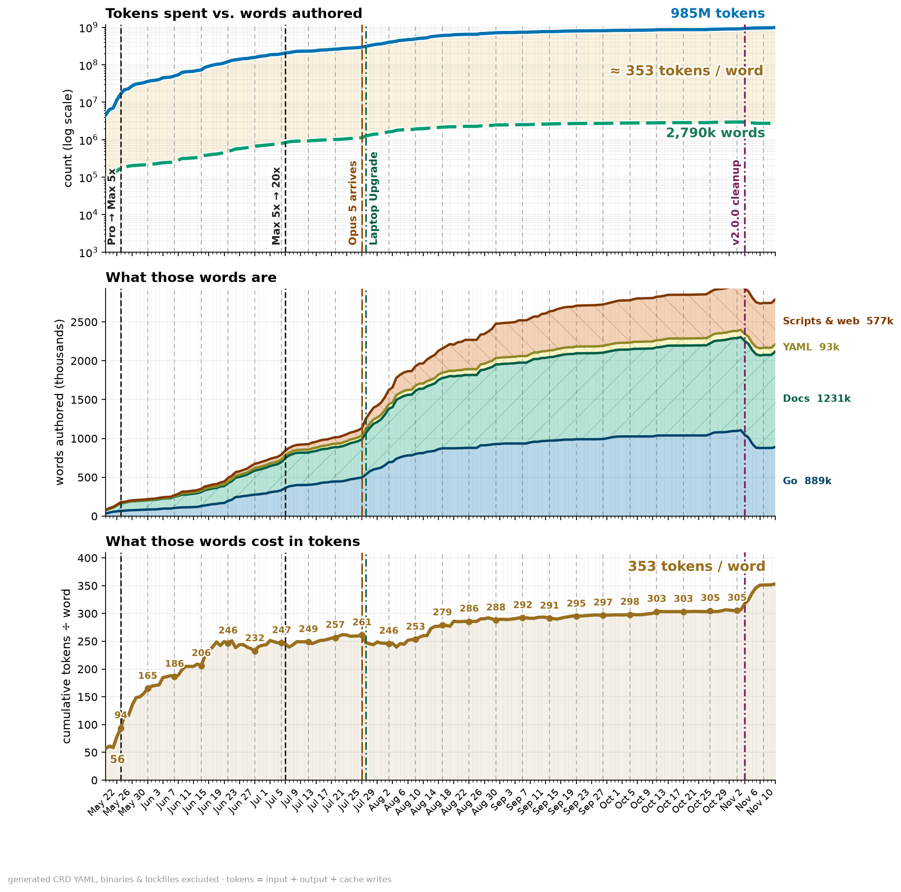 The three tokens-vs-lines views combined into one shared-timeline figure: **(1)** magnitude, tokens vs words authored on a log axis (gap = cost/word); **(2)** breakdown, what those words are; **(3)** cost, cumulative tokens ÷ word with the value at each weekly guide.
Event lines run through all three panels (labelled along the bottom of panel 1).
Where one crosses a value label it passes *behind* the digits and breaks around them, rather than striking through: the labels are drawn above the lines and cut them with their own white halo, so a gap in an event line at a number is the number winning, not a change of line style.
The standalone versions follow below.

### Daily token usage by model
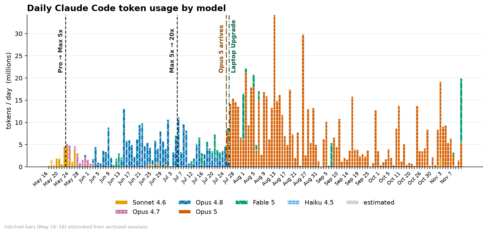 The Pro→Max 5x upgrade (first dashed line, 2026-05-23) is visible as the hand-off from Sonnet 4.6 (orange) to Opus 4.7 (purple), then Opus 4.8 (blue), with Fable 5 (green) appearing from June 9 and Opus 5 (vermillion) from July 25; the second dashed line (2026-07-05) marks the Max 5x→20x upgrade.
Opus 5 takes over almost completely from the green dash-dot line (2026-07-26), where `mac-2` took over; from 08-28 it leads 57 of the 59 days with spend (Fable 5 leads the other two) and is 92% of spend, Fable 5 7%, and Sonnet 4.6 the rest.
For its first month the `mac-2` era ran days around three times the height of the Opus 4.8 era, a median of 13.6M across the 31 days with spend through 08-27 against 4.6M across the days Opus 4.8 led.
That did not last: the 59 days with spend from 08-28 to 11-10 have a median of 3.6M, and 16 more days in that span had none.
The August jump is **not** more machines running at once: `mac-2` replaced `mac-1` rather than joining it.
The plan is a different question these series cannot answer: the Max 5x → 20x upgrade three weeks earlier moved none of them, but what both upgrades relieved was the 5-hour rolling limit, which nothing here measures.
What it cannot be pinned on is either the model or the machine alone, since Opus 5 arrived the day before `mac-2` did.
See the [velocity chart](#work-shipped-on-proxies-a-reformat-cant-move).
Charts use the Okabe–Ito colourblind-safe palette, and each model also carries its own hatch pattern.

Four kinds of event line, styled apart because they mean different things: a **black dashed** line is a plan upgrade (a higher ceiling on what one machine can spend), a **green dash-dot** line is a machine's rows beginning (a change in which machine is measuring), a **grey dotted** line is the sentence-per-line reflow (a change in what a line *is*), and a **purple dash-dot** line is the v2.0.0 cleanup from 2026-11-02 (about a fifth of the product's words deleted within the week).
The last two are drawn only on charts built from the tree, because they moved the denominator and nothing about what was spent: the reflow where a lines series is drawn, the cleanup wherever words or lines are.
The reflow line appears only on the three lines-and-ratio charts, because it moved the denominator and nothing about what was spent; marking it on a token chart would invite the reading that the reformat cost or saved something.
Machine lines are derived from the first row each machine reports, so a third machine marks itself with no code change.
They read "begins" rather than "joins" because the data can't tell a replacement from an addition: an old machine going quiet is not evidence it was retired.
A label that would overlap one already placed drops a row instead, measured on the rendered figure: the two July markers shared a height comfortably at day 80 and collided at day 89, because every added day squeezes the timeline under a fixed figure width.

### Tokens spent vs. words authored (the magnitude)
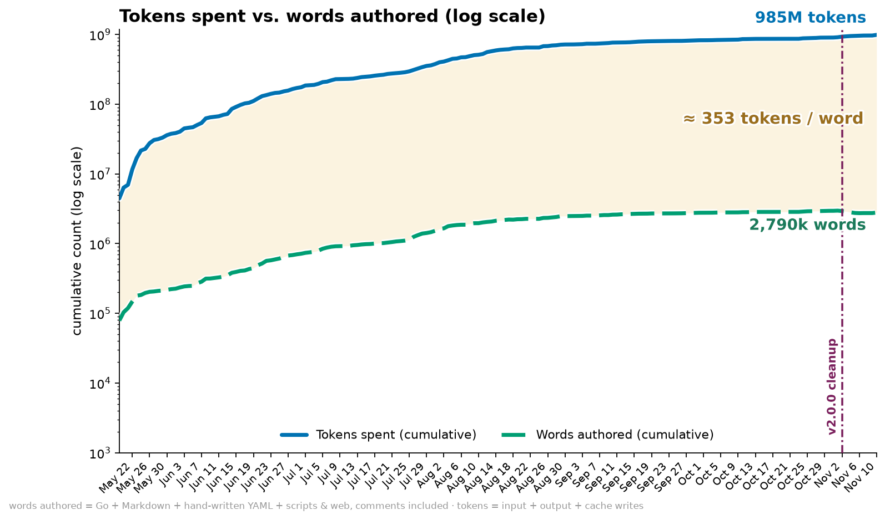 Log y so both ends are visible at once. ~985M cumulative tokens ride well above ~2.79M words authored; a linear axis crushes the smaller series to a sliver.
The gold-shaded gap between the two curves is the ~353 tokens/word; on a log axis a ratio is a vertical gap.
"Words authored" is all hand-written output: Go (code + tests), Markdown, hand-written YAML, and scripts & web, comments included; generated CRD YAML, binaries, and lockfiles excluded.
The undistorted breakdown of those lines is in the next chart.

### Tokens per word authored (the trend & the breakdown)
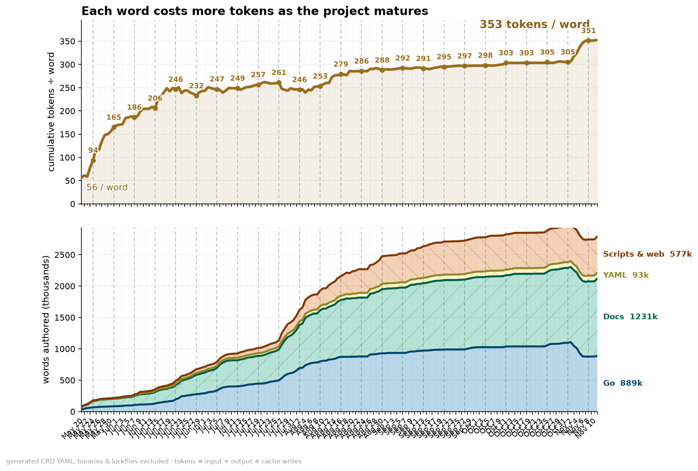 **Top:** cumulative tokens ÷ words authored, by day (measured days only).
It climbs from ~62 tokens/word in week one to ~240 by the end of June, then **plateaus** through July at 240–245, unlike its per-line predecessor, which climbed all cycle.
It rises again from August, to 289 at the month's end and about 300 through September and October.
The last step, 304 on 10-31 to 346 on 11-05, is the denominator shrinking rather than dearer work: the v2.0.0 cleanup deleted about 26k lines of Go in those five days, and a ratio over the current tree charges the tokens that wrote them to the words that remain.
Over the whole project each word now costs ~5.7× what it did in week one.
**Bottom:** the denominator itself, decomposed into Go, Markdown docs, hand-written YAML, and scripts & web.
Its total height at any date *is* the divisor above, so "a word" is shown, not just named; Markdown now outweighs all of Go, 1.23M words against 0.89M.
There is no reflow marker on this chart, and that is the point of the switch: the 2026-08-09 reformat moved lines and not words, so neither the band nor the ratio above it notices.
The v2.0.0 cleanup is marked, because it deleted words as well as lines.

### Work shipped, on proxies a reformat can't move
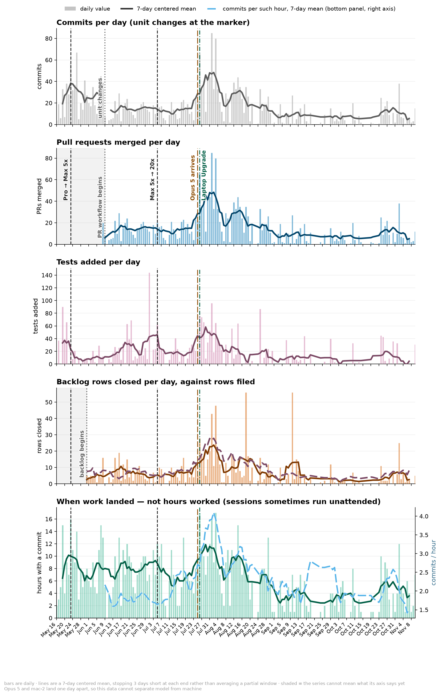 Tokens are an input and lines carry the reflow, so neither is a velocity series.
These four are immune to both: **PRs merged**, **tests added**, **backlog rows closed**, and the spread of the day work landed across.

Read the top three together and the plan upgrade does not show up: tests/day went 21.2 to 20.3 across 2026-07-05, Go lines/day 1,083 to 948.
That is a null result from a proxy that cannot observe the mechanism, not a finding that the upgrade did nothing.
Both upgrades were made because the **5-hour rolling limit** was binding, and no series here can see a 5-hour window, an account-wide meter, or a session that stalled waiting for one.
What moves is the pair of lines three weeks later, and **that is exactly what this chart cannot resolve**.
Opus 5 arrives 2026-07-25 and `mac-2` begins 2026-07-26, so the model and the machine are one day apart and no series here can say which did it.
Drawing both markers is the point; the single Opus-5-on-`mac-1` day is one data point and settles nothing.

The machine's side is measured elsewhere, though: a cold `make check` went from ~21 min on the retired Intel machine to **102 s** on its replacement, and [#1110](https://github.com/actions-gateway/github-actions-gateway/pull/1110) later sized the parallel-dispatch worker cap from RAM and cores rather than a constant.
A 12× faster gate is not something a model does.

Bars are daily and every line is a **7-day centered mean**, which is what makes the inflection legible: all three top series sit flat through June and most of July, then climb from the 07-25/26 pair.
The climb did not hold past August: PRs merged ran 23.9 a day that month, 6.0 in September and 5.5 in October, with neither model nor machine changing, so nothing these series measure accounts for it; the time-invested caveat under [Methodology](#methodology--caveats) is the input that could, and no file here records it.
Centered rather than trailing, because a trailing mean lags by half its window and would slide every inflection three days later than the day it happened, straight into the confound.
Each line stops three days short at either end rather than averaging a partial window.

Two shaded regions mark where a series cannot yet mean what its axis says: before the repo adopted PR squash-merges, and before `docs/STATUS.md` existed.
No trend line is drawn inside them.
**Commits are drawn despite being contaminated**, with a marker where the unit changes: before it a commit is one commit, after it a whole squashed PR.
Its trend line is broken either side of that marker rather than run through it, because the mean of a window spanning the switch averages two different units.
The panel is unshaded, unlike the two below it, since commits are real on both sides and only counted differently.

**The backlog panel draws filed against closed.** Closures alone cannot tell progress from treading water: the busiest stretch closed 15 rows a day while filing 21, so the backlog grew by 85 rows over the fortnight ending 2026-08-13, which no fortnight before or since has matched.
That is not automatically bad, since filing more can mean finding more real work, but the direction is only visible with both lines.
Both lines cross the backlog's own move from a table to one file per row on 2026-08-18, which is a change of home rather than of flow: the walk reads presence across the pair, so the table's disappearance books nothing by itself, and the 56 closures that day are rows whose own file was deleted.

**Panel 4 is not hours worked.** Sessions sometimes run unattended and keep committing with nobody watching, and merges get cleared in bulk, so it shows when work *landed* rather than when anyone was present.
Its bars and their trend cover the whole project; the commits-per-hour line starts later, because its numerator is `commits` and that series changes units at the PR-workflow switch.

### The project's rhythm, by weekday and by hour
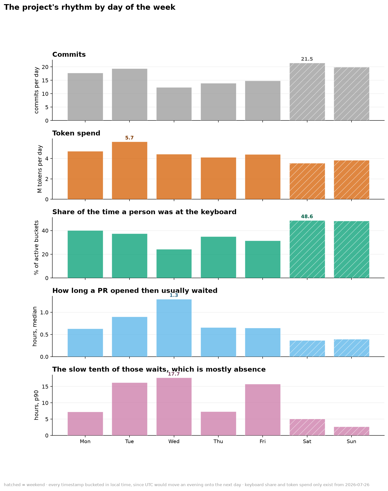 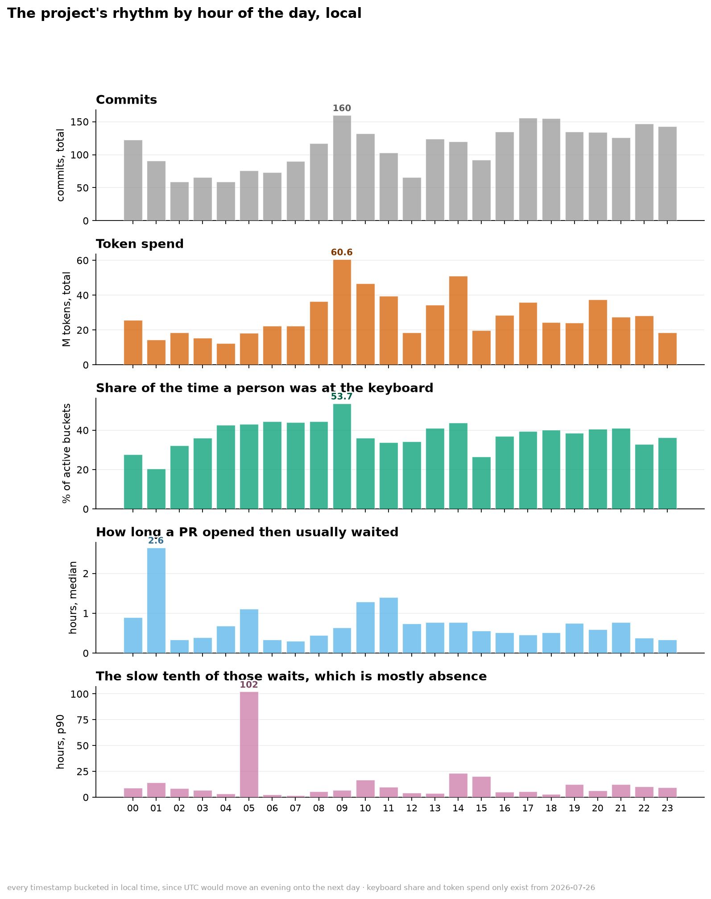 Aggregates rather than time series: every day of the project lands in one bucket.
Built to look rather than to confirm, since which of these would differ by the clock was not known in advance.

**Which day it is moves these series a long way.** Commits per active day range from 12.3 on Wednesdays to 21.5 on Saturdays.

**Spend and output do not move together across that range.** Tuesday is the heaviest-spend day at 5.7M tokens, and the weekend has the least spend and the most commits.
Spend per commit is highest on Wednesday, at 0.36M tokens against 0.16M on Saturday, and Wednesday is also the day with the least time at the keyboard: a person typed in 24% of its active buckets, against 48–49% at the weekend.
That is what unattended running looks like from the outside: the machine keeps working when nobody is there to steer it or merge the result.
It is also the clearest evidence here for the caveat in Methodology below, that the input none of these series measures is how many hours a person gave the project.

**Weekends run 1.3× weekdays**, 20.8 commits per active day against 15.8, down from 1.5× at the August snapshot.
A permutation test over 20,000 shuffles of the 155 active days' commit counts puts that gap at p = 0.039: still unlikely to be day-to-day variance, though much less clear-cut than August's p = 0.007.
Sunday has the highest p25 of any day, 9.75 commits, meaning Sundays are reliably productive; Saturday has the largest single day, 85 commits.
This is the time-investment variable made visible: weekdays compete with paid work and weekends do not.

By hour, the work runs 07:00 to 23:00 local with a sharp 09:00 peak in both commits and spend, a midday dip at 12:00, and a long evening plateau.
Presence is lowest just after midnight, which is where the unattended share is largest.

Everything is bucketed in **local** time, and the offset comes from the repo's own git timestamps rather than a setting.
UTC would have moved most of an evening's work onto the following day and flattened the very patterns these charts exist to show.

### How the work went, not just how much
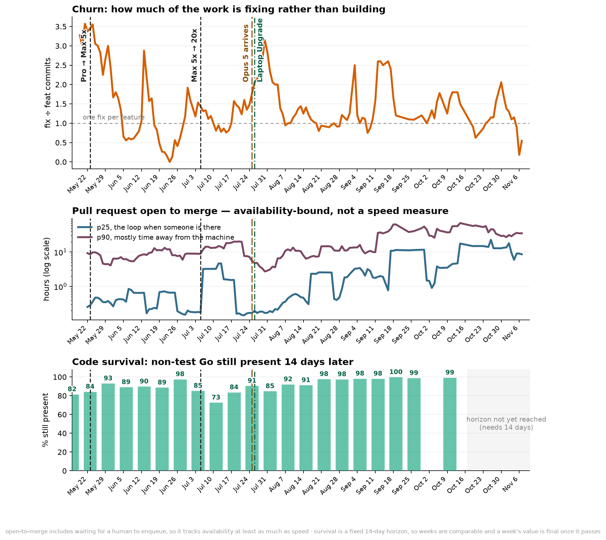 The volume proxies above cannot tell 85 PRs of progress from 85 PRs of churn.
These three can say something about it, each with a different blind spot, which is why they are drawn side by side rather than combined into a score.

**Churn** is `fix` against `feat` commits over a rolling week, since a daily ratio has days with no denominator.
Summed over each era rather than averaged, it ran 1.51 before the Max 20x upgrade, **1.04** under it, and 1.37 in the `mac-2` era, which splits into 1.52 through August and 1.18 since.
The busiest era is not the one fixing most, which an earlier snapshot misread: it took the mean of the rolling ratio and got 1.82 eighteen days into the `mac-2` era, where the summed figure for that same window was 1.72.
Read it with both its blind spots in view, because they do not cancel: a `fix` may repair something written months earlier, and this repo added gates over the same window, so better detection raises the ratio without more defects existing.

**Pull request open to merge** is **availability-bound, and not a speed measure**, which is worth stating twice because it was proposed as one.
Two things break that reading.
The local gate runs before a PR is opened, so this never contained the 12× hardware speed-up.
And merging here needs a human to enqueue, so a PR opened while nobody is at the machine waits exactly as long as that lasts.

The distribution says how much that dominates.
Bucketed by merge date, the p99 runs **37.2h before Max 20x, 90.0h under it, 24.6h in `mac-2`'s first month, and 202.7h since 08-28**: multi-day waits, which are days away rather than anything slow.
Treat any one of those as a rough figure, since a p99 over a few hundred PRs rests on its slowest three or four and moves several hours with the quantile method.
So the panel draws two percentiles instead of a median.
**p25** is the part availability cannot stretch and stands in for the loop itself; **p90** is mostly a record of being elsewhere.

The median was the wrong statistic and it misled: it rose 0.35h to 0.55h across the handover while p10 held flat at 0.09h and p99 **fell**.
The distribution tightened rather than slowed, and the median moved because the share merged inside 30 minutes fell from 60% to 47%, not because the slow end got slower.

**Since 08-28 the whole distribution moved, not just its tail.** p10 is 0.23h, p25 0.59h, the median 1.67h and p90 28.5h, and only 21% of 497 PRs merged inside 30 minutes.
A rising p10 is the part availability explains least, since it is the fastest tenth of merges; what changed under it is not something these series record.

**Code survival** asks whether a week's output lasted: what share of the non-test Go written in a week was still present 14 days later.
It runs 73–100%, and since the week of 08-22 every week whose horizon has passed sits at 98% or above.
So by this measure the `mac-2` era's output is not less durable, and it is not presented alone because its blind spot is the churn ratio's strength and the reverse: survival cannot see a line rewritten twice inside the fortnight, and churn cannot see whether the fixing held.
The horizon is fixed rather than measured to `HEAD` so every week is judged over the same window; the last three weeks are blank because theirs has not passed, and the weeks of 10-03 and 10-17 because no non-test Go was authored in them.

### Why the headline is words, not lines
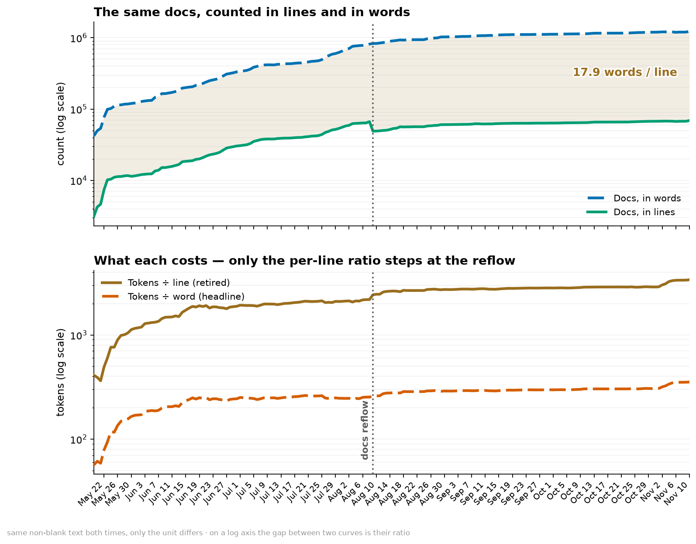 This is the chart that retires the per-line ratio.
A rewrap moves every line count that spans a paragraph and leaves the words alone, so a per-line cost figure carries any reformat the project ever does.
On the reflow day Markdown went **−17,574 lines and +15,098 words**.
A second, much smaller reformat then landed on 2026-08-15 ([#1555](https://github.com/actions-gateway/github-actions-gateway/pull/1555), an mdreflow upgrade): **+1,251 lines and +60 words**.
The headline ratio did not notice it, which is the case for the switch made concretely rather than argued.

**Only the first reformat carries a marker, and the test is magnitude rather than category.** The 08-09 reflow moved the line series 26.4% in a day, 0.133 of a decade on a log axis, which reads as deleted docs unless something says otherwise.
The 08-15 one moved it 3.4%, 0.015 of a decade, and roughly a third of even that was the day's ordinary writing rather than the reformat.
A line there would mark something a reader cannot see and would then have to explain away.
In words, the unit the headline now uses, the second reformat is 1.4% against the *first* reflow day's 1.9%: neither is visible, which is the whole point of the denominator.
The line series reads as a catastrophe, the word series as an ordinary productive day.

Log y, absolute counts, the same choice the tokens-vs-lines chart makes: in the docs corpus words outnumber lines about 18 to 1, so a linear axis leaves the smaller series a sliver.
**Top:** the docs corpus in each unit, with the shaded gap between them being the words-per-line ratio, since on a log axis a ratio is a vertical gap.
**Bottom:** cumulative tokens ÷ line against tokens ÷ word.
Only the per-line ratio steps on 2026-08-09, which is why the headline is now the other one.
Words are also the unit closest to a token, which makes the ratio a comparison between two counts of the same kind rather than a count against a layout choice.
The gap in the top panel is where the mechanism shows: sentence-per-line put the same words on fewer lines, so words per line went from 12.2 to 16.9 overnight and the band visibly widens.

The underlying climb is real in both units, which is the more interesting finding: cost per word still rose ~5.7× over the project against ~8.7× per line, so the trend was never an artifact; only the 2026-08-09 jump in the per-line version was.

### What the work was for, in both units
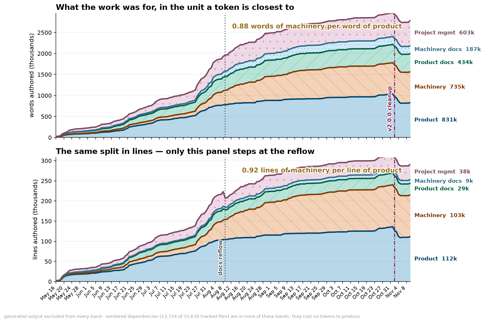 The language series say what was written; these say what it was written **for**.
**Top:** words, the unit a token is closest to.
**Bottom:** the same split in lines, where the 2026-08-09 reflow is visible as a step and carries its marker.

The two units disagree, which is why both are drawn.
Per word of product the project has written **0.88 words of machinery** and, counting all three prose bands, 1.47 words of docs and backlog; per *line* the machinery figure is 0.92 and the prose one 0.67.
Both rose steeply from August's 0.58 and 1.15 per word, because product ended slightly below its August size after the v2.0.0 cleanup, 111.9k lines against 112.5k, while machinery went from 71.3k lines to 103.4k over the same span.
Prose runs 15 to 22 words a line against code's 7, so a line count cuts every prose band by half or more against every code one.
The bands are cumulative tree snapshots like every other series here, so deleted work stops counting in both panels.

### Anatomy of token usage (log scale)
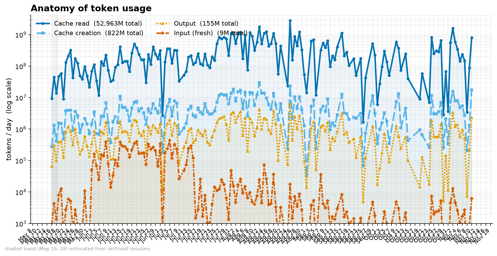 Daily input / output / cache-creation / cache-read, log Y. Cache reads sit an order of magnitude above everything else, every day.

### Cumulative cache traffic
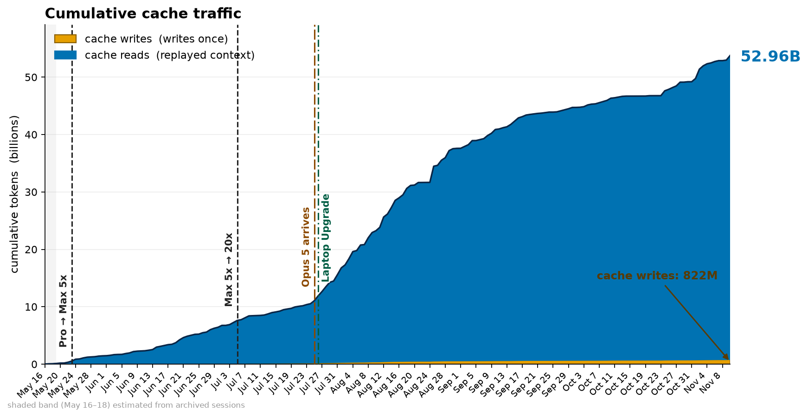 Cumulative cache reads (52.9B) vs writes (820M), measured days only.
Write once, replay ~64×.
Both plan upgrades and the `mac-1`→`mac-2` handover are marked; the curve visibly steepens at the last of them.

### Parallel sessions
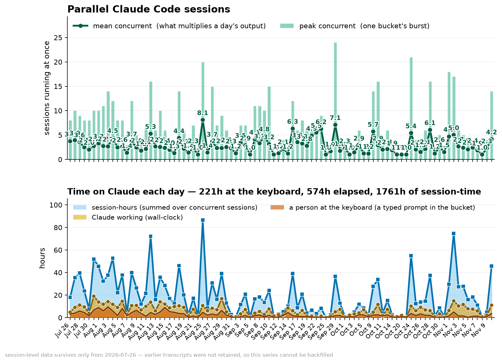 How much of the work runs concurrently.
**Top:** mean concurrency (line) against the day's peak (bars).
The peak is the dramatic number, up to 24, but it lasts a single bucket; the **mean of 3.1** is what actually multiplies a day's output.
**Bottom:** time on Claude each day, wall-clock against session-hours.
The gap between the two bands *is* the mean concurrency: **574h elapsed produced 1,761h of session-time** over the window, a 3.1× multiplier.
63% of active time had two or more sessions running, on 1–58 sessions a day.

The innermost band is time someone spent at the keyboard: **~221h against 574.3h**, or 39%.
A 10-minute bucket counts as attended when a person actually typed in it, which is the only unambiguous presence signal the transcripts carry.
Everything else here, every assistant record and every tool result, is produced whether or not anyone is watching.

**Treat that 221 as a scale, not a measurement.** Prompts are sparse point events, 2,671 of them, and crediting each one a whole bucket makes the total scale with the bucket: 37.8h at 1-minute buckets, 221.0h at 10, 586.0h at 60.
A session-of-presence model instead of buckets does not rescue it: summing every gap between consecutive prompt minutes up to an idle threshold gives 44.8h at 5 minutes and 289.9h at 60.
Any single figure here needs an arbitrary parameter and moves six- to fifteen-fold across defensible choices, which is worse than the wall-clock series it sits inside, where dense records make the width matter far less.

Two things survive that and are worth more than the hours: the **count**, 2,671 prompts, which no parameter touches, and the **shape**, since every bucket in every chart uses the one width, so comparisons across days and hours hold even where the level does not.

**Two of those counts are wanted, for different questions.** Accepting a parallel-dispatch chip is a keystroke, so all 2,671 count as presence.
The brief that arrives with it was composed by the dispatcher, though, so only **2,445 were authored by a person**.
Machine-composed openings are 8.5% of the prompts and **56% of all prompt characters**, which is why no character-based claim here may use the unsplit total.
They are identified by their opening rather than by length, since 140 authored prompts run past 2,000 characters while the shortest dispatcher brief is 826.
Three opening shapes exist: a second-person persona brief (171 openings, median 4,676 characters, 2026-07-27 to 09-18), prose naming the worker skill's `SKILL.md` (20 openings, median 2,827, 08-08 to 08-15), and the deliberate `[dispatched-session]` marker (35 openings, median 1,543, 09-17 to 10-10).
Matching only the first put the later dispatches in the authored column until this was corrected, with nothing to signal it: a convention is not a contract in either direction.
From October a session another session started opens with that session's brief and no human origin at all, so it is not a prompt here; the [session-kinds section](#who-opened-each-session) counts it as dispatched.
**"Authored" here means "not a dispatcher brief", not "typed".** A pasted hook hint, log or error is indistinguishable from typing in a transcript, which carries only the submitted text and one timestamp, so the authored count still mixes writing with pasting and no split here can separate them.
It also holds 42 prompts that open the way a reviewer brief does ("Review pull request #N …" or `/session-reviewer`) without the marker, which may be machine-composed; nothing in the record says.

**These are submissions, not keystrokes.** A user record carries one timestamp and nothing about composition, so a prompt written over three minutes is a single instant here.
The median authored prompt is 38 characters, but 20 run past 5,000, and a paste looks exactly like typing, so length cannot stand in for the missing time either.
The bias runs one way: **2,270 distinct minutes, 37.8 hours, is a floor on presence** rather than a measure of effort, because every minute spent composing is invisible to it.

### The predicate for a prompt a person actually submitted

Identifying a typed prompt takes more than the record's own marker.
`origin.kind == "human"` also arrives on things nobody typed, and they are stripped by leading tag rather than trusted ([`NOT_A_PROMPT`](compute_metrics.py)).
The tag is read after any leading `<system-reminder>` blocks, which the harness prepends to some prompts.
Three classes are observed in this corpus:

| arrives as | what it is | count |
|---|---|--:|
| `<bash-input>` | a bash line typed into the session, and its output | 32 |
| `<create-pr-command>` | a slash command's expansion | 13 |
| `<cross-session-message>` | a message from another Claude session | 8 |

Without the predicate the count is 53 records higher, 2.0% too high, and every one is a record nobody typed.

**The predicate itself was dropping real prompts until this snapshot.** At 08-27 this table had a fourth row, 60 records arriving as `<system-reminder>` and filed as injected reminders.
None of those records is a reminder alone: each has text after a reminder the harness prepended, and reading past it finds a prompt in 397 records from July to September, typed ones like "status?" and dispatched briefs alike.
A record that is reminders and nothing else is still rejected, and none occurs here.

**`<cross-session-message>` was the one missed first**, and it is the interesting one.
A peer session's message carried `origin.kind == "human"` because it entered the conversation the same way a person's prompt does, but nobody typed it.
Eight were counted as submitted *and* authored before this was measured, and it is still eight, because from August the harness marks a peer message `origin.kind == "peer"`.
That is the general point, made twice now: the marker says how text arrived, not who wrote it, and the harness changes how text arrives without notice.

`<bash-stdout>`, `<bash-stderr>`, `<command-name>` and `<local-command` are also stripped but appear zero times here; they are defensive, not observed.

**This band cannot reach back before 2026-07-26**, because the transcripts only began carrying that marker then and `mac-1`'s went with the machine.
It is the measure that would answer whether the new machine raised output per attended hour, and the window where it exists starts on the day the machine changed, so it cannot answer that and never will.
What it can do is serve as a denominator from here on.
Sessions sometimes run unattended, so a bucket counts whenever a session did something and the human may be elsewhere; these are hours the system was working, not hours at the keyboard.

How much attention a day needed varies with the work, which is why no fixed fraction can be read off these bands.
Coding needs the least and parallelizes best, so it fills the widest bands with the fewest prompts.
Work on skills, prose, process, and backlog grooming needs more attention per session and runs narrower.
The mix also runs both ways at once: a parallel dispatcher can be draining the backlog while attention goes to a hand-prompted session beside it.
And the ceiling on all of it is external, since days given to other projects or to paid work are simply days this machine sees less of.

**This chart has its own timeline, and starts at 2026-07-26.** Concurrency needs session-level transcripts, and no CSV before this one preserved them, so the mac-1 era cannot be reconstructed — daily token totals can't say how many sessions overlapped.
Drawing it against the project timeline would show 71 empty days and read as idleness rather than missing data.
The series is never estimated, for the same reason: unlike token volume, concurrency has no per-commit rate to model it from.

### Who opened each session

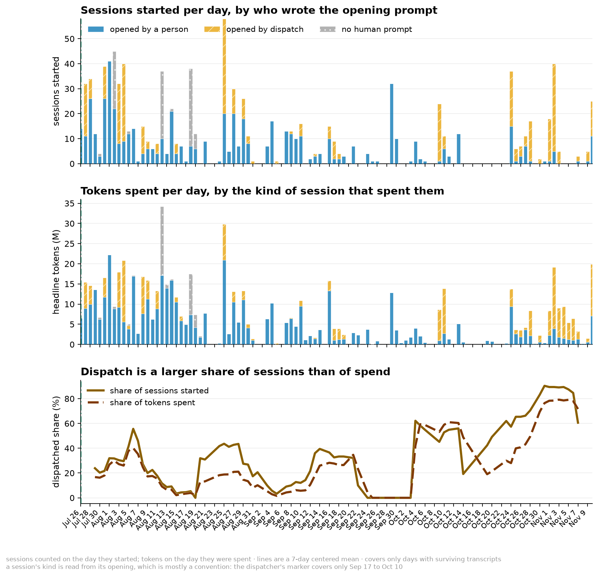 The concurrency chart above cannot answer this one.
Sixteen sessions at once is equally consistent with one person driving them all and with a dispatcher fanning them out, and the two say opposite things about how the work was done.
The only thing that separates them is who composed the opening prompt.

**The parallelism is mostly hands-on.** Manual sessions are 57% of the count and **68% of the spend**; dispatched sessions are 34% of the count but only **27% of the spend**, at two thirds of a manual session's tokens.
The remaining 9% opened with no prompt from anyone (resumed, or spawned and never driven) and account for 5%.
So the multiplier is mainly one person running many conversations at once, not a dispatcher running them for him.
Dispatch is real and useful, and it is the smaller part by the measure that costs money.

These shares are new at this snapshot, and the old ones were wrong in the dispatcher's disfavour.
The previous classifier read sessions that another session started as unprompted, because from October their opening brief carries no human origin, and it missed openings with a reminder prepended; reading both put the unprompted share at 34% of sessions and 26% of spend before the fix.

The third panel is the finding rather than the totals: the dispatched share of sessions runs above its share of spend in **68 of the 78** full 7-day windows that hold any dispatch, not just in aggregate.
The ten exceptions cluster in two spells, 09-20 to 09-21 and 10-07 to 10-13, plus 11-07.
It is drawn as two shares because tokens-per-session is undefined on any day a kind has no sessions, which is most days for dispatch: 35 of the 90 days with any session had one.
Each share is taken over its window's sums rather than as a mean of daily shares.
A quiet day has no share to average, and feeding it in as 0% would read as "dispatch did nothing" when the answer is that nothing happened at all.

Two clocks, deliberately: a session is counted on the day it **started**, since it has one opening and therefore one kind, while its tokens land on the day they were **spent**, so a session running past midnight doesn't move spend onto the wrong day.

**Coverage is about two thirds of the project.** This needs session-level transcripts, so it starts 2026-07-26 like the concurrency chart, and covers 682.0M of the 982.8M measured total.
Within its own window it accounts for 98.9% of measured spend; the missing 1.1% is days whose token rows were merge-preserved from sessions whose transcripts have since gone.
The rebuild that applied the fix dropped one zero-spend session on 07-27 for the same reason, and that day's row was restored from the previous file.

**A session's kind is read from its opening, which is mostly a convention rather than a marker.** The dispatcher's `[dispatched-session]` marker is deliberate, but it appears only from 09-17 to 10-10; before it the wording changed once mid-window without notice, and after it the opening became the starting session's "Background (from the session that started this one)" brief.
Each change was found by a classifier that stopped agreeing with the sessions it described, never by anything announcing it.

## Data files

All under [`data/`](data/).

### `token_metrics.csv` — merge-preserved
| column | meaning |
|---|---|
| `date` | UTC date of the message timestamp |
| `host` | machine that measured the row (`-` for estimated); sum a date's rows for the day's total |
| `input` / `output` | non-cached input and output tokens |
| `cache_creation` / `cache_read` | cache write and cache read tokens |
| `assistant_msgs` | assistant API responses (deduped on `message.id`+`requestId`) |
| `user_msgs` | user/tool-result records (deduped on record `uuid`) |
| `estimated` | `1` for backfilled (archived) days, `0` for measured |

### `model_daily.csv` — merge-preserved
Per-day, per-model, per-`host` `headline` (input+output+cache_creation), `output`, `messages`, and an `estimated` flag.
Backfilled archived days are attributed to the Pro-era model (Sonnet 4.6).
Drives the token-usage-by-model chart, which sums each (day, model) across machines.

### `git_metrics.csv` — recomputed each run
Per-day (last commit of each day) cumulative `commits`, `tests` (count of `func Test*`), `go_code` (non-blank minus line-comment Go lines, code + tests), `go_test` (the test-file subset of `go_code`), `md` (non-blank Markdown), `yaml` (non-blank hand-written YAML), and `scripts` (non-blank shell, Python, CSS/JS/HTML, Makefile, Dockerfile).
All exclude `vendor/`, at the repo root and inside every module.
Generated output is credited to nobody: `zz_generated.*` Go and generated CRD/controller-gen YAML are both out.
Go is matched by filename rather than by content, because a `controller-gen` content match also claims hand-written source that names the tool — `devtools/release/semverfloor/crdsurface.go` and the kubebuilder markers in several controllers.

`band_product`, `band_machinery`, `band_project_mgmt`, `band_product_docs`, `band_machinery_docs` and `band_residual` are those same authored lines re-cut by what the work was **for** rather than what language it is in, so `go_code` no longer has to stand for both "built the product" and "built the tooling that checks it".
They sum to `go_code + md + yaml + scripts` on every day; `go_test` is a subset of `go_code` and is not a band.

Each has a `_words` twin (`band_product_words` and the rest) which sums to `words`.
Both units are carried for the reason the language bands carry both: a rewrap moves a line count and leaves a word count alone, and a word is the unit closest to a token, so only the word bands can be put against spend.
They are not the line bands converted: the line bands subtract line comments and the word bands count comment text, the same way `go_code` and `go_words` differ.

**The two units rank the bands differently, which is the point of keeping both.** At the 2026-11-10 snapshot the split is:

| Band | Lines | Words | Words per line |
|---|--:|--:|--:|
| `product` | 111,948 (38.5%) | 831,046 (29.8%) | 7.4 |
| `machinery` | 103,375 (35.6%) | 735,116 (26.4%) | 7.1 |
| `project_mgmt` | 37,585 (12.9%) | 602,622 (21.6%) | 16.0 |
| `product_docs` | 29,177 (10.0%) | 433,795 (15.5%) | 14.9 |
| `machinery_docs` | 8,634 (3.0%) | 187,189 (6.7%) | 21.7 |

Prose carries two to three times the words per line that code does, because docs are written sentence-per-line and code is not.
So a line count understates every prose band against every code one: docs and project management are 25.9% of the tree in lines and 43.9% in words.
Read the word column when comparing a band against token spend, and the line column only when comparing like with like.

| Band | Covers |
|---|---|
| `product` | `cmd/` `api/` `broker/` `githubapp/` `scaleset/` `deploy/` `charts/` `Dockerfile` |
| `machinery` | `scripts/` `devtools/` `tools/` `.github/` `mk/` `hooks/` `test/` `testdata/` `updatecli.d/` `.claude/` `.githooks/`, plus the build and lint config at the repo root |
| `project_mgmt` | `docs/queue/` `docs/plan/` `docs/postmortems/` `claude-usage/` |
| `product_docs` | `docs/design/` `docs/operations/` `docs/releases/` `docs/reference/`, the site assets, and the published pages including `README.md` and `DESIGN.md` |
| `machinery_docs` | `docs/development/` `CONTRIBUTING.md` `CLAUDE.md` `AGENTS.md` |
| `residual` | No lines, on every day of the series, and the suite fails on one. Four tracked files land here (`THIRD-PARTY-NOTICES`, its Docker twin, `go.work.sum`, `tmp/.gitkeep`), which is why `band_files` in `summary.json` shows a residual count while every `band_residual` column is zero: none of them is Go, Markdown, YAML, or a script, so no series counts them. |

`claude-usage/` counts itself as project management.
The tool is authored and tokens were spent on it, so excluding it would understate the total by exactly the part it can measure best.

Vendored dependencies are in no band at all.
They cost no tokens to produce, and at 13,724 of 15,646 tracked files they would erase every other band on a shared axis.
The one number for them is `vendor_files` in `summary.json`.

Also cumulative: `prs` (commits whose subject ends in `(#N)`, this repo's squash-merge signature) and `queue_closed` / `queue_filed` (backlog rows leaving and entering, counted on a row's *first* removal so a re-filed id can't book the same work twice; a work proxy rather than a completion ledger, since it catches a declined or pruned row too).
The backlog has had two homes, anchored rows in `docs/STATUS.md` until Q889 and one file per row under `docs/queue/` after it, so both are walked and a removal only closes a row the other home doesn't still hold.
Reading either walk alone books the migration as 178 closures and 178 filings for work that never moved, and then flatlines: the table walk alone recorded 178 closures on 2026-08-18 and nothing at all after it, since the file it reads no longer exists.

`go_words`, `md_words`, `yaml_words`, `scripts_words` and their sum `words` are tree snapshots like the line counts above, in the other unit, one per band so the cost ratio's denominator decomposes the same way.
`yaml_words` applies the same generated-file exclusion `yaml` does; counting the CRDs would have diluted the headline ratio by a third.
Both include comment text, so `words` is not the line total converted: it is the corpus with nothing subtracted.
They exist because a rewrap moves a line count and leaves a word count alone.

`active_hours` is the one column that is neither a running total nor a snapshot: it is the count of distinct clock hours that day with a commit landing in them.
It says when work landed, **not** hours worked: sessions sometimes run unattended, and merges get cleared in bulk.

### `session_metrics.csv` — merge-preserved
Per-day, per-`host` session concurrency, in 10-minute buckets: `sessions` (distinct sessions that did work that day), `peak_concurrent` (most sessions active in any one bucket), `active_buckets` (buckets with any session), `parallel_buckets` (buckets with two or more), and `session_buckets` (concurrent sessions summed over every bucket).
Every column is a count that can only rise as more transcripts become visible, so the upward-only merge is right for all of them.

`attended_buckets` is the same shape as the others and merges the same way, but counts only buckets a person typed in.
It is zero before the transcripts began marking a typed prompt, so `summary.json` reports its own `attended_first_date` rather than letting it be read against the older series.

Two headline figures are derived rather than stored, because a ratio isn't monotone and so can't be max-merged:

| figure | from |
|---|---|
| **Hours using Claude** (wall-clock) | `active_buckets` ÷ 6 |
| **Session-hours** (summed over concurrent sessions) | `session_buckets` ÷ 6 |
| **Mean concurrency** | `session_buckets` ÷ `active_buckets` |

`active_buckets` is time Claude was actually working: a bucket only counts when a session did something in it, so a session left open overnight adds nothing.
It measures engaged time, not session lifetime, and not human presence either.
Sessions sometimes run unattended here, so a bucket fills whether or not anyone is watching it, and the attended fraction moves with the kind of work rather than staying fixed.

There is no `estimated` column — this series is measured or absent.
Summing across machines works for the bucket counts and `sessions`, but `peak_concurrent` is combined with a **max, not a sum**: two machines' peaks need not fall in the same bucket, so adding them would invent a burst that never happened.

A resumed session replays earlier records verbatim, which would credit the resuming session with work it only re-read, so each record is attributed to the earliest-starting session holding it.
Replays are ~3% of records here and shift one day's peak by one.

### `session_kinds.csv` — merge-preserved

Per-day, per-`host`, per-`kind` sessions and spend: `kind` is `manual` (a person wrote the opening prompt), `dispatched` (a dispatcher, or the session that started it, composed it), or `unprompted` (no human prompt at all).

`sessions` counts on the day a session **started**, since a session has one opening and therefore one kind.
`headline` lands on the day each record was **produced**, since a session running past midnight spends on both days.
Only the second column reconciles with `token_metrics.csv`, and only within this file's own shorter window.

Sessions are walked in start order so the token dedup keeps the earliest holder of a replayed record, matching `session_metrics.csv`.
Without that ordering, whichever session won would depend on the filesystem: `glob` returns directory order, which is creation order on one filesystem here and alphabetical on another.

`kind` comes from a classifier over prompt text, so **a re-run after that classifier changes wants to revise a row downward, which the upward-only merge refuses**.
Same constraint as `prompt_minutes.csv`: rebuild the file rather than re-running over it.

### `pr_metrics.csv` — merge-preserved, fetched incrementally
One row per merged pull request: `number`, `merged_date`, `created_at`, `merged_at`, `cycle_hours`.
The only series here whose source is a remote API rather than something recomputable offline, so it gets the same merge-preservation the token series does.

Each run reads the highest number already stored and asks only for what is newer.
A 200-PR page that holds nothing already stored means the gap is wider than the page, so the fetch widens fourfold until it reaches stored rows or the 3,000-PR backfill cap; until 2026-11-10 it stopped at one page, and a 75-day gap recorded the newest 200 of 513 missing PRs with the rest below the next run's high-water mark.
Measured 2026-08-15: one 100-PR page costs 3 GraphQL points against a 5,000/hour budget, so the one-time 1,521-PR backfill was ~48 and one 200-PR page is two of those.
A PR merged after a higher-numbered one was stored falls below that mark and is never fetched; five did by 2026-11-10, filled that day by deleting the CSV and refetching all 2,208.
The fetch is skipped entirely when the remaining budget is under 500, since that budget is shared with every other tool on the account.
No `gh`, no network, an API error, or a low budget all leave the existing rows untouched and let the run continue, so every other series still works offline and the charts still rebuild from committed data alone.

### `survival_metrics.csv` — merge-preserved, final once the horizon passes
Per 7-day bin: `week_start`, `added`, `survived`, `horizon_days`, `rate`.
What share of the non-test Go written that week was still present 14 days later.

Non-test Go only, because docs and YAML move for reasons that say nothing about whether the work held up: a reflow, a regenerated CRD.
Both sides are bucketed by **author** date.
`git log --since/--until` filter on commit date and `git blame` reports author time, and this repo rebases constantly, so mixing them credits a week with survivors it never wrote.
`rate` is not clamped: a value above 1 would mean the two sides disagree, and capping it would hide exactly that.

### `rhythm_metrics.csv` — merge-preserved
Rows keyed `(dim, bucket)` where `dim` is `weekday` (0–6) or `hour` (0–23), plus one `offset_hours` row recording the UTC offset everything was bucketed in, so the charts bucket pull-request timestamps identically instead of assuming it.
Columns: `days`, `commits`, `prs`, `feat`, `fix`, `tokens`, `attended_buckets`, `active_buckets`.

Merge-preserved because the hourly resolution exists only in the transcripts and cannot be rebuilt from the daily CSVs, so a recompute after they are archived would quietly lower it.

**Wait times are deliberately not aggregated here.** They are skewed enough that a stored sum and count yield only a mean, and the mean inverts the reading: pull requests opened at 05:00 average 19h and have a median of 0.32h, the fastest hour of the day, because a handful waited days.
The charts take percentiles from `pr_metrics.csv` instead, which holds every request individually.

### `summary.json`
The `head_snapshot` block counts the **working tree**, and the daily series counts a **revision**, so the two answer slightly different questions and can disagree.
Both exclude vendor and both exclude symlinks: `git grep` skips a symlink, so the series counts a linked file once under its real path, and `tracked_files` drops the same paths for the same reason.
Counting them would credit the target twice, which put 623 Markdown lines into every snapshot before 2026-08-27: `AGENTS.md` points at `CLAUDE.md`, and two `testdata/` doc links do the same.

Totals split into `measured` / `estimated` / `combined` (summed from the persisted rows, so archival-safe), an `estimation` block documenting the per-commit method, a `sessions` block (bucket width, span, session-days, mean and peak concurrency, hours using Claude, session-hours, parallel share), per-model and per-machine (`by_host`) splits, an accurate HEAD working-tree snapshot (including `band_files`, the per-band file census the `band_*` series are cut from, `go_generated`, and the `vendor_files` / `authored_files` pair), and full provenance — including which machine took the snapshot, which machines are on record, and the dates that break a series (the two plan upgrades, the docs reflow, and the v2.0.0 cleanup).

## Methodology & caveats

- **Dedup.** Resumed/compacted sessions replay earlier records verbatim.
  Token usage is deduped on `(message.id, requestId)`; without it cache-read totals roughly double.
  Message counts dedup on record `uuid`.
- **A day is only as complete as the machines that have reported it.** Rows are per `(date, machine)` and summed, so a day worked on two machines is only whole once both have run the script and their rows are committed.
  Until then the day reads low rather than wrong — nothing is lost, and a later run from the missing machine fills it in.
  No machine is outstanding in this snapshot: `mac-1` is retired and `mac-2` measured through the snapshot date.
  A retired machine can never report again, so whatever it had not captured by its last run is gone rather than pending.
- **Archived early days are estimated, not measured.** The project's first commits (2026-05-16 to -18) predate the earliest surviving transcript (2026-05-19), so their token usage is gone from the logs.
  Those days are **backfilled** from the Pro-era per-commit rate and flagged `estimated=1` (see "Backfilled (estimated) days" above).
  The ~2.5M backfill is a modeled figure, not a measurement — the defensible measured-only floor is 982.8M.
  The git series is fully measured from 2026-05-16.
- **"Concurrent" is a bucket width, not a fact.** A session counts as active in a 10-minute bucket if it produced a record there, so two sessions are "concurrent" when both worked within the same 10 minutes — not necessarily in the same second.
  The width is a judgement: wide enough that a session waiting on a build still counts as in flight, narrow enough that work hours apart never collides.
  At 1-minute buckets the daily peaks come out 1–15 rather than 1–24, and every figure with time in it moves too: the mean falls to 2.3, the parallel share to 51%, and wall-clock hours to 330 from 574, because the bucket *is* the unit of time.
  At the August snapshot the peak was 15 against 20 and barely moved; it now falls by 37%, between the mean's 26% and the hours' 43%.
- **The largest input is not in this data.** Every series here measures what the system produced.
  None measures how much time the maintainer chose to give it, which is the input they all sit downstream of.
  That choice rose over this window for reasons no file here records: the replacement machine is more enjoyable to work on, so more hours went to it, and the project started looking useful enough professionally to be worth pushing further.
  Competing work moves it the other way, since days spent elsewhere are days this project does not get.
  So the 2026-07-26 step is where **three** things coincide, not two.
  A new model, a new machine, and a rise in time invested all land within a day of each other, and this data separates none of them.
  Read every "the tooling got faster" conclusion against that: the hours panel rising 1.4× is as consistent with wanting to spend more time as with being able to do more per hour, and the honest reading is that both moved at once.
- **Commits change units mid-project, so they are not a velocity series.** This repo moved from direct commits on `main` to PR squash-merges: the share of commits whose subject ends in `(#N)` runs 0% through 2026-05-31, 26% in the first half of June, and 100% from 2026-06-09 on.
  An early "commit" is one raw commit and a later one is a whole squashed PR, so charting commits across that boundary deflates the recent half.
  It is the same defect as the reflow, pointed the other way.
  `commits` stays in the CSV because the per-hour ratio needs a numerator; the velocity chart draws `prs` instead and shades the region where that series cannot mean what its axis says.
  The ratio inherits the same defect and is cut at the same date: measured 2026-08-26, commits per hour-with-a-commit averages 3.39 before the switch and 2.37 after, a 30% apparent drop that is entirely the unit changing.
- **Tokens-per-word is a proxy, and it rewards length.** The denominator is all hand-authored output (Go code and tests, Markdown, hand-written YAML, and scripts & web, comments included), but tokens also go into review, debugging, and exploration that never lands as a word, so the ratio tracks overall effort-per-output, not the literal cost of one word.
  Its honest weakness is the one in the old saw about writing a shorter letter given more time: prose or code cut to say the same thing in fewer words scores as *less* output, so a session spent tightening reads as expensive.
  It replaced tokens-per-line on 2026-08-15 because a line is a layout choice and a word is not; the retired ratio is kept beside it in the lines-vs-words chart.
  Generated YAML (CRDs/controller-gen, ~46k lines at this snapshot, down from ~132k at the August one), binaries, lockfiles, and license boilerplate are excluded so non-authored content doesn't dilute it.
  Estimated (pre-transcript) days are excluded so it's measured-only.
  The denominator is still the current tree rather than everything ever written, so deleted work stops counting; what it no longer does is move on a reformat.
- **Neither plan ceiling is in this data, and the binding one was never the weekly.** Both upgrades (Pro→Max 5x, Max 5x→20x) were made because the **5-hour rolling limit** was being hit; the weekly allowance only started binding much later, first running to 100% in the window that reset on 2026-08-10.
  Nothing in the transcripts records either: every `rateLimits` field they carry is null, and both meters cover every project on the account while these CSVs cover one.
  So a flat reading across an upgrade date is not evidence the upgrade did nothing.
  These series measure output per day; the constraint the upgrades relieved was how much could be spent within any five hours, which no daily total can show.
- **Date basis differs by source.** Token dates are UTC (from message timestamps); git dates are author-local (`--date=short`).
  Close enough at daily granularity, but they can disagree by a day at midnight boundaries.
- **`go_code` is approximate in the daily series** (non-blank minus line comments, so block comments count as code).
  `summary.json`'s HEAD snapshot uses an exact comment-aware split; the two agree to within ~0.1%.
  Both drop generated Go (2,204 lines at `d91669bec`, 1.9% of the figure before the change), which the series counted as authored until then.
- **Messages are fuzzy.** The original post's "20k messages" came from a counter that can't be reconstructed from these logs; treat `assistant_msgs` / `user_msgs` as the well-defined replacements, not as the same quantity.

### A worked anomaly: the fresh-input regime change

Fresh input (`input_tokens`: the part of a request neither read from cache nor written to it) sits near 0.1% of uncached input for most of the project, and between 2% and 8.5% from **2026-06-02 to 07-15**.
Both transitions are single-day steps rather than a hump, so it is a regime change and not a change in the work.

At the 07-16 edge three quantities move together:

| window | fresh input | cache reuse | cache writes, share of traffic |
|---|--:|--:|--:|
| before 06-02 | 0.18% | 47.3× | 2.06% |
| 06-02 to 07-15 | **4.59%** | 45.3× | 2.15% |
| after 07-16 | 0.11% | **70.4×** | 1.40% |

So the two edges are not one thing toggling: the onset moved fresh input alone, while the offset also lifted reuse from 45× to 70× and cut writes per unit of traffic by a third.
That combination is what a change in cache-breakpoint placement would look like, since fresh input is exactly the content after the last breakpoint.

**The offset has a documented cause.** Claude Code 2.1.211, released 2026-07-15, records: "Fixed a prompt-caching regression on Bedrock, Vertex, Mantle, and Foundry that billed the trailing system context block as fresh input tokens on every request" ([changelog](https://code.claude.com/docs/en/changelog)).
The symptom names the exact quantity (fresh input tokens), the exact location (the trailing context block), and the fix lands the day before the step.

One discrepancy is unresolved: the entry names third-party gateways, and this project ran on a first-party subscription.
So either the regression was wider than the entry lists, or the match of symptom and date is coincidence.
Nothing available here distinguishes those, and the entry is reported as the best external evidence rather than as a closed case.

**The onset is still unexplained.** A regression fixed on 07-15 was introduced earlier, but the published changelog does not reach back to 2026-06-02, so the introducing release is not identifiable from it.

What was eliminated, and by what test, because the tests generalize better than the answer:

| candidate | eliminated by |
|---|---|
| Dispatcher-composed prompts | Dates: dispatched sessions ran from 07-27 on, entirely after the window closed. Composition: measured over that window, dispatched sessions carry 0.14% fresh input against manual's 0.13%, indistinguishable. |
| The human-prompt filter (`NOT_A_PROMPT`) | Data path. That filter reads *user* records to count prompts; this series sums `usage` off *assistant* records. No prompt filter can move it, and a verbose prompt that gets cached lands in `cache_creation`, never in `input`. |
| The model | Explains one edge only. The onset tracks Opus 4.8 arriving, but on 07-16 fresh input collapses while the model is still Opus 4.8 at 100%. |
| Context size (`CLAUDE.md`, `docs/`) | Direction. `docs/` grew 50 to 295 files and `CLAUDE.md` 8k to 40k while fresh input went low, high, then low. Between 06-10 and 06-25 `CLAUDE.md` *shrank* and fresh input *rose*. It moves against context size both ways. |
| The `CLAUDE.md` commit on the onset date | Clock. It is authored `2026-06-02 23:46 -0700`, which is 06-03 06:46 UTC, and this series buckets by UTC. It lands after the step it would have to cause. |

The local record that would have dated it is gone: transcripts carry a `version` field only from 2026-07-26, ten days after the offset, because earlier sessions were archived.
**That absence was mistaken for the question being unanswerable.** It was answerable, from a source outside the dataset entirely, and the search that found it took one query.

### What this dataset can and cannot answer

Five habits that this investigation and its predecessors paid for.

1. **A quantity's data path decides which filters can touch it.** Prompt classifiers act on user records; token series act on assistant `usage`.
   Asking whether a prompt filter moved a token curve is answerable from the code alone, before any measurement.
2. **Test a hypothesis on timing *and* composition.** Either alone is weak; a candidate that survives both is worth pursuing.
   Dispatch failed both, and the composition test is the one that also explains *why*.
3. **A correlate that explains one boundary is not a cause.** Stopping at the onset would have shipped "it is the Opus 4.8 era", which the offset refutes outright.
4. **A size hypothesis is testable by direction.** A monotone input cannot produce a non-monotone response, so any "there was more of X" explanation dies on a chart of X against the effect.
5. **The instrument bounds what *this* dataset can answer, not what is knowable.** Local transcripts cannot see cloud sessions, a `version` field starting after an event cannot date it, and archived days cannot be re-measured.
   Establish that early.
   But "not answerable from here" is a statement about the dataset, and it was wrongly promoted to "not answerable" for this very anomaly: the vendor changelog named the regression, the quantity, and the date.
   **When a metric anomaly survives every internal test, check the changelog of whatever produced the numbers before concluding anything.** The tool is a dependency like any other, and its release notes are evidence.

[post1]: https://bsky.app/profile/karlkfi.bsky.social/post/3mmpo56ds6c23
[post2]: https://bsky.app/profile/karlkfi.bsky.social/post/3mnqwj3nlhk2x
[post3]: https://bsky.app/profile/karlkfi.bsky.social/post/3moqxgrpouk23
[post4]: https://bsky.app/profile/karlkfi.bsky.social/post/3mprnre3zsc2v
[post5]: https://bsky.app/profile/karlkfi.bsky.social/post/3mrftwskoas2r
