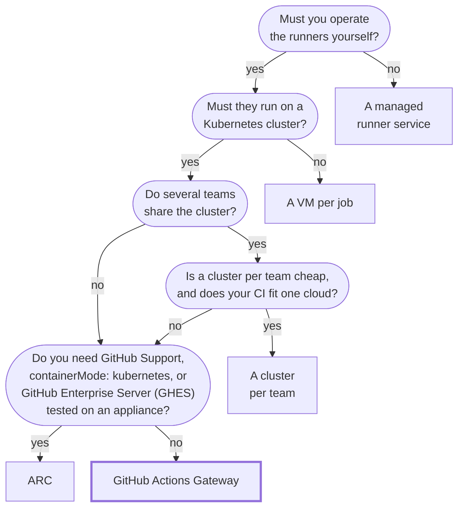

---
hide:
  - navigation
---

# Choosing how to run self-hosted CI

GitHub Actions Gateway (GAG) is built for one case: **the jobs must run on a Kubernetes cluster you operate, and several teams share it**.
On a cluster like that, GAG separates what the platform owns from what a tenant owns, which Actions Runner Controller (ARC) has no primitive for.
If your case is different, the chart names what fits it better.

## Which option fits

The table gives each answer's options, where they can run, and the reason to pick them.
Where an option can run is the fastest filter, and most comparisons omit it: "self-hosted" usually means "self-hosted on AWS".
Every competitor-side fact here carries the date it was read, because they move.

| Option | Runs on | Choose it when |
|---|---|---|
| A managed runner service: Blacksmith, Namespace, Ubicloud, Depot, WarpBuild | the vendor's infrastructure, or your cloud account under the vendor's control plane (Depot: AWS; WarpBuild: AWS, GCP and Azure, with static IPs) | per-build speed and price per minute are what you are buying. GAG has measured neither and claims neither. None of the five sites read describes running on a cluster you operate, or a platform/tenant boundary (read 2026-11-07; [D.14](design/appendix-d-alternatives-considered.md#d14-managed-runner-services-an-explicit-non-competitor)) |
| A VM per job: [RunsOn](https://runs-on.com), [terraform-aws-github-runner](https://github.com/github-aws-runners/terraform-aws-github-runner) | AWS only | your compute is elastic cloud capacity and you want no cluster. A VM per job isolates without any namespace argument. RunsOn retries a spot-interrupted job once on on-demand (its site, 2026-11-07), so the difference from GAG is who owns the pool, not who re-runs the job ([D.11](design/appendix-d-alternatives-considered.md#d11-self-hosted-github-actions-without-kubernetes)) |
| A VM per job: [Actuated](https://actuated.com) | your hardware, vendor-hosted control plane | you want the same isolation on machines you own |
| [ForgeMT](https://github.com/cisco-open/forge) | AWS only | you want a multi-tenant platform and your tenant boundary can be cloud identity ([below](#on-your-own-hardware)) |
| A cluster per team | managed Kubernetes, each cluster in its own cloud project | managed Kubernetes is cheap and your CI fits one cloud. A project boundary isolates harder than any shared cluster, and costs an API call |
| [ARC](https://github.com/actions/actions-runner-controller) | any conformant Kubernetes cluster, including on-premises and air-gapped | you need a GitHub Support entitlement, `containerMode: kubernetes`, or GHES tested on a real appliance. GAG has none of the three and plans only the third ([D.3](design/appendix-d-alternatives-considered.md#d3-actions-runner-controller-arc)) |
| **GAG** | any conformant Kubernetes cluster, including on-premises and air-gapped | several teams share the cluster and that sharing has to be safe. One team gets every GAG capability too, and what running GAG costs one team against ARC is unmeasured ([D.3](design/appendix-d-alternatives-considered.md#d3-actions-runner-controller-arc)) |

### On your own hardware

!!! tip "On your own hardware, the list is short"

    On-premises or on GPUs already bought, three rows are left: Actuated, ARC and GAG.
    Actuated puts a vendor-hosted scheduler in the control path, so air-gapped the field is ARC or GAG before a feature is compared.

On-premises also removes the isolation boundaries the other options are built from, which is the serious argument against a shared cluster.
ForgeMT, the one other multi-tenant platform on the list, draws its tenant boundary in IAM and OIDC role scope, GitHub App scope, and runner labels, and offers a VM per job when a pod is not enough (its docs, read 2026-08-12).
Every one of those is an AWS API, and on your own hardware the equivalent is a hardware purchase rather than a free call.
[Appendix D.9](design/appendix-d-alternatives-considered.md#d9-forgemt-and-cloud-identity-tenant-boundaries) states both trade-offs, including the one this design loses.

## What GAG adds once teams share a cluster

Adding teams does not add a feature, it adds roles.
Three end up in the room, each with different powers and a different blast radius, and holding them apart is most of the work.
ARC models the first two as one person, which is coherent for a single-owner cluster and is why it has no primitive separating them.

| The boundary | How GAG draws it |
|---|---|
| Platform sets a cap the tenant cannot raise | `ResourceQuota` is platform-owned; the controller has no write verb on it |
| Platform grants privilege, tenant cannot self-grant | Pod Security Admission is a namespace label; privileged shapes come from a platform `ClusterRunnerTemplate` |
| Platform bounds priority, tenant composes within it | [`priorityTiers`](operations/tenant-onboarding.md) draws from a platform allowlist, editable without a restart |
| Tenant self-serves without cluster-admin | one [`ActionsGateway`](getting-started.md) provisions controller, proxy, RBAC and policies inside the quota |
| Tenant sees its own data only | [metrics and a dashboard per tenant](operations/observability-dashboards.md), plus a separate platform view |
| Contributor's code is contained | [default-deny egress, per-tenant egress identity, Kata workers](design/05-security.md) |

Each role and what it cannot do: [Personas](operations/personas.md).

## A paved road is worth more than a trail map

- **Feature comparisons** tell you what *can* be done.
- **Reference architectures** prove it has been validated, and tell you how to do it.
- **Runbooks, dashboards, and alerts** tell you how to operate it.

Each ARC cell names the day it was read; the first two against ARC 0.14.2 and `master`, the last two against 0.15.1 and the repository's issue, pull-request and code search.

| | GAG | ARC |
|---|---|---|
| Sandboxed workers | [500-line guide](operations/kata-dind-workloads.md), validated end to end on GAG's own cluster before every release, validated on named kernels, no privileged container | same `runtimeClassName` field; no doc covers it, absent from chart values, two closed issues ever (2026-08-06) |
| Observability | [20 alert rules](operations/observability-alerting.md), [two dashboards for two audiences](operations/observability-dashboards.md), [per-tenant metrics](operations/observability-metrics.md), [redaction before any log line](operations/observability-logging.md) | one per-scale-set sample dashboard, no alert rules, metrics opt-in; [dashboard request open since 2025-01-13](https://github.com/actions/actions-runner-controller/issues/3753) (2026-08-06) |
| Peer-to-peer image distribution | [a Dragonfly node-client recipe](operations/p2p-image-distribution.md#gags-dragonfly-node-client-recipe) you apply, validated on GKE with Kata, its node effects and proxy exposure measured, in the release gate's Dragonfly leg since 2026-10-23 (no candidate has run that leg yet) | `imagePullPolicy` and a copy-to-your-registry step in the docs; zero issues, pull requests or code mentioning Spegel or Dragonfly (2026-11-07) |
| In-cluster `actions/cache` server | [one per tenant](operations/in-cluster-cache.md), in its namespace, enforcing GitHub's ref scope from each job's token | nothing on the scale-set docs page; [dependency caching](https://github.com/actions/actions-runner-controller/issues/2726) has been an open ask since 2023-07-07 (2026-11-07) |

## What you trade

Six things GAG does not have today, who does, and where GAG stands on each.
**No single alternative holds all six.**

| What you give up | Who has it | Where GAG stands |
|---|---|---|
| Install base | ARC 6,632 stars, ForgeMT 214, GAG 7 (2026-11-07) | an evidence trail, described below |
| Commercial support | ARC, and every managed service | none planned, by design |
| `container:`/`services:` without privilege | ARC, via `containerMode: kubernetes` | Docker-in-Docker inside a Kata micro-VM, which runs them with no privileged container and needs nested virtualization. ARC's mechanism was [declined 2026-08-25](design/appendix-d-alternatives-considered.md#d15-pod-per-step-container-execution-arcs-containermode-kubernetes) |
| GHES tested on a real appliance | ARC | GHES gateways are served and [flagged untested](features.md); testing needs an operator with an appliance |
| Per-build speed | managed runner services | not claimed in either direction; a [benchmark](roadmap.md) is on the roadmap and not done |
| Flaky-job retry | several CI systems ([G.17](design/appendix-g-future-enhancements.md#g17-opt-in-auto-retry-for-flaky-jobs-beyond-disruptions)) | detection ships; retry is [on the roadmap](roadmap.md). Auto re-run covers a job the cluster disrupted, never one that failed |

**Install base has no engineering answer.** If being the first production deployment is unacceptable, that settles it.
If it is not, what you have to go on is the evidence trail: dated measurements, failure modes documented with the incidents that found them, and a [published retraction](design/appendix-a-capacity-slos.md) of the project's own best number once it proved unmeasurable.

## Next steps

[Get started](getting-started.md){ .md-button .md-button--primary } [Why GAG over ARC?](why-gag.md){ .md-button }

[Appendix D](design/appendix-d-alternatives-considered.md) argues every alternative in full, including [Prow](design/appendix-d-alternatives-considered.md#d10-prow-and-the-prior-art-for-automatic-re-run), which is why GAG does not claim automatic re-run is novel, and [GitLab Runner](design/appendix-d-alternatives-considered.md#d12-gitlab-runners-kubernetes-executor), which faces the identical problem and resolves it the other way.
