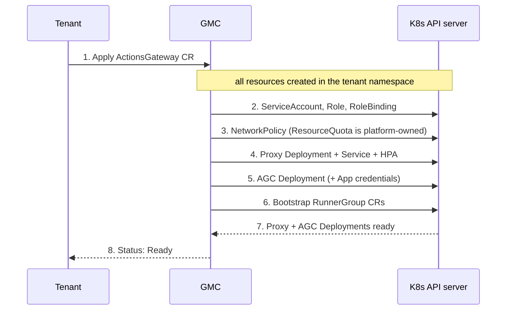
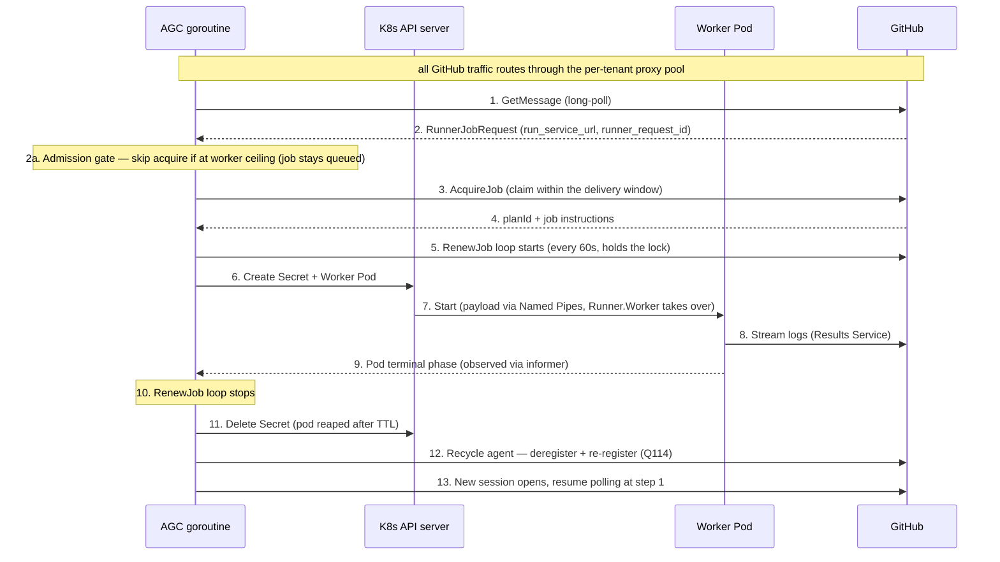
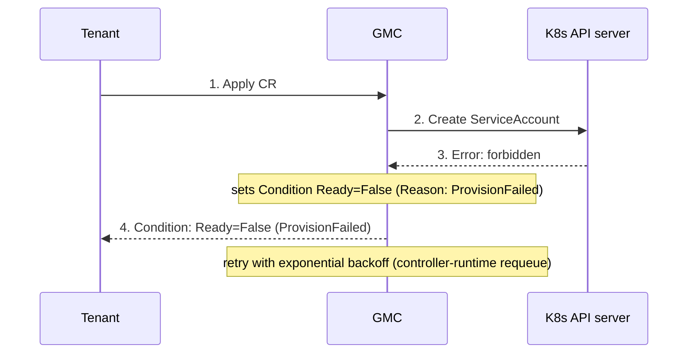
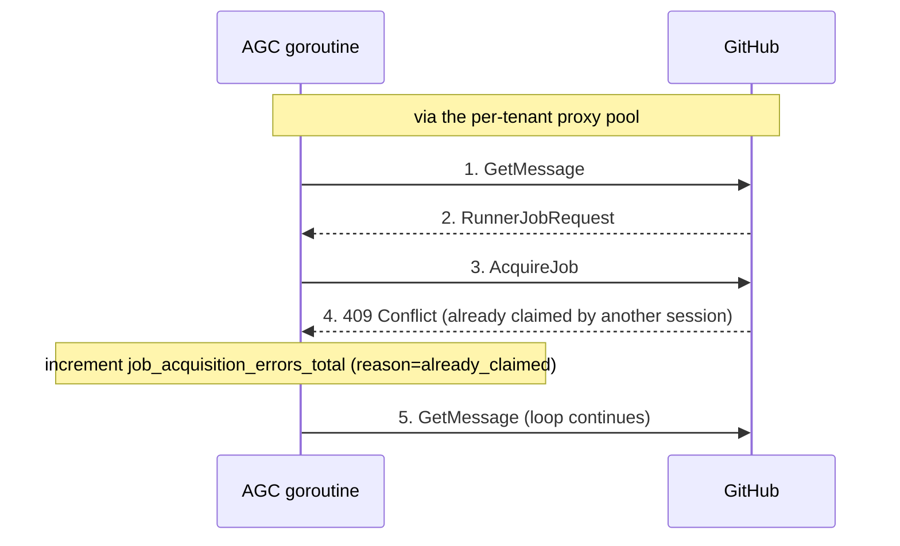
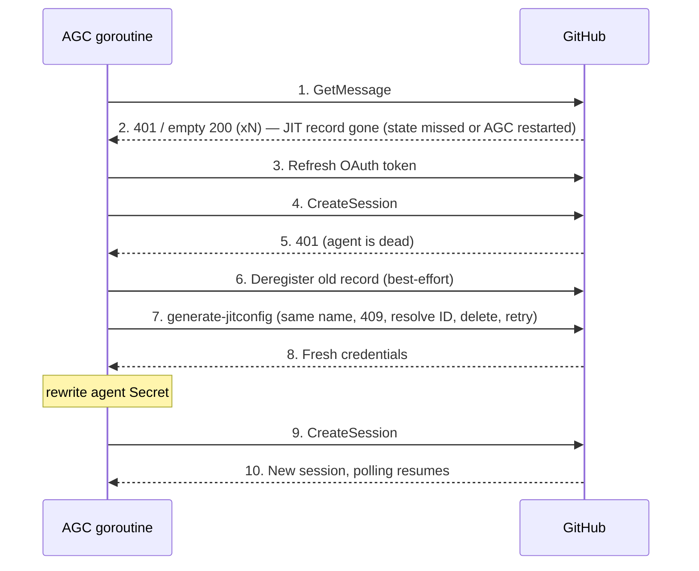
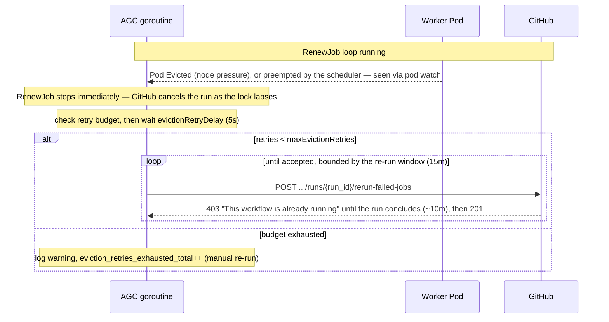
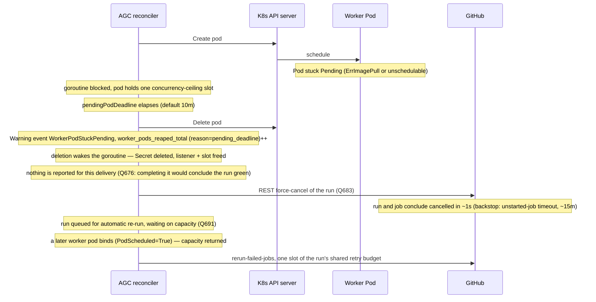
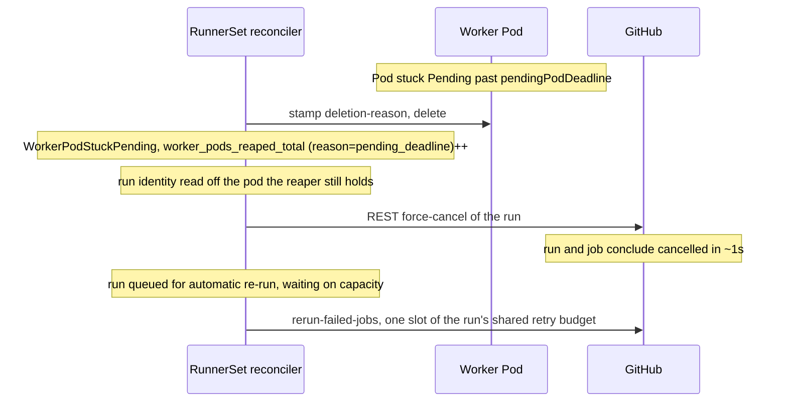
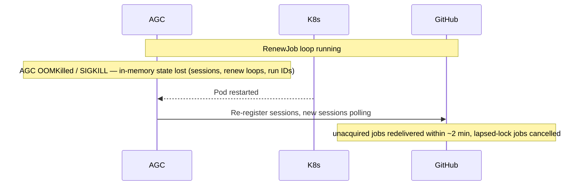

# 4. Operational Lifecycle Execution Flows

← [API & Data Contracts](03-api-contracts.md) | [Back to index](README.md) | Next: [Security →](05-security.md)

---

There are two distinct lifecycle flows: tenant provisioning (GMC) and job execution (AGC).

## 4.1. Tenant Provisioning Flow (GMC)

This flow runs once when a tenant creates an `ActionsGateway` resource in their namespace, and re-runs on any spec update.



1. **Declare:** A tenant creates an `ActionsGateway` CR in their own namespace, providing a `gitHubAppRef`, optional `proxy` scaling config, and optional initial `runnerGroups`.
   No cluster-admin involvement is required.
2. **RBAC:** The GMC creates a `ServiceAccount` for the AGC and a `Role`/`RoleBinding` scoped strictly to the CR's namespace.
   The AGC receives no cluster-level permissions.
3. **Guardrails:** A `NetworkPolicy` is applied.
   The NetworkPolicy permits egress to GitHub's IP ranges only from proxy pods (matched by label); the AGC and worker pods are permitted egress only to the proxy `ClusterIP` Service within the namespace.
   The namespace `ResourceQuota` is **platform-owned** — the platform admin provisions it out-of-band and GAG operates within it; the GMC neither creates nor mutates it (Q130).
4. **Proxy:** The GMC creates the proxy `Deployment` with `podAntiAffinity` spreading replicas across nodes, a `ClusterIP` `Service` in front of it, a `PodDisruptionBudget` with `minAvailable: 1`, and an `HorizontalPodAutoscaler` configured from `spec.proxy`.
   The HPA scales between `minReplicas` and `maxReplicas` targeting `targetCPUUtilizationPercentage`.
5. **Deploy:** The GMC creates the AGC `Deployment`, injecting the GitHub App credentials from the referenced Secret and setting `HTTP_PROXY`/`HTTPS_PROXY` to the proxy Service address.
   The worker pod template in the AGC's config also receives these env vars so all job log traffic routes through the proxy pool.
6. **Bootstrap:** Any `RunnerGroup` specs in the `ActionsGateway` CR are created as `RunnerGroup` resources in the same namespace for the AGC to reconcile.
   This reconciles to the desired set, not just additively: after applying the groups currently in `spec.runnerGroups`, the GMC prunes any `RunnerGroup` it owns (matched by owner labels) that is no longer in the spec, so removing or reordering an entry deletes the orphaned `RunnerGroup` — and cascades to its listeners and worker pods via the AGC's RunnerGroup cleanup — rather than leaving it running until the whole `ActionsGateway` is deleted (Q101).
   Pruning keys on the owner labels, not the slice index, so a reorder never orphans a group.
7. **Signal:** The GMC watches both the proxy Deployment's `ReadyReplicas` and the AGC Deployment's `ReadyReplicas`, updating `ActionsGatewayStatus.ProxyReadyReplicas` and the `AGCAvailable` Condition as they become available.
8. **Report:** The `ActionsGateway` status transitions to `Ready` once both the proxy pool has at least `minReplicas` ready and the AGC is healthy.

### 4.1.1. Tenant Teardown and Child Reclamation

Deleting the `ActionsGateway` reclaims every resource provisioned above through **two independent mechanisms, deliberately layered**:

- **The cleanup finalizer is the primary path.** It is ordered and fail-closed (Q125): the GMC deletes the `RunnerGroup`s first and waits for them to be gone — so listeners and worker pods drain before the AGC `Deployment` and its credentials are removed — then deletes the remaining children, and only removes the finalizer once *every* delete is confirmed.
  A delete that keeps failing retains the finalizer and requeues rather than abandoning a live, credentialed AGC.
  It also reaches objects the current reconciler no longer applies (the pre-v0.X per-tenant `Role`, the legacy `actions-gateway` `NetworkPolicy`), which nothing else would reclaim.
- **Owner-reference cascade garbage collection is the backstop.** Every namespaced child the GMC applies carries a controller `OwnerReference` to its `ActionsGateway` (Q394).
  Because a `ResourceQuota`-style platform-owned object is never a GMC child, and because the GMC places the children in the CR's own namespace, the reference is always valid.
  It costs nothing in the normal path (the CR is not removed from etcd until the finalizer clears, so the ordered drain always runs first) and it is what makes an operator force-removing the finalizer a recoverable mistake rather than a leak of credentialed `ServiceAccount`s, the AGC `RoleBinding`, the egress `NetworkPolicy`s, and the proxy `HPA`/`PDB`/`Service` into a namespace the tenant still controls.

The one intentional exception is a **cluster-scoped** child: a namespaced `ActionsGateway` cannot own one (the apiserver rejects the cross-scope reference and never collects it), so the per-gateway `ClusterRoleBinding` is un-owned and reclaimed by the finalizer alone.
Any new cluster-scoped child inherits that constraint and must be deleted explicitly in `reconcileDelete`.

**v2 needs a third mechanism for the tenant's worker pods** (Q547).
The ordered drain above works in v1 because `RunnerGroup`s *are* the gateway's children: deleting them first cascades to their worker pods. v2 decomposed them into standalone `RunnerSet`s that only reference the gateway and are deliberately **not** deleted with it — a tenant re-applies the gateway and its sets resume — which leaves worker pods owned by a live object whose only reaper is about to be torn down.
Reaping cannot ride the AGC's SIGTERM either: `reconcileDelete` deletes the AGC's `RoleBinding` and `ServiceAccount` within milliseconds of its `Deployment`, so a shutdown-time reap would find its authorization revoked and its bound token invalid.
So the two controllers split it:

1. The AGC watches its `ActionsGateway` already, for reference resolution.
   A `deletionTimestamp` on it makes the RunnerSet reconciler stop both acquisition tiers and delete every worker pod under `reason="gateway_deleted"` — while it still holds its full tenant grant, because the GMC has not deleted anything yet.
2. Teardown's **first** act is to check `status.activeJobs`/`pendingJobs` across the bound sets and requeue while any are non-zero, before the first `del`.
   The counts fall as soon as the AGC issues its deletes (a pod carrying a deletion timestamp is finished by the kubelet with no controller involved), so the healthy path costs one requeue.
   It also requeues while any bound worker pod has no deletion timestamp (Q1362), because a pod whose job finished is in neither count and would otherwise wait for the AGC's `completedPodTTL` with the AGC already gone.
   On the release gate that pod then held the workload policy below until the autoscaler removed its node, 8.7 to 16.3 minutes per tenant swap.
   Deleting a finished pod removes it at once, so this wait also costs a requeue or two.
   A 90-second deadline measured from the CR's own `deletionTimestamp` — stateless, so it survives a GMC restart mid-teardown — bounds the case where no AGC is running to reap at all; past it teardown proceeds and emits a `WorkerDrainTimeout` Warning naming what it is leaving to the kubelet's `maxWorkerLifetime` deadline.
3. The workload `NetworkPolicy` waits for the pods rather than the counts (Q1328).
   It is a worker pod's only egress restriction, and a pod still runs job code after the counts fall: through its template's `terminationGracePeriodSeconds`, which nothing caps, on the healthy path, and until `maxWorkerLifetime` past the deadline.
   So teardown deletes every other child, keeps that policy and the gateway's finalizer while any pod of a bound set remains, terminating ones included, and names the pods in a `TeardownIncomplete` event.
   A pod whose RunnerSet is already gone counts too, because a set deleted with its gateway sheds its finalizer before its pods exit.
   It reads them with an uncached Pod list through the namespace's `gmc-tenant-secret-reader` binding, and a failed list holds the policy too.
   A terminating namespace skips the hold: the namespace controller deletes the policy and the pods itself, and revokes the binding the list needs.

The trigger is a *terminating* gateway, never a missing one: a gateway that is gone is both the resting state after teardown and the gap between a delete and a re-apply, so reaping there would destroy live workers on a recreate.

---

## 4.2. Job Execution Flow (AGC)

This flow runs per-job inside the tenant namespace, entirely managed by the AGC.

> **This is the classic acquisition flow.** A `RunnerSet`, which always acquires through a scale set, does not run steps 2a–5 as written: the runner pulls and completes its own job through its own session, and the AGC advertises a single capacity integer (`X-ScaleSetMaxCapacity`) instead of deciding per delivered job.
> Two consequences are called out where they arise.
> Eviction auto-retry is ported to this tier (Q417, [below](#on-the-scale-set-tier-q417)), as is the admission ladder of step 2a (Q443, [below](#the-ladder-as-an-integer-scale-set-tier-q443)) and the abandoned-run force-cancel with its capacity-gated re-run (Q766, [below](#on-the-scale-set-tier-q766)).
> All three were classic-only, which the `v2.0.0` removal of classic acquisition would have turned into a silent capability deletion.



1. **Poll:** A dedicated AGC goroutine fires a `GetMessage` request via the proxy pool.
   GitHub holds the connection for up to 50 seconds; returns `202 Accepted` if no job is queued.
2. **Intercept:** GitHub responds with a `RunnerJobRequest` message containing `run_service_url`, `runner_request_id`, and `billing_owner_id` in the decoded body.
   2a.
   **Admit (Q59, #784, Q405, Q406, Q717):** Before claiming the job, the goroutine consults the pre-acquisition admission gate, which asks four questions in order.
   **Quota:** can the namespace `ResourceQuota` admit one more worker pod right now (`hard − used` against this owner's worker footprint)?
   **Capacity:** if the owner opted into a capacity gate, can the cluster currently *place* one more worker pod of this shape?
   **Ceiling:** is the in-memory, per-RunnerGroup reservation counter below the worker ceiling (`maxWorkers` / the maximum `priorityTiers` threshold)?
   **Rate:** if the owner opted into `spec.scaleUp`, does its token bucket have a token for another pod creation?
   A no from any of them **skips `acquirejob`**, increments `actions_gateway_jobs_admission_rejected_total{reason}` (`quota`, `capacity`, `scaleup`, or `ceiling`), and resumes polling at step 1 — the job stays queued at GitHub and is redelivered to a sibling session with capacity, rather than acquired-then-dropped.
   When the gate admits, it reserves a slot held until the job completes (step 11), then proceeds to step 3.
   The two observed rungs fail open and reserve nothing, which is why they precede the ceiling; the reservation is fail-safe soft state (reset on AGC restart).
   The rate rung reserves nothing either but *takes* its token, which is what lets it bind on a simultaneously-delivered burst where an observation could not: every listener would read the same free token and claim anyway.
   It comes last, behind the ceiling, so no rung refuses a job the bucket has already charged, and so the reason reported is the one that will not clear on its own.

   **Why an admitted job can hand its token back (Q972).** The token buys a worker pod, so a delivery that returns before asking for one gives it back when it releases its slot: a failed `acquirejob`, and above all a duplicate delivery whose `planID` a sibling has already claimed (Q260).
   Without the refund a job fanned out to N sibling sessions charges N tokens for the one pod its dedup winner creates, so the effective ramp is `maxPerSecond / N` under exactly the burst `spec.scaleUp` exists to smooth.
   The refund stops at pod creation and never fires on job *completion*: returning a token when a worker finishes would make the bucket a second concurrency ceiling rather than a rate limit.

   **Why the rate limit is a rung rather than a wait (Q717).** `spec.scaleUp` used to be waited on *after* the claim, at pod-creation time, which put it in exactly the position this gate exists to remove: a job that cannot be provisioned yet, holding a GitHub job lock while it waits.
   A long ramp (a large burst at a low `maxPerSecond`) walks the tail of that burst past the lock's lifetime, and a job whose lock lapses is cancelled rather than redelivered, so the anti-stampede knob could destroy the jobs it was smoothing.
   As a rung it withholds intake instead, and the classic provisioning path no longer touches the bucket at all: the token is charged once, before the claim, and refunded there too if the job never reaches a pod.
   The provisioner's post-acquire ceiling check and quota-retry loop (step 6) remain the authoritative backstops.

   **Tier scope.** This *per-delivered-job* form of the gate is wired from `AdmitFor` (v1 `RunnerGroup`) and the classic branch of the v2 `RunnerSet` reconciler; `reconcileScaleSetListener` returns before it.
   A `ScaleSet` set walks the same ladder once per long-poll and states the result as one integer — see [The ladder as an integer](#the-ladder-as-an-integer-scale-set-tier-q443).
   Every rung must exist in both forms; a rung added to only one ships to only one tier, which is how the quota rung came to be classic-only until Q443.

   **Why quota gates unconditionally and placeability is opt-in.** The quota rung and the scheduler's `WorkersUnschedulable` verdict look symmetrical and are not.
   A `ResourceQuota` rejection is never an autoscaler input, so declining to claim forfeits no capacity and self-clears as in-flight jobs release headroom.
   A Pending unschedulable pod, by contrast, *may be* the request for a node: on an elastic cluster, gating on it would suppress the signal cluster-autoscaler needs and starve the tenant exactly when scale-up would have rescued it, while on a fixed-size cluster nothing is waiting on that pod and the same verdict is pure waste.
   The asymmetry belongs to the cluster, not to the signal, so the owner asserts which one it has via `spec.capacityGate.mode` (default `Off`) and the AGC never auto-detects it — a wrong detection starves a tenant.
   Rationale: [Appendix D §D.8](appendix-d-alternatives-considered.md#d8-gating-intake-on-capacity-which-signals-are-safe-to-gate-on).

   **Two inputs, from two parties (Q470).** The *mode* is the tenant's `spec.capacityGate.mode` (`Off`|`Observe`) — how hard should this set try not to claim work it cannot run.
   The *signal* follows from the platform operator's `ActionsGateway.spec.clusterCapacity.nodeAutoscaling`, because which reading of an unschedulable pod is sound is a property of the cluster, identical for every set in it.
   Splitting them is what makes the one harmful misconfiguration — gating on the scheduler's verdict where an autoscaler was about to add a node — **unrepresentable** rather than merely documented, and it stops a tenant being asked to speak for infrastructure they may not own.

   **The two placeability signals.** With `nodeAutoscaling: Absent` the gate reads the scheduler's verdict, sound because nothing is waiting on those pods.
   With `Present` (the default) it reads the *autoscaler's own declination* — cluster-autoscaler's `NotTriggerScaleUp`, or Karpenter's `FailedScheduling` from a non-scheduler reporter — recorded as an Event on a stuck worker pod, because only the autoscaler saying it will not act is evidence that no node is coming.
   Both feed the identical rung, condition, and metric label.
   `Present` is the default deliberately: it can only ever *under*-gate, so a cluster whose operator never set the field keeps today's behavior.
   The reporter check is load-bearing, because `FailedScheduling` is also kube-scheduler's own reason for every ordinary transient placement failure.
   So is recency: the verdict is the newest relevant event, so an autoscaler that declined and then scaled up reopens the gate rather than being remembered as a no. Recency is deliberately asymmetric — one autoscaler loop can record both verdicts for one pod milliseconds apart, so a declination counts as superseding a scale-up only from more than a second later, and a closer pair resolves open.
   Events are read uncached, field-selected to one pod, only for pods already stuck past the scheduling grace, and bounded per reconcile — there is no Event informer, and a healthy set costs zero reads.
   Detail: [Appendix H §H.7](appendix-h-v2-api-decomposition.md#h7-reference-integrity--runtime-conditions-not-admission).

   **A third signal, selected by nothing (Q714).** Both signals above ask whether a pod can be *placed*.
   A worker pod that WAS placed and then could not be started, with the kubelet in `ImagePullBackOff` (a `workerImage` that does not pull), answers neither, so it tripped no rung at all and every job delivered in its `pendingPodDeadline` window was claimed.
   The gate now reads that too, as `PodsNotStarting`, and reads it on **every** cluster rather than under one value of `nodeAutoscaling`: §D.8's question is whether another actor is waiting on the pod to make capacity appear, and a bound pod is not a request for anything.
   The kubelet's backoff is the verdict, so the signal needs no scheduling grace of its own, which is also why the matcher takes `ImagePullBackOff` and refuses the pre-backoff `ErrImagePull`.

   **The capacity rung self-resolves through a probe, and that is what keeps it safe.** It reads the `WorkerCapacityDeclined` condition, which is derived from the *existence* of a stuck worker pod — and because the reaper deletes exactly that pod at `pendingPodDeadline`, the condition does not clear on the reap: it **latches** as `AwaitingProbe` and admits exactly one probe job (Q512).
   The probe's pod is the fresh evidence, in whichever direction it lands: one of its containers runs and the gate clears completely, or it sticks and the live verdict returns.
   Running rather than merely being scheduled is the release condition (Q714), because a probe binds within a second and only reveals that it cannot start seconds later, so releasing on the binding would restore the full advertisement inside that gap.
   A burst of *N* jobs that would each have been claimed and cancelled becomes roughly one wasted claim per deadline window — a bound on the rate, not an elimination.
   The latch is what makes that rate hold on the scale-set tier too, where capacity is an integer per poll rather than a decision per job: clearing on the reap would restore the whole advertisement each window (measured as a no-op — [plan §9e](../plan/capacity-aware-intake.md#9e-what-the-dogfood-run-measured-q469)).
   Nothing here removes the need for `pendingPodDeadline` and the reaper.
3. **Lock:** The AGC immediately calls `POST {run_service_url}/acquirejob` via the proxy — before creating any Kubernetes resources — to claim the job within the 2-minute delivery window.
4. **Payload:** `acquirejob` returns the full job instructions and `planId`.
   The AGC decrypts the payload and extracts the single-use `ACTIONS_RUNTIME_TOKEN`.
5. **Renew:** A per-job background goroutine starts calling `POST {run_service_url}/renewjob` every 60 seconds.
   Each renewal extends the job lock by ~10 minutes.
   Pod startup time is no longer a race — the lock is already held.
6. **Stage:** The AGC commits a short-lived Kubernetes Secret containing the decrypted job payload to the tenant namespace, then creates the Ephemeral Worker Pod mounted with that Secret and `automountServiceAccountToken: false`.
7. **Handoff:** The worker pod boots, the entrypoint wrapper feeds the payload into Named Pipes, and the .NET `Runner.Worker` engine takes over.
   The wrapper stays resident as PID 1 and relays SIGTERM/SIGINT down to the engine, so a pod termination (eviction, node drain) reaches the process that can actually abort the job and report it (Q385).
   Note the precondition: the relay carries a *pod* termination.
   A run **cancelled at GitHub** does not terminate the pod — the cancellation arrives on the AGC's broker session and nothing forwards it to the worker, so the runner executes its remaining steps while GitHub concludes the job at its own ~5-minute cancellation grace (measured 2026-07-29: a `sleep 600` job ran the full 600s after its run was cancelled).
   [Q501](../queue/Q501.md) carries that gap; what it has closed so far is the *actuator* — when the AGC does give up on a job (step 5's lock loss), the worker pod is now deleted rather than left running to the `maxWorkerLifetime` cap.
   **The gap is specific to this tier.** On **ScaleSet** the listener holds a message queue for the whole job, and a cancelled run puts a terminal `JobCompleted` on it — measured live at ~0.2 s for a job with no runner attached (Q468) — which stamps `actions-gateway.com/job-completed-at` on the worker and hands it to the reaper's five-minute `Running` grace (step 11, Q420).
   So the ScaleSet worst case is GitHub's cancellation grace plus the reap grace, against classic's *whole remaining job* bounded only by `maxWorkerLifetime`.
   Detail: [q501-cancel-relay.md](../plan/q501-cancel-relay.md).
8. **Stream:** The worker pod streams live execution logs to GitHub's Twirp Results Service via the proxy pool.
9. **Complete:** The worker container exits with code `0` on success (non-zero on workflow failure).
   A single event handler on the AGC's shared Pod informer observes the terminal pod phase and wakes the waiting session goroutine — detection is event-driven, not polled, so completion is noticed near-immediately regardless of how many sessions are in flight.
10. **Stop renewing:** The RenewJob goroutine detects pod completion and exits cleanly.
11. **Reclaim:** The AGC deletes the associated job Secret immediately.
    The completed pod is retained for `completedPodTTL` (default 5m) and then deleted by the RunnerGroup reconciler's worker-pod reaper; `completedPodTTL: 0s` deletes it immediately on completion.
    Both the pod and the Secret also carry a controller `OwnerReference` to the RunnerGroup, so RunnerGroup or tenant deletion cascade-deletes anything still present.

    On the **ScaleSet** protocol the same invariant holds — a credential-bearing per-job Secret never outlives its job — but the reclaim point differs, because the AGC does not wait on the worker there.
    The provisioner is fire-and-forget: any exit that fails *before* the worker pod exists deletes the Secret it just staged (a replay whose Secret an earlier delivery staged leaves it alone — that delivery's pod may be mounting it), and in steady state the Secret is deleted when the scale-set listener sees the job's terminal `JobCompleted` on its queue.
    Because the queue replays messages the listener has not deleted to a re-created session, an AGC that crashes between a job's completion and its Secret delete reclaims it on restart.
    That property survives the Q583 delete-ack precisely because the delete waits on the reclaim: a completion whose Secret delete failed is not treated as concluded, so its message stays in the queue and the next session retries it.
    A reclaim that fails outright is logged and falls back to the `OwnerReference` cascade-GC.
12. **Recycle (Q114):** The acquisition in step 3 consumed the agent's single-use JIT runner record, so the session is dead.
    The goroutine deletes it (best-effort) and re-registers the agent under its stable `<group>-<index>` name — deregister-then-recreate, resolving a `409` from a surviving record by ID lookup.
13. **Resume:** The agent Secret is rewritten with the fresh credentials and a new session opens; the same goroutine resumes polling at step 1, so listener capacity never dips.

### The ladder as an integer (scale-set tier, Q443)

A `ScaleSet` set never reaches step 2a, because it is never offered a job to decline: it states, once per long-poll, how many jobs GitHub may keep assigned to it, as the `X-ScaleSetMaxCapacity` header.
GitHub then holds `totalAssignedJobs` at or below that value, so the *same* ladder produces the *same* outcome — a job that would have been declined is simply left queued — through an integer rather than a per-job boolean.

The advertised number is the **minimum** of the ladder's rungs, recomputed every poll (so a spec edit or a quota change takes effect without an AGC restart):

| Rung | Contribution | Fail-open value |
|---|---|---|
| Ceiling (Q59) | the max `priorityTiers` threshold, else `maxWorkers`, else `10` | — (the `10` default *is* the fallback) |
| Quota (#784, Q443) | this set's non-terminal worker pods **+** how many more the namespace `ResourceQuota` can admit | no bound (the ceiling stands) |
| Capacity (Q405, Q406, Q512, Q714) | this set's non-terminal worker pods, while its capacity gate is declining — no room for one more; **plus one probe slot** while the gate is latched (`AwaitingProbe`) with no probe pod outstanding | no bound (gate `Off`, an unimplemented mode, nothing declining, or nothing readable) |
| Rate (Q223, Q717) | this set's non-terminal worker pods **+** the whole tokens free in its `spec.scaleUp` bucket | no bound (`scaleUp` unset, or the pod count unreadable) |

Three properties follow, and they are why this is not merely the classic gate in different clothing:

* **Nothing is spent to discover the limit.** The classic gate declines a job that was already delivered; here the job is never assigned, so no single-use JIT runner record is consumed and no GitHub job lock is taken out on a pod that cannot be created.
* **The quota rung is a total, not a delta.** Headroom answers "how many *more* fit"; the header wants "how many at once", so the set's own in-flight worker pods — already inside the quota's `used` — are added back.
  Deliberately the pod count and not GitHub's `totalAssignedJobs`: the two diverge across an assignment the AGC has not provisioned yet, and biasing low only delays a job where biasing high would reproduce the claim-and-stall.
  The rate rung converts the same way and it is load-bearing there in a second sense: free tokens cap at `burst`, so advertising them directly would pin the set at `burst` assigned jobs forever and silently turn a *rate* limit into a lower *concurrency* ceiling.
  Added to the in-flight count it does what the field says: the set jumps to `burst` on the first poll, then climbs at `maxPerSecond` per second until another rung binds.
* **Recovery is a poll, not a job.** Classic re-decides per delivered job; this decides once per poll for the whole set, so restored headroom reopens assignment within one long-poll interval (~50s) rather than immediately.

Because every rung can only *lower* the number, a rung that cannot read what it needs (no quota, an unreadable quota, an unresolved template) contributes no bound and the set advertises its declared ceiling — exactly the behavior that predates this rung.
The provisioner's post-create ceiling check and quota-retry loop remain the backstops for the races an advertised integer cannot close (a sibling AGC, a stale `.status.used`).

**What an operator sees.** `actions_gateway_scaleset_advertised_capacity` is the number most recently advertised, and `actions_gateway_scaleset_capacity_withheld{reason}` attributes the gap to the rung that took it (`quota`, `capacity`, `scaleup`).
The per-job `actions_gateway_jobs_admission_rejected_total` is structurally unreachable on this tier — there is no rejected job to count — so these two gauges are its counterpart, alongside the `WorkerQuotaPressure`/`WorkerQuotaExceeded` and `WorkerCapacityDeclined` conditions the set publishes.

---

## 4.3. Failure Paths

The happy-path flows above are sufficient for most operations.
The following diagrams cover the most operationally significant failure modes.

### Provisioning Failure (GMC Cannot Create Resources)



The GMC reconciler is a standard `controller-runtime` reconciler.
Errors are returned from `Reconcile()` and trigger automatic requeue with exponential back-off.
The GMC sets a `Ready=False` condition with reason `ProvisionFailed` and a message containing the specific error on each failed attempt.

**What the tenant observes:** The `ActionsGateway` CR exists but has `Ready=False`.
No AGC, proxy, or RunnerGroup resources are present.
The condition message includes the underlying error.

**Resolution:** See [Troubleshooting — GMC Not Provisioning Tenant Resources](../operations/troubleshooting.md#gmc-not-provisioning-tenant-resources).

---

### Job Acquisition Failure (Broker Returns Error)



`AcquireJob` can fail with:
- `409 Conflict` — job was claimed by another session (benign race in multi-listener scenarios; the job is executing elsewhere).
- `404 Not Found` — the delivery window expired before `acquirejob` was called; GitHub will redeliver.
- `422 Unprocessable Entity` — job payload is malformed or the runner version is incompatible.

In all cases the goroutine increments `actions_gateway_job_acquisition_errors_total{reason="..."}` and continues polling on the next `GetMessage` loop iteration.
A replacement listener goroutine is not spawned (no job was acquired to spawn it for), so the listener count stays the same.

---

### Stale Session (Consumed Single-Use Agent) Self-Heal



GitHub deletes a JIT runner record once it acquires a job, so a session can go stale outside the normal post-job recycle — most commonly when the AGC restarts between a job's acquisition and its recycle.
The poll loop classifies the two live-observed stale signatures ([M4 §12](../plan/archive/milestone-4.md#12-live-multi-tenant-validation-evidence-2026-06-1112)): a `401/403` triggers a heal immediately (steps 3–4 also fix plain broker-token expiry, in which case the flow stops at step 4 with no recycle); three consecutive `200`-with-empty-body responses trigger the same ladder.
Only when *fresh* credentials are still rejected (step 5) is the agent re-registered (steps 6–8, `actions_gateway_agent_recycles_total{trigger="stale_session"}`).

If the heal itself fails — e.g. GitHub is down — the goroutine exits with a retriable error and the multiplexer's restart backoff paces further attempts; an agent marked consumed is parked in the pool and repaired by the next reconcile rather than being handed to another listener.

If instead the baseline exits *non-retriably* (version-too-old, or a credential GitHub treats as permanently dead), the multiplexer deliberately does not restart it — but the RunnerGroup reconciler requeues itself on a bounded interval while the live listener count is below the desired ceiling, so its zero-listener recovery revives the baseline within seconds rather than leaving `status.activeSessions`/`Ready` stale until the next watch event or the 10-hour resync (Q137).

**What the tenant observes (pre-fix versions):** runner list emptying after each job, `ActiveSessions` decaying, jobs queueing forever once ~`maxListeners` jobs have run.

---

### Worker Pod Eviction and Auto-Retry

> **Both acquisition tiers, by two different routes.** The flow below is the classic `provision()` path, which blocks on the worker pod's terminal phase.
> `ProvisionScaleSetWorker` is fire-and-forget by design — the runner pulls and completes its own job — so it observes nothing, and until Q417 an evicted `ScaleSet` worker got no rerun at all.
> That mattered because `ScaleSet` is the default protocol (Q264 P5) and the only one `v2` offers, so the capability covered only the *deprecated* tier.
> The port relocates both of the classic path's inputs onto the worker pod; see [On the scale-set tier](#on-the-scale-set-tier-q417) below.



Three disruptions reach this flow, and each is detected differently:

* **Kubelet node-pressure eviction** leaves the pod `PodFailed` with `Status.Reason: Evicted` and a `DisruptionTarget=True` / `TerminationByKubelet` condition.
  The kubelet writes the same phase and reason when a pod exceeds its *own* storage limit, and that shape is withheld before any re-run ([below](#an-eviction-for-the-pods-own-limit-is-not-a-disruption), Q1177).
* **kube-scheduler preemption** — what a `priorityTiers` `PriorityClass` drives — instead *deletes* the victim after stamping a `DisruptionTarget` condition with reason `PreemptionByScheduler`, so it is recognised by that condition, which travels out of the pod wait alongside the phase (Q497).
* **External graceful deletion** — a `kubectl drain` or a bare `kubectl delete pod` — is recognised by the pod's `deletionTimestamp` being set at the moment its terminal phase publishes **and** the deletion *request* — `deletionTimestamp` less the grace period it carries — predating the container's recorded exit, which also travels out of the pod wait.
  The AGC's own deletions are excluded by the `actions-gateway.com/deletion-reason` stamp written before each of them (Q502).

See [Which disruptions are recovered](#which-disruptions-are-recovered-and-which-are-not) for the full boundary.

The AGC stops renewal immediately on detecting any of these, so the outstanding lock starts lapsing at once and GitHub concludes the run when it expires: within the remaining lock window, at worst ~10 minutes from the last renewal (the lock TTL — see `RenewJobResponse.LockedUntil` in `broker/types.go`).

The AGC waits `evictionRetryDelay` (default 5 seconds) and then calls the rerun API — **retrying while GitHub refuses with `403 This workflow is already running`**, the answer every re-run gets until GitHub has concluded the original run (Q503).
The retries are paced at a fixed 30-second interval inside a 15-minute re-run window, sized past the lock TTL bound above; the whole refusal-spanning recovery holds **one** slot of the retry budget.
A re-run still refused when the window closes, or refused with anything other than the still-running message, is terminal: `actions_gateway_eviction_rerun_failures_total` increments and an `EvictionRerunFailed` Warning Event names the run needing a manual re-run.
On the external-deletion arm each pass first reads the run's conclusion and stands the recovery down if GitHub concluded it `cancelled`, so the runbook's delete-to-reclaim remedy no longer undoes a cancel ([below](#which-disruptions-are-recovered-and-which-are-not), Q811).

The call addresses `GITHUB_API_BASE_URL` — the same endpoint the installation token was minted against — resolved through the one helper the token exchange uses so the two cannot drift.
Before Q504 it defaulted past a configured GHES endpoint to `api.github.com`, so on GHES the call failed with a 401 before it could reach the refusal above.

**Both halves of that recovery — how long GitHub takes to conclude the run, and the refusal window the retry loop exists to absorb — are measured against live GitHub, on both acquisition tiers (Q396).** A worker killed by a real kubelet eviction, on a job carrying no `timeout-minutes` to confound the timing, saw GitHub conclude the job `failure` **9m36s** after the kill — consistent with the lock TTL being the mechanism, since the runner is SIGKILLed with roughly two seconds of grace and never gets its own report out.

Reproduced on the classic tier on 2026-08-03 against the published `v1.3.0` images at **9m37s**, and once on scale-set at **9m38s**, where detection runs from the owning reconciler instead (Q417).
Re-measured on the scale-set tier at **9m45s** (Q657), which is the third clean observation and the best-evidenced: the worker was cross-checked against GitHub's own `runner_name` before being disrupted, and GitHub's step records show the job at `completed/failure` with the interrupted step frozen at `in_progress/null` — the runner never posted its end.

**One scale-set run disagrees and is unattributable:** a second run of the same spec on the same build concluded 17 seconds after the job started and accepted the re-run on the first call, but it predates that identity check, and a run taken afterwards proved the spec could evict a worker that was not the one executing the job.
So "a kubelet ephemeral-storage eviction is not reliably ungraceful" is **unsupported rather than established** — not refuted either, since the two runs differ in exit code.
What holds is that how long GitHub takes depends on whether the runner's report escapes, not on which tier detected the loss.
Quote the ~10-minute figure for the case where nothing is reported; do not quote a scale-set-specific number.

The AGC originally fired the re-run exactly once, 5 seconds after the eviction — squarely inside the window GitHub refuses — so the budget was spent, `actions_gateway_eviction_retries_total` incremented, and the job was never re-run (the Q503 defect).
Treating the still-running refusal as "not yet" rather than a spent attempt is what closed it, and the retry loop is measured absorbing that window: **20 paced calls before GitHub accepted** on the classic tier and on the scale-set run whose report did not escape, and **21** on the Q657 re-measurement.
See [eviction-oversubscription-validation.md § Result](../plan/eviction-oversubscription-validation.md#result-measured-2026-07-29) and [§ Scale-set result](../plan/eviction-oversubscription-validation.md#scale-set-result-measured-2026-08-03).

Contrast the *graceful* removal path, where the worker gets the full 30-second grace period and the runner does report: GitHub concludes in 15–26 seconds, and `rerun-failed-jobs` is accepted (Q459).
The two paths differ by whether the report escapes, and that is what sets both the latency and whether recovery is even possible.

**A preemption is on the graceful side of that line, so the refusal window barely arises there.** kube-scheduler deletes its victim rather than SIGKILLing it, the SIGTERM relay gets the runner its grace period, and the job concludes in seconds rather than waiting out the lock — so the first or second re-run call is already past the refusal that an eviction's recovery must out-wait for ~10 minutes.
A drain (Q502) sits on the same graceful side, with a measured conclusion latency of 15–26s — a few paced retries at most.
The three causes share one code path, one budget per tier, and one retry loop; they differ only in how long that loop runs.


`maxEvictionRetries` is a hard lifetime cap per `run_id`, not a per-disruption-wave allowance: once exhausted, every subsequent disruption of that run is a no-op (counted by `eviction_retries_exhausted_total`).
On the classic tier the counters are in memory, so an AGC restart resets them; the scale-set tier keeps its budget in a ConfigMap that a restart does not touch (below).
Because a single workflow run can have several worker pods evicted simultaneously under node pressure — or preempted together when a floor tier claims capacity — the check-and-increment of the per-run counter is serialized per `run_id`, so concurrent disruptions can never collectively exceed the budget, whatever mix of causes they are.

#### On the scale-set tier (Q417)

The flow above is the **classic** tier, where one goroutine holds the job's identity and watches its own pod.
The scale-set tier provisions fire-and-forget and receives no acquired payload, so it has neither the watcher nor the identity.
Both are relocated onto the worker pod, which makes the mechanism restart-safe rather than process-scoped:

```mermaid
sequenceDiagram
    participant Q as Scale-set queue
    participant L as Listener
    participant P as Worker Pod
    participant R as RunnerSet reconciler
    participant C as Recovery-claim ledger (ConfigMap)
    participant GH as GitHub
    Q-->>L: JobAssigned (ownerName, repositoryName, workflowRunId)
    L->>P: provision, stamping run-id/repository + acquisition-protocol=ScaleSet
    Note over L: fire-and-forget — the runner pulls and completes its own job
    P-->>R: Failed/Evicted, DisruptionTarget=PreemptionByScheduler, or Failed + deletionTimestamp; the reconciler's pod watch hands the event's pod to recovery at once (Q1029), and a scan at the top of every reconcile lists for what no event reached
    R->>C: claim the pod's recovery (optimistic lock) — outlives the pod (Q1108)
    alt claim won and identity present
        R->>P: stamp eviction-handled-at (best-effort cache filter)
        R->>GH: POST .../runs/{run_id}/rerun-failed-jobs (retried until the run concludes — the classic loop above)
    else identity absent
        Note over R: eviction_recovery_identity_unknown_total++, Warning Event (manual re-run)
    else claim held elsewhere
        Note over R: the other detection path, another reconcile, or a replica owns it — skip
    else claim unrecordable
        Note over R: eviction_recovery_evidence_lost_total++, Warning Event (manual re-run)
    end
```

Three properties make this equivalent rather than merely similar.
The claim is taken **before** the GitHub call and **off** the pod, so recovery is at-most-once per disrupted pod across reconciles, restarts and replicas, and survives the pod's own deletion: a duplicate re-run would silently spend another slot of the run's budget, and a lost claim used to cost the run its recovery entirely (Q1108, below).
The recovery scan runs **before** the worker-pod reaper in the same reconcile, so a terminal pod is never deleted before its identity is read.
And the budget survives a restart, which the classic tier's in-memory one does not (Q1182).
It lives in the set's `scaleset-failures-<set>` ConfigMap as a count of GAG's own re-runs per run plus a record, per run attempt GAG re-ran from, of the disruptions that re-run covered, written with the same read, modify, compare-and-swap loop as the claim.
A reservation is taken once per disruption, after a run read that names the attempt the job failed in, and does one of four things: it **resumes** a reservation the same worker already holds, **merges** into a re-run already reserved for that attempt (rerun-failed-jobs re-runs every failed job of an attempt, so a second disruption of the same attempt is covered and spends nothing), **refuses** at `maxEvictionRetries`, or **reserves** a slot.
Every outcome but a refusal then enters the re-run loop, which reads the run before each call and stands down once its attempt is past the one the job failed in, unless that attempt's jobs show the job was not re-run in it.
That is what stops two disruptions in one run from each landing a re-run (before it, the second retried against `403 This workflow is already running` until GAG's first re-run concluded, then re-ran the run again), and what keeps a merge safe: a merged disruption re-runs the attempt itself if the reservation it joined never lands, because that recovery failed or the AGC restarted before it.
A disruption detected late (the vanished arm, or a scan after a restart) can read an attempt another re-run already started; the [`already_rerun` check](#futile-re-runs-are-withheld-before-a-slot-is-spent-scale-set) tells that from when the worker was provisioned, and judges the job rather than the attempt (Q1320).
The cap covers every disruption cause, so the `cause` label splits the reporting but not the cap; it is per set, so a run whose jobs span two sets, or a set and a classic group, has a budget in each.
A run that cannot be read, or a decision that cannot be written, withholds the re-run, counted as `eviction_rerun_failures_total{reason="conclusion_unknown"|"api_error"|"budget_unrecorded"}`.
The ConfigMap's schema and its rules for being shared by two AGC versions are in [the Q555 recovery design](../plan/q555-automatic-recovery-design.md#the-storage-shape).

#### Which disruptions are recovered, and which are not

Five causes reach the recovery above, and the boundary between them and everything else is the whole safety argument.
Four of them re-run at once; the fifth, an abandoned never-started worker, re-runs only once capacity returns, because it was the absence of capacity that abandoned it (Q691):

| Disruption | Pod shape | Recovered | Why |
|---|---|---|---|
| Kubelet node-pressure eviction | `PodFailed` + `Status.Reason: Evicted`, with `DisruptionTarget=True` / `TerminationByKubelet` | ✅ | SIGKILL — nothing inside the pod reported, so the job hangs until its lock lapses |
| Kubelet eviction for the pod's own limit: its total `ephemeral-storage`, one container's, or an `emptyDir` `sizeLimit` | `PodFailed` + `Status.Reason: Evicted`, a limit message, and **no** `DisruptionTarget` condition | ❌ (Q1177) | The job outgrew a limit its own template sets, so a re-run gets the same limit and fails the same way. Withheld before a budget slot is spent; see [below](#an-eviction-for-the-pods-own-limit-is-not-a-disruption) |
| kube-scheduler preemption (`priorityTiers`) | Deleted, with `DisruptionTarget=True` / `PreemptionByScheduler` | ✅ (Q497) | The scheduler is the condition's only writer, so the signal is unambiguous |
| Node shutdown: a Spot or preemptible reclamation the kubelet shuts down gracefully, a Node object deleted under the worker, or a dead node an admin taints `node.kubernetes.io/out-of-service` | `PodFailed` with `DisruptionTarget=True` / `TerminationByKubelet` (the kubelet's graceful shutdown; `Status.Reason: Terminated`), `DisruptionTarget=True` / `DeletionByPodGC` (PodGC failing and force-deleting the orphan of a node already gone), or `DisruptionTarget=True` / `DeletionByTaintManager` with the runner container still recorded `Running` (PodGC failing and force-deleting a pod the taint manager could not finish deleting) | ✅ (Q1179, Q1207) | All three reasons are written by cluster components, so like preemption the signal needs no conclusion check. No shape reached an older arm: the reason is not `Evicted`, the condition reason is not `PreemptionByScheduler`, nothing deletes a gracefully shut-down pod, PodGC writes the orphan's phase before its delete, the order the drain row reads as cleanup, and no kubelet records the out-of-service pod's exit for the drain row to order against. `DeletionByTaintManager` also follows a human's `NoExecute` taint on a live node, so the arm takes it only while the runner container is still `Running`: a live kubelet finishing the same delete records the exit first, and the drain row keeps that pod and its conclusion check. Only the runner counts, because a regular sidecar such as dind can outlive a runner whose job already ended. The AGC's own deletions are excluded here as on the drain row, and so is a worker none of whose containers ever started: the kubelet's shutdown fails a still-`Pending` worker too, and that job never ran, so it takes the never-started row below (Q1198). The out-of-service taint is the admin's confirmation that the node is dead, so re-running carries no risk of a partitioned runner finishing the job twice. A node that goes `NotReady` and keeps its Node object with no such taint is **not** covered: the taint manager's graceful delete never completes without a kubelet, so the pod stays `Running` until an admin taints the node or deletes the Node object. The out-of-service shape is measured on kind v1.36.1; the other two are read from kubernetes v1.35.0 source, not yet from a reclaimed dogfood node |
| `kubectl drain` / eviction API, `kubectl delete pod` | `PodFailed` + empty reason, publishing **with** `deletionTimestamp` set | ✅ (Q502) | Measured discriminator: a cancel and a genuine failure publish the same shape with **no** mark. Gated on the mark, not on the `EvictionByEvictionAPI` condition, so a bare delete is covered too. This arm alone also reads the run's conclusion before re-running, and stands down on `cancelled` (Q811), because an operator following the cancel runbook supplies the mark by hand |
| The AGC's own deletions — reaper, and the job-abandoned reclaim | As above, plus the `actions-gateway.com/deletion-reason` stamp | ❌ | The AGC deletes pods it gave up on: the reaper's stuck-Pending and orphaned-Running workers, and (Q501) the worker of a job whose lock the renew loop lost, which GitHub has already redelivered to a sibling. Recovering either would turn cleanup into a re-run trigger. The stamp, written before every AGC-issued delete, is the exclusion. It is the pod's, so it dies with the pod: a reaped worker whose completion a previous process never read is re-run by the Q844 path instead, which is the narrow residual recorded below |
| Deleted before its container ever ran, or lost with its node before it did | Vanishes, or publishes a transient `Failed` + mark with **no container start record** (a drained or reaped *Pending* worker, whose waiting container the kubelet rewrites as `Terminated`/`ContainerStatusUnknown` with no start, exit or container ID; measured on kind v1.36.1, Q1231), or `PodFailed` with one of the node-shutdown row's `DisruptionTarget` reasons and no container start record (Q1198) | ✅ (Q691, both tiers since Q766; the transient `Failed` since Q1231) | The job never ran to a reportable end, so nothing is reported for the assignment; the run is force-cancelled instead, concluding run and job `cancelled` in ~1s (GitHub's ~15-minute unstarted-job timeout is the backstop). The cancelled run then **does** accept `rerun-failed-jobs`, so it is re-run automatically once the owner places a worker pod again, on the shared retry budget. This row is the one cause that does **not** enter `disruptionAwaitingRecovery`, on either tier: a job that never ran has no failed job for `rerun-failed-jobs` to act on, so the run has to be concluded first. See [Stuck-Pending Worker Pod](#stuck-pending-worker-pod) (Q628/Q676/Q683/Q691/Q766) |
| Runner killed for memory | `PodFailed`, the runner container terminated `OOMKilled` | Only under a right-sizing profile (Q1183) | Not read as a disruption: its termination reason does not say whether the runner reached its own limit or memory ran out above it (Q1400). A retry class re-runs it where the next attempt can get a strictly higher limit, and withholds it everywhere else; see [below](#out-of-memory-under-right-sizing-the-first-retry-class-scale-set-q1183) |
| Job failed on its own | `PodFailed`, empty reason, no deletion mark | ❌ | Re-running genuinely failing work is a retry loop, not a recovery |

The drain row closed later than preemption, and the reason is worth being precise about.
Preemption could close first because `PreemptionByScheduler` has exactly one writer — never a human, never a failing job — so it needs no further measurement to be safe.
The drain row keys on `deletionTimestamp` instead, which a human cancelling a run might plausibly also have produced; that had to be measured before it could be trusted.
It was (2026-07-29): a cancelled run's worker publishes the same phase and empty reason with **no** deletion mark — nothing in the gateway deletes a cancelled run's pod — so the mark does separate a disruption from a cancel.
The residual ambiguity is deliberate: an operator's bare `kubectl delete pod` of a running worker re-runs the job it interrupted, which is the drain behaviour, not a defect (see [q459-drained-worker-recovery.md](../plan/archive/q459-drained-worker-recovery.md)).
Its sharpest edge is a run the operator *cancelled*, because the cancel runbook's own remedy for a worker that will not stop is to delete the pod, which supplies by hand the mark the measurement above found absent.
A `cancelled` conclusion then accepts `rerun-failed-jobs` rather than refusing it the way a `success` conclusion does (measured 2026-08-05, [the Q683 measurement](../plan/q645-abandoned-completion.md#q683--the-fast-ending-measurement-2026-08-05)), so the job used to be re-queued and the cancel undone.

**This arm therefore reads the run's conclusion before it re-runs** (Q811).
The check runs before every attempt of the re-run loop rather than once, because at detection the run has not concluded and its conclusion is null; GitHub concludes it minutes later, which is the wait that loop already exists to sit through.
A run GitHub concluded `cancelled` stands the recovery down: no `rerun-failed-jobs` call is made, `actions_gateway_eviction_rerun_withheld_total{reason="run_cancelled"}` increments, and a **Normal** `EvictionRerunWithheld` Event names the run.
The retry slot is still spent, since it is reserved at detection, minutes before there is a conclusion to read, so a repeated cancel-then-delete cycle remains bounded by `maxEvictionRetries` even though none of it re-runs anything.

Two boundaries make the check safe rather than merely useful.
A conclusion the AGC cannot read is **not** treated as "not cancelled".
The failures are split the way the re-run call's already are: a request that never completed and a 5xx are retried inside the same 15-minute window, and a window that closes on one ends as `actions_gateway_eviction_rerun_failures_total{reason="conclusion_unknown"}` with an `EvictionRerunFailed` Warning Event.
A 4xx, and a 2xx carrying something that will not decode as a run, are terminal at once and counted `api_error`, because neither becomes a verdict inside the window: a 2xx that is not a run means the configured endpoint is not the API, and re-asking it thirty times only delays the Event that says so.
Either way no re-run is fired, so a job that lost its recovery is visible rather than silently re-queued against a cancel.
On the classic tier only this arm takes the check: an eviction, a preemption, a node shutdown and a vanished worker are signals only the cluster writes, so no operator action produces them, and gating them would spend a GitHub call per attempt discriminating a case that cannot arise.
The residual there is a cancelled run whose worker is *also* evicted or preempted before it stops, which is re-run as before.
On the scale-set tier every arm takes it (Q1181), because that tier already reads the run on every pass, so the check costs no call, and the failure ledger's `selfCancelledAttempt` tells the abandoned arm's own force-cancel from anyone else's: a user's cancel, or a concurrency group's, is honoured whichever arm the worker was lost to, and GAG's own cancel is re-run with no exemption for any arm.

##### Futile re-runs are withheld before a slot is spent (scale-set)

Some re-runs cannot help, and before Q1181 each one spent a budget slot, a node and queue time, then ended in an Event asking for a manual re-run that would not help either.
The scale-set tier now judges the run read it takes before reserving a slot ([`rerun_futility.go`](../../cmd/agc/internal/provisioner/rerun_futility.go)) and withholds a futile re-run there, so it spends nothing, except where the table says the re-run loop found it: `actions_gateway_eviction_rerun_withheld_total` counts the `reason`, and a **Normal** `EvictionRerunWithheld` Event names the run, the reason and what would fix it.

| `reason` | Withheld when | What the Event says to do |
|---|---|---|
| `already_rerun` | The run is past the attempt the job failed in, and its latest attempt's jobs (`GET …/runs/{id}/attempts/{n}/jobs`) show that attempt re-ran the job | Nothing: it was re-run |
| `run_cancelled` | The run concluded `cancelled`, the ledger does not record GAG force-cancelling that attempt, and the attempt does not merely carry an earlier one's cancelled jobs ([how](#who-cancelled-an-attempt-q1401)). Also checked on every pass of the re-run loop, since at detection the run has usually not concluded; a cancel seen there has already spent its slot. The abandoned arm takes the same check on its own run read, before force-cancelling: a run already cancelled that way is withheld with `cause="abandoned"`, neither cancelled again nor recorded as GAG's cancel (Q1232). The conclusion does not say who cancelled, so this includes GitHub's own ~15-minute unstarted-job timeout, which lands before the reap when `pendingPodDeadline` is set past it; that run needs a manual re-run | Re-run by hand if the cancel was not intended |
| `run_succeeded` | The run concluded `success`, whose failed jobs GitHub refuses to re-run with a 403. Also checked on every pass of the re-run loop, where the slot is already spent | Nothing |
| `attempt_limit` | `run_attempt` is past 50, so the run has already been re-run 50 times, GitHub's cap on re-runs of a run, full or partial ([changelog, 2026-04-10](https://github.blog/changelog/2026-04-10-actions-workflows-are-limited-to-50-reruns/)) | Start a new run |
| `run_too_old` | The run was created more than 30 days ago, outside GitHub's re-run window | Start a new run |
| `superseded` | A `push` or `pull_request` run, and the newest run of the same workflow, event and branch is from a newer commit in the same head repository; or a `merge_group` run, and a newer run of the same workflow is for another group of its pull request, at a different commit (Q1381). The merge-group half is also checked in the re-run loop once the run has concluded, where the slot is already spent | Nothing: the newer commit is building, or the queue no longer waits on the group |
| `worker_unstartable` | A worker pod of the set is bound and in `ImagePullBackOff`, and no worker of the set still present has started since the oldest such pod was placed | Fix the image or its pull credentials, then re-run by hand |

A field GitHub did not send skips its check rather than withholding.
Three checks cost a call.
`run_cancelled` lists jobs only for an attempt past the first that concluded `cancelled`, and withholds on a list GitHub refuses, since re-running somebody's cancelled run is the worse mistake.
The other two do not withhold on an answer they cannot read, because each only ever withholds: `superseded` lists the workflow's runs, newest first, filtered to the event and to the branch, or for a `merge_group` run to those created since it (at most 3 pages of 30); `already_rerun` lists a moved attempt's jobs.

`already_rerun` makes its call only when the attempt has moved, which for a disruption detected live it has not (Q1320).
An arm that knows its attempt compares it; every other arm compares the run's `run_started_at` against when the job's worker was provisioned, allowing a minute of clock skew, and a worker with no such time is taken as unmoved.
A moved attempt is then read from its jobs, because a single-job re-run moves `run_attempt` and leaves the failed siblings standing ([measured](../plan/q555-automatic-recovery-design.md#readings-from-githubs-api-2026-11-23)).
GitHub lists every job of the run under each attempt, and one the attempt did not run keeps the runner and the `completed_at` of the attempt it ran in.
It fills a new attempt's list over its first seconds, so a job missing from the list counts only once the attempt has concluded or is 2 minutes old; until then the read is retried, before the reservation as in the loop, and a parked re-run is kept.
So the worker's runner name still on the list means the job was not re-run, and its absence means it was; with no recorded start the answer comes from whether any carried job is a failure, then from the job's display name.
A job found not re-run is recovered from the latest attempt, where its failure still stands.
Where the jobs do not say, the pre-reservation check lets the re-run through.
The re-run loop and the parked re-runs then stand down on the attempt alone where the attempt the job failed in is known, since a second re-run of one attempt is the worse mistake; an arm that does not know it takes the moved attempt as its own, so one list it cannot read can end in a second re-run of a job already re-run and failed.
The vanished arm knows neither the runner nor the job's name, so it withholds only where no failure was carried; with another job's failure carried, it re-runs even a job that was already re-run.

###### Who cancelled an attempt (Q1401)

GitHub concludes an attempt `cancelled` with nobody having cancelled it, where a single-job re-run carries cancelled jobs from the attempt before ([measured](../plan/q555-automatic-recovery-design.md#readings-for-a-cancelled-sibling-2026-11-24)).
So the scale-set tier's check before the reservation and the one in the re-run loop ask who cancelled, an attempt at a time from the newest ([`cancelledByOther`](../../cmd/agc/internal/provisioner/rerun_futility.go)):

| The attempt, concluded `cancelled` | Read as |
|---|---|
| GAG force-cancelled it, by the ledger | Not somebody's cancel |
| It is attempt 1 | Somebody's cancel |
| It ran a job the list calls `cancelled` | Somebody's cancel |
| It ran none | What the attempt before it is, and no cancel where that one concluded anything else |

A read that fails with a 5xx is retried, and one GitHub refuses counts as somebody's cancel.
A cancel that lands while only an `if: always()` job is running can leave no job of the attempt `cancelled`, by GitHub's documentation of what a cancel does to such a job, so it reads as carried and the run is re-run; this is not measured.
The fork refusal and the abandoned arm's read before its force-cancel keep the conclusion as GitHub gives it, and the classic tier does too, since it re-runs no job alone.

`worker_unstartable` reads the worker pods, not the capacity gate, so it holds on a set with no `spec.capacityGate`: it is the startup half of the verdict [`WorkersNotStarting`](../operations/troubleshooting.md#the-reason-is-podsnotstarting-the-image-will-not-pull) publishes on every set, plus the requirement that nothing started since, so one node that cannot reach the registry does not withhold (Q1320).
A started worker counts only until it is deleted (`completedPodTTL`, 5 minutes by default), and a failing pod counts until it is reaped (`pendingPodDeadline`, 10 minutes by default) even if its image reference has been fixed since, so either can withhold a re-run that would have worked for a few minutes.
Every scale-set arm asks it, and it matters most to the abandoned arm, which is released by any pod of the set binding, one stuck pulling an image included; that release still counts `capacity_returned`.
The gate's placeability verdicts are not consulted: a cluster that is merely full reads as unschedulable, and withholding is final where a re-run's job would only have waited.
The reaped worker itself is not evidence, because it is being deleted, so a set whose only failing worker was the reaped one re-runs.

Comparing the head repository keeps a fork's branch from matching upstream's of the same name; GitHub's `branch` filter does match a fork pull request's head branch, but the newest run it returns can be another fork's, which hides this fork's own newer commit (M5, [measured from the API](../plan/q555-automatic-recovery-design.md#readings-from-githubs-api-2026-11-22)), and a miss there re-runs, the safe direction.

A merge queue that drops a group builds another for the same pull request, at a new commit: at once when a group ahead failed, or when the pull request is queued again.
GitHub leaves the old group's runs going ([measured](../plan/q555-automatic-recovery-design.md#readings-from-githubs-api-2026-11-22)).
A pull request holds one place in a queue, so a newer group for it means no queue entry reads the old group's result.
The check matches the two on the branch name, `gh-readonly-queue/<base>/pr-<number>-<sha>`, up to the commit at its end.
It does not ask whether the group's branch still exists: that needs `Contents: read`, which the tenant's App [does not have](../operations/tenant-onboarding.md#0a-create-the-app-web-ui), and a merged group's branch is deleted too.
It asks a second time just before the re-run call, because a disrupted required job is itself what makes the queue drop the group, as the run concludes.
So for a group still queued when its job is lost, only that second ask can find a newer group, and the slot is already spent.
It usually finds none, because somebody has to queue the pull request again first: of 106 failed runs measured, 5 had a newer group as they concluded ([readings](../plan/q555-automatic-recovery-design.md#readings-for-the-merge-group-check-2026-11-23)).
A pull request removed from the queue and not yet queued again has no newer group, so its re-run goes ahead ([Q1391](../queue/Q1391.md), with the figures).

A support ticket can raise GitHub's re-run cap for an organisation, and the check does not know that; such an organisation sees `attempt_limit` where GitHub would have accepted the re-run.
The classic tier reserves from process memory with no run read first and takes none of these checks.

##### Detecting a disruption is not the same as claiming it

The two deleted-pod rows above are readable only until the kubelet finishes tearing the object down, and recovery reads the pod off the informer (the watch event, or the scan's cached List) while it claims through the live API.
So a pod can pass the discriminator and still be gone before a claim written *on that pod* could land.
Measured on three `e2e-calico` runs on 2026-08-12, where a drained worker was removed within about two seconds of the delete request, well inside its 30-second grace period, because the container exits as soon as it is signalled ([Q809](../plan/q549-scaleset-rerun-flake.md#mode-b-attributed-2026-08-12-the-claim-was-made-and-lost)).

**The pod is doing two jobs, and only one of them has to survive the delete.** It is the *evidence*, meaning the cause and the run identity, which recovery has already read off the informer before it claims.
And it is the *substrate* the at-most-once claim is written on.
Losing the evidence would be fatal; losing the substrate is not, because the substrate can live somewhere the delete does not reach.

**So the claim does not live on the pod (Q1108).** A per-`RunnerSet` recovery-claim ledger, in a ConfigMap the owning reconciler writes under an optimistic lock, is what arbitrates: a recovery keyed by the worker pod's name is entered there before anything calls GitHub, and whoever wins that write owns the run's single recovery attempt.
The pod's `eviction-handled-at` annotation is still stamped, and is still what an operator reads, but it is now a cache-level filter that keeps the scan from re-judging a pod it has already adjudicated, not a lock.
It is written after the ledger claim is won, as a plain merge patch, and a failure to write it costs one redundant ledger read rather than a correctness property.

Three properties come out of that, and the third is why the ledger and not something cheaper:

* **A drained worker whose pod is gone is recovered rather than reported.** The claim never needed the pod, so its removal takes nothing the recovery depends on.
* **At-most-once still holds across reconciles, replicas and restarts**, on the ledger's own `resourceVersion` rather than the pod's.
  It has to be the ledger and not a fallback: one claimant stamps the pod, the pod is deleted, and a second claimant working from a pre-stamp cached copy then sees `NotFound` on its own write.
  That sequence was already known and already counted, so falling back to a durable claim only on a `NotFound` would have re-run such a run a second time.
* **An in-process claim set alone would not have been enough**, which is why there is a durable object and not just a lock.
  A lock closes the two goroutines inside one AGC, and the correlated case is precisely the one it misses: draining a node takes the AGC's own pod out alongside the workers on it, so the rollout that puts two AGCs in one window is the same event as the drain they are racing.

**Why the ledger is its own object rather than the guard ConfigMap the listener already writes (Q606/Q844).** Sharing that object was the cheaper-looking answer and is unsound as stated: the listener's `Save` re-serialises the whole of `guards.json` from its in-memory state, so anything the reconciler wrote *inside* that document is overwritten on the next poll cycle that concludes or retires anything.
Writing a second data key in the same ConfigMap would survive that, since `Save` preserves keys it does not own, but it makes the two writers contend on one `resourceVersion`, and a conflict there is not symmetric: a failed `Save` holds the listener's queue-message deletes until the next cycle, while a failed claim costs only a retry.
A separate object keeps the listener's single-writer invariant literally true, costs one ConfigMap per `RunnerSet` that has ever had a worker disrupted (created lazily, owner-ref'd to the set, garbage-collected with it), and needs no RBAC the AGC does not already hold.

A finalizer on the worker pod was rejected rather than weighed: it closes the race by holding the object open, but `kubectl drain` would then block on the AGC being alive, which is exactly when a node is drained, and [appendix-h](appendix-h-v2-api-decomposition.md) already records stuck-`Terminating` resources as a common cost of finalizers.

**What the ledger costs.** One uncached `Get` and one `Update` per disruption, on a path that previously took one pod patch; disruptions are rare by construction, and the budget that bounds them (`maxEvictionRetries`, default 2) says so.
One AGC's own claims are serialised behind a mutex before that write, so the compare-and-swap arbitrates between replicas rather than between goroutines: a node drain disrupts every worker it holds at once, and both detection paths see each of them, which is enough concurrent claimants to exhaust a retry budget sized for replicas.
The mutex also turns one replica's claims into a back-to-back burst, so a replica claiming during a rolling update can lose a round to each of the other's writes; the retry is therefore not counted (Q1197).
Every conflict is another claim landing, so the loop runs only as long as the other replica keeps writing, and the watch path's 30-second recovery budget cuts it shorter; the reconcile scan's context carries no deadline.
Entries are swept on write, past a TTL that has to outlive every possible rival claimant: a stale informer copy, the watch handler's own 30-second budget, and the once-per-process orphan scan a restart runs.
The set is additionally capped, so the object cannot grow without bound on a `RunnerSet` under sustained preemption.
Overflowing the cap can cost at-most-once for the oldest claim it drops, which is a strictly better failure than the manual re-run it replaces.

**A tenant can write in its own namespace, so the ledger is tenant-reachable.** That was already true of the pod annotation it replaces, and the exposure is the same shape: forging a claim *suppresses* a re-run, it does not fabricate one.
Deleting the ConfigMap re-opens the window for whatever is in flight and nothing else, because the entries are claims rather than work.

**How often this fires in production is not measured.** The three sightings are `e2e-calico` runs of a probe container that traps `TERM` and exits at once; a real runner takes its grace period to report.
So the window is established and its production frequency is not.

A scan alone could also miss a drain outright, and that loss had no report at all: the scan runs once per reconcile over the informer cache, so a drained worker whose window opened and closed between two reconciles was never listed and never judged, with no pod to count and no Event to attach.
A reconcile already in flight held the next one past the window, since the queue runs one reconcile of a key at a time and the listener bootstrap does its GitHub I/O inside `Reconcile`: an 8-second gap between reconcile completions swallowed a 3.4-second window on the Q549 sightings.
So the disruption is observed from the worker-pod watch as well (Q1029): the phase-change or preemption event that enqueues the reconcile hands its pod straight to the same judge and the same claim, and recovery no longer waits on the queue.
The scan stays for what no event reaches, such as a pod already terminal when the process started, and the ledger arbitrates between the two, so a pod both see is recovered once.
What the scan *can* still say is the other half.
It logs the terminating workers it did judge and decline, at `Debug`, so an unrecovered drain that appears nowhere in the log is separable from one the discriminator rejected.

**What is still reported as unrecoverable**, under the same `actions_gateway_eviction_recovery_evidence_lost_total` counter and `EvictionRecoveryEvidenceLost` Warning Event the lost pod used to produce, is a claim the AGC could not durably record at all: the ConfigMap write failing for any reason but a conflict, or conflicting until the watch path's recovery budget runs out.
The metric's meaning is unchanged where an operator acts on it ("this disruption was detected and its run will not be re-run automatically"); what narrowed is the set of ways to reach it.

Note that the `DisruptionTarget` **condition type** alone is not the discriminator for either deleted-pod row: the eviction API stamps it too, with reason `EvictionByEvictionAPI`, and a bare `kubectl delete pod` stamps nothing.
Preemption detection matches the full type/status/reason triple; drain detection keys on the deletion mark at terminal publish, ordered on both tiers against the container's recorded `finishedAt` — as the deletion *request* time, `deletionTimestamp` minus the grace period the apiserver folds into it.

The raw mark sits a whole grace period after the request, so comparing it directly recognises only a worker that ignored SIGTERM to its SIGKILL and misses every runner that shuts down cleanly — the shipped Q502 form, caught by `E2E_AGC_ScaleSetRecovery` on a real kubelet (Q519; envtest never sees the offset because unscheduled pods delete with grace collapsed to zero).

That ordering carries two exclusions at once:

* A delete issued *after* the container exited is cleanup of an already-failed pod, not a disruption.
* A deleted worker with *no* exit record never ran its job.
  A real kubelet publishes a transient `Failed`-with-mark even for a drained still-`Pending` pod (CI's fake-GitHub drain spec caught a mark-only rule firing on exactly that), so the absence of a terminal phase cannot be relied on to exclude it.
  That exclusion keeps such a worker off *this* path, where a re-run would be issued against a job that never failed; since Q766 it is recovered by a different one, which force-cancels the run first.

#### An eviction for the pod's own limit is not a disruption

The kubelet writes `PodFailed` + `Evicted` for two causes, and only one is a disruption.
Node pressure evicts whichever pod the kubelet ranks worst, so a fresh pod on a fresh node clears it.
A pod that outgrows its own storage limit is evicted by the same code path for a cause its job and template own, and a re-run gets the same limit.
A runner terminated `OOMKilled` is withheld as `own_limit` too, unless a sizing profile can give the re-run more memory, but its termination reason does not say which limit ran out ([below](#out-of-memory-under-right-sizing-the-first-retry-class-scale-set-q1183)).
Until Q1177 the eviction arm keyed on the reason alone and re-ran these up to `maxEvictionRetries` times.

Two kubelet signals separate them, measured on kind v1.35.5 (2026-10-23) and matching the kubelet source at that version (`pkg/kubelet/eviction/eviction_manager.go`, `helpers.go`):

| Eviction | `status.message` | `DisruptionTarget` condition |
|---|---|---|
| Pod total over its `ephemeral-storage` limit | `Pod ephemeral local storage usage exceeds the total limit of containers 16Mi.` | none |
| One container over its own limit | `Container w exceeded its local ephemeral storage limit "16Mi".` | none |
| `emptyDir` over its `sizeLimit` | `Usage of EmptyDir volume "scratch" exceeds the limit "16Mi".` | none |
| Node memory pressure | `The node was low on resource: memory. Threshold quantity: 6400Mi, available: 6181172Ki. …` | `True`, reason `TerminationByKubelet` |

Both signals must agree before the re-run is withheld: a limit message **and** no `TerminationByKubelet` condition.
An `Evicted` pod that matches neither, from a kubelet whose wording changed or a cluster too old to stamp the condition, keeps its re-run, so an unrecognised shape costs at most the futile re-runs it cost before, never a disruption's recovery.
The withhold is decided at detection, before the budget is touched, so it spends no slot: `actions_gateway_eviction_rerun_withheld_total{cause="eviction", reason="own_limit"}` increments and a **Normal** `EvictionRerunWithheld` Event quotes the kubelet's message and names the fix.

The live eviction specs (Q396) evicted through exactly this shape, with a 256Mi pod-level limit they overshot, so they now make genuine node pressure instead.
They raise the kubelet's `memory.available` hard threshold on the worker's own node to just under what that node has free, read from its `stats/summary` at the moment of use, and make the worker hold 1GiB; a low memory request is what makes the kubelet's ranking pick it.
The threshold has to be computed rather than fixed because a kind node's capacity is the Docker host's memory while its working set is only its own containers'.
Prototyped on kind v1.35.5: evicted 17 seconds after the fill began, exit 137, `DisruptionTarget=True` / `TerminationByKubelet`.

#### Out of memory under right-sizing: the first retry class (scale-set, Q1183)

A retry class is a failure GAG recognises as platform-caused from objects it owns, and re-runs on the disruption arms' path: the same recovery claim, the futility checks above, and the run's `maxEvictionRetries` budget in the failure ledger, so a run cannot collect one budget per class.
Each class declares how its cause clears ([R11](../plan/q555-flaky-job-retry.md#classified-platform-retry-phase-2)).
This one clears by a value GAG computes: the next attempt's memory limit.

A runner killed at its own memory limit is the tenant's job outgrowing its pod, which a re-run at the same limit repeats.
Under the `Binpack` and `Throughput` [sizing profiles](../operations/worker-rightsizing.md) GAG chose that limit from history, so it can choose a higher one.
The history cannot be counted on to move by itself: the sampler records an out-of-memory job's peak at or below the limit the runner had.
So the class raises the limit from the killed pod's own:

```
next = min(roundUp64Mi(killed × headroom), ceiling, room)
headroom = 1.4 (Binpack) | limitHeadroomPercent / 100 (Throughput, default 1.5)
ceiling  = spec.sizing.maxRequests.memory, or 2 × killed where unset
room     = the template's spec.resources.limits.memory, and under Binpack its
           spec.resources.requests.memory (its limit where it sets no request)
           less the other running containers' requests
```

`room` is there because the API server refuses a pod whose container limit is above the pod's, or whose containers' requests together are above an explicit pod request (`validatePodResourceConsistency`, Kubernetes v1.35.5, read), and a raise past it recorded a floor and spent a slot on a pod nothing could create (Q1402).
It is read from the template rather than the killed pod, whose pod request the API server defaulted to its containers' own; that default must itself be at or below the pod's limit, which is why the limit bounds a following request where the template sets no pod request (measured, `TestPodLevelResources_RefuseWhatTheRaiseIsHeldTo`).
A raise `room` cut says so in its `MemoryLimitRaisedForRetry` Event.
The profiles' derived limits are capped at the pod's limit the same way.

It fires on a worker whose pod reached `PodFailed` with the **runner** container terminated `OOMKilled`, and which carries the `actions-gateway.com/sizing-profile` annotation, meaning the profile derived its limits when it was built.
That is the shape a memory kill leaves on cgroup v2, which kills the whole container: reproduced on dogfood under `Throughput` on 2026-11-22 and under `Binpack` on 2026-11-24 (R12), GitHub concluded the job `failure` 9 min 43 s to 9 min 48 s after the kill, and the re-run at the raised limit succeeded ([the first readings](../plan/q555-automatic-recovery-design.md#readings-from-the-dogfood-turn-up-2026-11-22), [the second](../plan/q555-automatic-recovery-design.md#readings-from-the-binpack-turn-up-2026-11-24)).
A sidecar killed for memory is not covered: the runner survives it to report the job's own result, so the pod's terminal transition says nothing about whether the job failed.

**It does not know which limit ran out** (Q1400).
A kill made above the container leaves the same status: at `kubepods`' limit that is measured, four kills of a runner on GKE (kubelet v1.35.8-gke.1796000, kernel 6.8.0-1064-gke, 2026-11-25, [the readings](../plan/q1316-dogfood-reproduction.md#the-second-run)); by the node running out, or by a limit on the pod, it is read from source.
Nothing the AGC reads tells them apart:

| Fact | What it points at | Where it misleads |
|---|---|---|
| The runner's memory request equals its limit, as `Binpack` sets them | Its own limit: for a node-wide kill the kubelet scores a Burstable container lower the more it requests (`pkg/kubelet/qos/policy.go`, v1.35.5) | No proof: the kernel picks a process and not a container (from recall), and where the pod has a limit of its own it picks inside the pod |
| The pod is `Guaranteed` | Its own limit: scored -997, among the last to go (the same file) | Says nothing of a Burstable pod, and a pod with `spec.resources` set takes its class from those alone (`pkg/apis/core/v1/helper/qos/qos.go`, v1.35.5) |
| The sampled peak is near the limit | Its own limit | A low or missing peak says nothing: dogfood's three kills came in the job's first 17 seconds, against a 15-second sample |
| Another worker on the node was evicted or killed for memory | The node | Own namespace only, and two jobs can each reach their own limit |
| A `SystemOOM` Event on the node | The node | The AGC has no grant on Node Events; the Event names a process and not a pod, and the kubelet raises none for a kill at `kubepods`' limit (`pkg/kubelet/oom/oom_watcher_linux.go`, v1.35.5) |

So the class acts on the limit the next attempt would get, and its Events give the worker, its node, its request and its limit, and name no cause.
Where an out-of-memory reporter's condition is on the pod, the failed job's record and Event say what it names ([below](#the-limit-a-pod-condition-names-q1403)), and the class does not act on it.
For a runner killed because its node ran out, that has a cost.
Withheld as `own_limit`, it is not re-run where a fresh node might have passed it.
Raised, it gets memory it did not need: under `Binpack` a request no node may hold, under `Throughput` a limit that overcommits nodes further.
A raised run also counts toward the breaker, which can then withhold kills that more memory would fix.

| Shape | What happens | `reason` on `eviction_rerun_withheld_total{cause="oom"}` |
|---|---|---|
| Profile-built worker, `next` above the killed limit | `next` is recorded for the job's later attempts and the run goes to the disruption arms' futility checks and budget. Once it holds a slot, a **Normal** `MemoryLimitRaisedForRetry` Event names both limits and the run is re-run as `eviction_retries_total{cause="oom"}`; a run with no budget left gets `EvictionRetriesExhausted` and no `MemoryLimitRaisedForRetry` | none: re-run |
| No right-sizing profile now, or the pod was built before one applied (`Static`, `NodeShare`, `AwaitingSamples`) | Withheld: a re-run may get the same limit; a set that was `AwaitingSamples` gives it a derived one where it has samples by then | `own_limit` |
| `next` not above the killed limit: at `maxRequests`, at `room`, or `limitHeadroomPercent: 100` | Withheld; at `room` the Event names the template's pod-level `spec.resources` as what to raise | `own_limit` |
| The same job killed again after its limit was raised | Withheld: one raise per job, so growth is bounded by the ceiling | `same_class_again` |
| More than 10 distinct runs held a slot in 10 minutes | Withheld for 30 minutes, with one **Warning** `AutoRetryPaused` Event when it opens | `breaker_open` |
| The runner had no memory limit | Not this class: there is no limit to raise. No re-run, and no Event of its own; the job's failure still raises `PlatformFaultOnFailedJob` | none: not recognised |

Every withhold spends no slot and emits the **Normal** `EvictionRerunWithheld` Event saying what to do.

**It waits for the killed worker's start** (Q1389).
Until its `JobStarted` is handled, a worker's pod names the job it was created for, which is often not the job its runner took, and acting on it raised that other job's limit and spent a slot of that other job's run.
So the class leaves a kill unclaimed while its pod carries no `started-job-id`, and the start stamps the `Failed` pod, which no other terminal pod takes.
The stamp reaches recovery through the worker-pod watch, whose predicate admits it on a `Failed`, unclaimed pod and nowhere else.

The wait is 15 minutes from the pod's end, or from this process's first scan of the set where that is later, because a restarted AGC scans before its listener has polled the message queue.
It is capped at an hour after the pod's end, so restarts cannot hold a pod for good.
The price is an AGC down for longer than that: its first scan gives up before its listener's first poll, with the start unread in the queue, and one down for 45 to 60 minutes waits only what is left of the hour.
GitHub concluded a killed job 10 minutes after it started ([measured](../plan/q555-automatic-recovery-design.md#readings-from-the-binpack-turn-up-2026-11-24) on three kills in the job's first 17 seconds), so 15 minutes outlasts the job.
It delays no re-run, since the re-run waits for the run to conclude, which needs the killed job to.

| After the wait | What happens |
|---|---|
| The start arrived | The class acts on the job it names |
| The start carried no complete run identity | Reported as `EvictionRecoveryIdentityUnknown`, no raise and no re-run |
| No start, or the pod was deleted before one | The same report, under a claim that covers no job, so the job the worker was created for keeps its own recovery and its own failure's cause |

A start that the AGC could not record is redelivered and recorded later, except where one batch holds that start and the job's completion: the completion is handled after it and the start is then dropped, which ends in the last row.
A listener that cannot open its session for those 15 minutes ends there too, and a start it reads later finds the pod claimed.
Since that claim covers no job, detection records the killed job's failure with no cause, and a re-run by hand that passes counts as flaky.

A killed worker whose pod is gone before a restarted AGC's first scan is left to the vanished arm, which re-runs every failed job of the run with no raise, as every disruption arm does.
That arm re-runs nothing for a job whose own worker is still listed, with no start recorded or with an idle worker beside it, because such a job may still be queued.

The reaper keeps an unclaimed kill past `completedPodTTL`, to 5 minutes after the wait ends.
Only a kill the class could retry waits: a runner with its own memory limit and a name, on a pod a sizing profile built, that no disruption arm takes.
The disruption arms do not wait, and read the created-for identity as before ([Q1398](../queue/Q1398.md)).

**The raised limit is a per-job floor in the failure ledger**, under `memoryFloors["<runID>/<job name>"]` for 7 days.
Provisioning a scale-set worker looks it up by the assignment's run ID and job display name and raises the runner's memory limit to it, held to `room` for a template lowered since the kill, where the resolved limit is lower; under `Binpack` the memory request rises with it, since that profile sets the two equal.
Nothing checks that a node can hold the raised request: one no node can hold leaves the re-run `Pending`, and `maxRequests.memory` is what caps it ([measured](../plan/q555-automatic-recovery-design.md#readings-from-the-binpack-turn-up-2026-11-24)).
It applies to the job's next attempt whoever starts it, so a manual re-run after the budget is spent gets the memory too.
The lookup reads the in-memory index of the ledger, so a job with no floor costs no API call once the process has read that set's ledger, and one read before that; a floor another replica wrote since that read is missed, and the attempt then runs at the resolved limit.
That window is a rolling update in which the new process read the ledger before the old one wrote the floor: the re-run spends a slot at the killed limit, and its kill is then withheld as `same_class_again` though no raise ever applied.
Closing it means an uncached ledger read for every worker a right-sized set builds, since the assignment carries no run attempt to confine the read to re-runs, so it stays open.
Unlike failure records, floors are never evicted for size.

**What it masks.** A change that doubles a job's memory use gets the memory on its retry, once.
The `MemoryLimitRaisedForRetry` Event and `cause="oom"` count make each raise visible, `eviction_rerun_outcomes_total{cause="oom"}` gives the class's success rate ([R14](../plan/q555-flaky-job-retry.md#classified-platform-retry-phase-2)), and `SizingDrift` still reports a template below observed peaks.

**The breaker is in memory, one per set and class cause**, so a restart closes it and the per-run budget still bounds what that costs.
While it is open `actions_gateway_auto_retry_paused{cause="oom"}` reads 1, and the pending sweep's 30-second tick closes it when the cooldown ends, so the gauge drops then rather than at the next kill (Q1245).
**Misclassification is an alert** (Q1245): `ActionsGatewayRetryCauseMisclassified` fires when more than half of a cause's re-runs on a set failed again over 7 days, counting at least 5, the cross-job reading the per-job `same_class_again` check cannot take.
**A re-run's worker pods carry `actions-gateway.com/rerun-cause`**, the cause of GAG's latest re-run of the run, read from the in-memory ledger index the floor lookup loads, so cost attribution can split re-run compute by cause; the ledger records re-runs by run and not by attempt, so a pod the original attempt builds after the reservation carries it too, which for an out-of-memory re-run spans the whole parked wait, including one that expires without a re-run.
The disruption arms are outside it: a mass Spot preemption is exactly when their recovery is wanted.

**The re-run waits for the run to conclude** (Q1244), the design's [deferred wait](../plan/q555-automatic-recovery-design.md#how-it-waits).
The disruption arms' 15-minute window covers GitHub concluding a runner it lost, about 10 minutes, and not a sibling job that runs longer, and a job that outgrows its memory is often one of a long matrix.
So the class takes its slot when it fires, with the run read and the futility checks the arms take, and parks the re-run in the failure ledger under `pending["<runID>/<job name>"]` in the same write, recording the attempt the job failed in.
A sweep on the abandoned-run sweeper's 30-second tick reads each parked run every 30 seconds for its first 5 minutes, every 2 minutes to its first hour, then every 10, about 175 reads in a day.
A run past the recorded attempt whose latest attempt re-ran every job the entry is for has been re-run by someone, and the entry is dropped.
A read that fails retries at the next poll, whatever the failure, since over a day of polling a rate limit or a token that would not mint is expected; only a 404 or 410 ends the wait early, as `eviction_rerun_failures_total{reason="api_error"}`.
A concluded run is released into the arms' path with no delay: it reads the run and takes the futility checks again, its reservation resumes the slot already held, and the entry leaves the ledger once the re-run has finished.
The release re-runs the killed jobs and no other where it can tell them apart ([below](#the-re-run-takes-only-the-killed-jobs-q1319)).
At 24 hours the entry gets one last read, whatever the cadence, so a run that concluded while no process swept, or since the last due read, is still released, and one already re-run is still dropped.
A run still in progress at that read ends the wait as `eviction_rerun_failures_total{reason="run_never_concluded"}` with an `EvictionRerunFailed` Event; a read that fails is retried at the 10-minute cadence for half an hour, about four reads, before ending the wait the same way, so one bad answer costs a poll rather than the re-run (Q1254); the entry is kept an hour past the 24 hours so a prune on another write does not drop it unreported.
**A restart loses no parked re-run.** The entries are in the ledger; what a new process lacks is which sets to sweep, since the AGC runs no ConfigMap informer and a ledger does not hold the owner the release needs.
The `RunnerSet` reconciler hands every scale-set set to the sweep once per process, ahead of resolving its references so a set whose template or proxy is missing is found too, which reads that set's ledger and adds the set where it holds entries; the reconciler's initial list reaches every set at startup.
Two replicas can both release one entry: the second reservation resumes the same slot and its re-run loop stands down once the first re-run moves the run past the recorded attempt, as for any resumed disruption.
The disruption arms keep their 15-minute window.

**The shape is the cgroup v2 one, measured on dogfood** ([R12](../plan/q555-flaky-job-retry.md#classified-platform-retry-phase-2)).
On cgroup v2 with `memory.oom.group` at 1, as on its worker nodes (kubelet `v1.35.8-gke.1796000`, `singleProcessOOMKill` unset), an out-of-memory kill takes the whole container, so it ends the runner along with the step that used the memory.
On cgroup v1, or with the kubelet's `singleProcessOOMKill`, only the largest process dies, the runner can survive to report the step's failure, and that pod is not recognised; this half is from recall of the kubelet, not measured here.

#### The re-run takes only the killed jobs (Q1319)

`rerun-failed-jobs` would re-run every failed job of the run, a sibling's genuine failure included, and hide it if it passed.
So the parked entry lists each worker killed in the attempt with its runner's name, up to 16, and the release reads the latest attempt's jobs list, which is complete once the run has concluded ([`job_rerun.go`](../../cmd/agc/internal/provisioner/job_rerun.go)).
A listed job whose `runner_name` is a killed worker's, and which failed, is one to re-run.
Two jobs of a run can share a display name, and a worker often runs a job other than the one its pod was built for, so the runner's name is what identifies the job ([measured](../plan/q555-automatic-recovery-design.md#m6-readings-from-the-job-granular-probe-2026-11-24)); the display name is used only where the pod carries no runner name.

| In the latest attempt | Re-run | Slots |
|---|---|---|
| Every failed job is a killed one or its [red dependent](#the-jobs-a-killed-job-took-with-it-q1401) | `rerun-failed-jobs`, which takes the cancelled jobs too | One |
| One killed job, and another job failed | `POST …/jobs/{id}/rerun` for the killed one, which GitHub extends to its `needs:` dependents | One |
| Several killed jobs, and another job failed | The first alone. The others stay parked and are judged again once the attempt it starts concludes | One each |
| No killed job is left, and every failed job is a red dependent beside a cancelled one | `rerun-failed-jobs`, as the [siblings' turn](#the-jobs-a-killed-job-took-with-it-q1401) | One |
| No failed job ran on a killed worker's runner | None: `reason="job_not_found"` | The one taken when the class fired |
| The list is refused or empty, a display name does not name exactly one job, 16 workers are listed, or an older AGC wrote the entry | `rerun-failed-jobs`, as before Q1319 | One |

A list GitHub fails to serve retries at the next poll, like the run read.
Taking turns is GitHub's limit as much as the budget's: it refuses a single-job re-run while the run is in progress.
The list carries no `needs:`, so in the attempt of the kill a dependent that failed because a killed job did, such as an `if: always()` aggregate, counts as another failure; the killed job's re-run takes it along.
A job GitHub cancelled is not another failure here, so a killed leg of a fail-fast matrix and the siblings GitHub cancelled with it are re-run together, as they were before Q1319.
Beside another failure the leg is re-run alone, and the siblings are re-run only where that failure turns out to be its [dependent](#the-jobs-a-killed-job-took-with-it-q1401).
The list says `cancelled` for a fail-fast matrix's sibling, a job past its `timeout-minutes` and a job a concurrency group cancelled alike ([measured](../plan/q555-automatic-recovery-design.md#readings-for-a-cancelled-sibling-2026-11-24)), so the last two are re-run with the siblings.
A run GitHub itself concludes `cancelled`, as it can one holding a timeout, is not re-run at all (`run_cancelled`), unless the attempt only [carries its cancelled jobs](#who-cancelled-an-attempt-q1401).

**The reservation follows the call.** A kill reserves its attempt's one slot when it fires, with scope `FailedJobs`, and later kills of the attempt merge into it.
A release that re-runs one job narrows that record to the job, scope `Job`, in the write before the call, so each job that waits reserves a slot of its own at its turn, and a release that crashes before the call resumes the same job on the same slot.
The record is not narrowed where a disruption arm holds the attempt too, since its own loop calls `rerun-failed-jobs`, and the release then makes that call.
An arm's disruption that finds a single-job re-run recorded for the attempt reserves beside it rather than merging, because that re-run does not cover its job.
A resumed single-job re-run whose run has since moved on is recorded under the attempt it now re-runs from, so detection pairs the job with it.
A release that re-runs every failed job instead, because the other failure is gone, widens the record to the killed jobs it takes.

Releases of one run take turns, one at a time per set, and a release GitHub refuses as already running goes back to waiting: its entry stays parked, on the slot it holds, until the attempt in progress concludes.
Past the 24 hours a refused release waits out the 15-minute window instead and then ends as `run_never_concluded`.

Runs whose jobs span two sets are judged by each set's own ledger, so a job another set's class killed is a failure this one did not classify.
Each set re-runs its own jobs alone, one set after the other, since GitHub refuses the second call until the first's attempt concludes.

##### The jobs a killed job took with it (Q1401)

A single-job re-run tells what the list does not: GitHub runs the job, its `needs:` dependents and nothing else ([M6](../plan/q555-automatic-recovery-design.md#m6-readings-from-the-job-granular-probe-2026-11-24)).
So the entry records the attempt its accepted call started and the display name of the job it re-ran (`startedAttempt`, `startedJob`), and a release whose latest attempt is that one also lists the attempt before.
A job is a **red dependent** where that attempt ran it, it is not the job called, it ended `failure` there and in the attempt before, and its name is one row of each list.
It is not another failure, so a run whose only other failure is an aggregate is recovered in two attempts: the killed job and the aggregate, then every other killed job and every cancelled one with the aggregate again.

| Attempt 1 | Attempt 2, re-running `a` and `gate` | Attempt 3 | Slots |
|---|---|---|---|
| `a` killed, siblings cancelled, `gate` red | `a` passes, `gate` red again | The siblings and `gate` | 2 |
| `a`, `b` and `c` killed, `gate` red | `a` passes, `gate` red again | `b`, `c` and `gate` | 2 |
| `a` killed, siblings cancelled, `gate` and `lint` red | `a` passes, `gate` red again, `lint` carried | None: `lint` failed on its own | 1 |
| `a` killed, siblings cancelled, `gate` red | `a` fails again | None: `a` failed on its own | 1 |

**Red in both attempts is what keeps a genuine failure out.** A `deploy` that needs the killed `build` is skipped in attempt 1, and red in attempt 2 for its own reason; it is a dependent and it is not re-run.
One red in both, such as a cleanup job with a bug, is re-run once more; nothing in the list says why a job failed.

**The siblings' turn** is the release with no killed job left, and the entry stays parked for it only where the list the last call was made from held a cancelled job that was not killed.
It holds a slot of its own, under the last killed worker's key with `/siblings` appended, so it needs `maxEvictionRetries` of at least 2; on a spent budget it ends as `EvictionRetriesExhausted`, whose message names the siblings, as the Events that end its wait do.
A killed job that needs the one the call named was re-run with it, so it is no longer waiting.
The turn is dropped where the run succeeded, another job failed on its own, no cancelled job is left, or somebody re-ran the run since.

What loses that turn, where a killed job still parked goes one at a time instead:

- A restart between GitHub accepting the call and the record of it, or a call whose response is lost.
  The ledger holds what GAG meant to call, not that the attempt was its own, and after a person's `rerun-failed-jobs` every red job would read as a dependent.
- A red job that reports on another matrix.
  Of two fail-fast matrices with a killed leg and an aggregate each, the second leg's attempt carries the first aggregate, which is then another failure, so the siblings of both stay cancelled (Q1404).
- A killed job no red job needs, handled before the leg whose aggregate is red.
  It takes a slot and shows no dependent, so the leg and the siblings then need two more; the other order recovers all three on two.
- A list GitHub refuses, or two jobs of the called job's name, since the dependents are then unknown.
- Another set's re-run of the same run in between, whose own last release takes the cancelled jobs where that set's ledger allows it.

Only the spent budget, a run gone at GitHub and the end of the 24 hours are reported in an Event; a dropped turn is a log line.

#### Flaky jobs: pairing a failure with its later attempt (scale-set, Q555)

Detection records what each recovery did, and changes nothing it does.
The listener reports every terminal `JobCompleted` once per process, with its result, run identity, triggering event and workflow ref.
A `failed` completion, or a `canceled` one a recovery claim names, is recorded in the set's failure ledger (`scaleset-failures-<set>`, the ConfigMap that holds the scale-set budget) under `failures["<runID>/<job name>"]`, for 7 days.
The record carries the worker's state at its terminal transition, which the pod watch snapshots, and the two arrive in either order:

- **The worker finishes first** when something kills its runner: GitHub completes the job when its lock lapses, about 10 minutes later, by when the pod may be reaped.
  The snapshot waits in a bounded in-memory map (1,024 workers) and the completion takes it.
- **The completion arrives first** when the job ends on a step's result, and finds the pod still `Running` ([measured](../plan/q555-automatic-recovery-design.md#readings-from-the-dogfood-turn-up-2026-11-22), Q1376).
  The failure is recorded at once from the running pod, so a restart cannot lose its pairing, and the pod watch rewrites the record's context when the worker finishes, one more ledger write per such failure.
  A restarted sidecar's crash is in no finished pod's status, since the kubelet drops it (measured on v1.35.5), so the watch also passes a container's restart, and the write keeps every container's crash from the reads before it.
  That write keeps the proxy readiness the completion read, the nearer reading to the job's end, and a fault it adds is reported only where it is dated before the completion, since what happens to a worker after its job has a result did not cause it.
  The wait is off the listener's goroutine, which handles one message at a time, so nothing behind the completion is delayed.

A worker whose completion has already been handled is not snapshotted, since nothing would take it; a record with neither a snapshot nor a pod has no context.
A restart loses the snapshots waiting for a completion and the failures waiting for a worker, and the latter keep the running pod's context.
The snapshot also carries the set's egress proxy pool as `proxy`, read from the AGC's cache: a colocated pool's `Ready` condition and `readyReplicas`, or `mode: shared` alone for a pool in another namespace, which that cache cannot see (Q1237).
It is read once: a `Failed` worker snapshotted again as its job's start is recorded keeps the readiness read as it failed.
The cause a recovery claim names for the job is recorded with it, so a disrupted job is not read as flaky, with two exceptions: a runner killed for memory whose [start never came](#out-of-memory-under-right-sizing-the-first-retry-class-scale-set-q1183), and any other worker claimed before its start was recorded, where it ran a job other than the one it was created for ([Q1398](../queue/Q1398.md)).

A later completion of the same key with a new job ID is the job's next attempt or another job with its `name:`, which GitHub allows in one run, and the completion carries no attempt number to tell them apart.
So the AGC reads the run's jobs in every attempt (`GET …/actions/runs/{id}/jobs?filter=all`) and finds the completed job by its runner's name (Q1375).
It is the failed job's re-run when the jobs of its name differ between its attempt and the one before by those two alone, the failed job's runner gone and the completed job's added; anything else changes no record.
A job with no runner, a skipped one included, matches nothing in the other attempt, so a name that any job was skipped under never pairs: a job skipped beside its failing twin can run in the re-run.
The rule rests on the earlier attempt, which has finished and lists every job, because the later one does not list a job whose `needs` are still running ([measured](../plan/q555-automatic-recovery-design.md#readings-for-pairing-jobs-that-share-a-name-2026-11-23)).
The read happens only for a completion that matches a record, never for an ordinary one, and off the listener's goroutine, so nothing behind the completion waits for it.
A run's matches gather for 30 seconds and share one list and one ledger write, so a run costs a set at most one list in that time, of one request per 100 jobs over its attempts; past 1,000 jobs it costs one request and pairs nothing.
Re-running 100 of a run's 200 legs, finished together, costs 4 requests and one write.
The delay also lets a fast job's attempt finish listing.
A restart loses the matches gathered in those 30 seconds, whose re-runs then count nothing; at most 1,024 wait at once.

A re-run of an attempt is attributed from what the same ledger says GAG re-ran of that attempt:

| GAG re-ran the failed attempt and | Trigger | Flaky when it succeeds |
|---|---|---|
| listed this job | `gag` | Never; the result counts in `eviction_rerun_outcomes_total{cause}` |
| re-ran another job without listing it: every failed job, or the jobs that need the one it re-ran | `gag_collateral` | When its failure had no disruption cause |
| did neither | `other` | As above |

A succeeded attempt deletes the record; a failed one updates it, keeping the first failure's time and context.
A succeeded completion with no record, the common case, reads an in-memory index of the ledger's keys and costs no API call; the index is refreshed on each read and write of the ledger, so a record another replica wrote since is missed and counts nothing.
A job its `timeout-minutes` killed completes `canceled`, as a user's cancel does, and only an annotation on its check run tells the two apart (Q1374).
So a `canceled` completion that a runner had started and no claim names is held in memory: its runner, and nothing in the ledger.
A later success of that run and job name joins the batch above, and where the list shows it re-ran the held job, the job's annotations are read once, after the batch's ledger write, off the listener.
A re-run of a job GitHub says exceeded its limit counts as a failed job's does.
A cancel that is never re-run costs no call: a superseded run's jobs, the bulk of them, stay in memory until they age out.
At most 4,096 are held for 7 days, oldest dropped first, and a restart loses them; a job that timed out and whose re-run fails is not read, and counts nothing.
One read per re-run of a cancelled job, in a 30-second budget per batch: 100 legs cancelled, re-run and passed together cost 100 reads beside the list.
The annotations are the job's own output too, so an answered body is never logged.
Reading them needs the App's `Checks` permission on a private repository, which stays optional: a refusal raises a Normal `CancelledJobUnread` Event.

Failure records are evicted oldest first once the ledger passes half its 512 KiB cap, and budget records never are: `v1.10.0` writes the same object, keeps failure records it does not know, cannot evict them, and refuses a write past the cap, so records allowed to fill it would withhold that version's every reservation during a rollout or after a rollback.

#### The limit a pod condition names (Q1403)

An [out-of-memory reporter](../plan/q1403-oom-kill-reporter.md) says which limit ran out in a pod condition of type `oom.actions-gateway.com/<container>`.
The condition follows the worker's failure, and the pod is usually gone before its job is red, so the pod watch passes a condition that appears on a `Failed` worker and adds its reason to the snapshot that waits for the completion.
That event starts no recovery and queues no reconcile, and the snapshot's other readings stay those of the failure.
A condition the pod already has when it fails, or when a completion reads it, is in the snapshot.

The reason is `oomReason` beside the container in the record, and words of the AGC's in the Event and the log line.
Whoever can write `pods/status` can write such a condition, so it changes no action, and what it can change in a record is bounded:

- It adds words to a fault that is there: the container its type names, `OOMKilled` in the pod's status, and for any container but the runner with exit code 137.
  Whoever can write `pods/status` can write that too, as they could before this.
  It raises no Event of its own.
- The words are the AGC's, one set for each of `ContainerLimit`, `PodLimit`, `PodsLimit`, `AbovePods` and `Unknown`, and say that a pod condition reported it.
  Any other reason is ignored, as is the condition's message.
- A container that restarted is recorded as without one, since its condition may be an earlier kill's.
- The first reason read for a container's ID stands, except that any other replaces `Unknown`.
- A condition that comes after the completion is not recorded, nor one whose update reaches the AGC in one event with the pod's deletion, and an AGC restart drops the snapshots that wait.

#### Why preemption *deletes* rather than *evicts*, and what that costs us

A recurring question, because the answer decides three things we measured and could not change: why the worker's disruption-safety annotations did not deflect the preemption, why adding a `PodDisruptionBudget` would not either, and why scale-set preemption recovery cannot be made restart-safe.

**"Evict" and "delete" are not a gracefulness distinction.** The Eviction API (`pods/<name>/eviction`) is essentially *a DELETE that checks PodDisruptionBudgets first* and returns `429` if the budget would be violated.
Both paths honour `terminationGracePeriodSeconds`, which is why a preempted worker still receives SIGTERM and why the Q385 relay gets the runner its grace period on that path.
The real question is therefore not "graceful or not" but **"should a PDB be able to block preemption"** — and upstream Kubernetes deliberately answers no, for two reasons that apply with extra force to a multi-tenant gateway:

- **Priority inversion.** If PDBs were a hard constraint on preemption, any low-priority workload could make itself un-preemptible by declaring a tight one.
  The floor tier's guarantee would degrade from "guaranteed runners always schedule" to "…unless someone downstream declared `minAvailable`."
  In our setting that is a cross-tenant denial of service: a tenant could pin a PDB over their opportunistic workers and starve another tenant's guaranteed GPU tier — precisely the failure the platform-owned `PriorityClass` allowlist exists to prevent.
- **Liveness.** The scheduler selects a victim set inside a scheduling cycle and must then bind the preemptor.
  An API call that can be refused would leave the high-priority pod `Pending` with no recourse and no retry that would fare better.

PDBs *are* consulted, as a soft preference: the scheduler prefers victims whose removal violates none, and violates them when it has no alternative.
The same reasoning explains the annotations — `cluster-autoscaler.kubernetes.io/safe-to-evict: false`, `karpenter.sh/do-not-disrupt`, and the descheduler opt-out are advisory to *those controllers*, and kube-scheduler is not one of them.
Q423 measured all of this rather than assuming it: the worker carried every marker and was preempted anyway.

**This is not an upstream defect, and upstream did address the consumer's half of it.** The `DisruptionTarget` condition exists exactly so a controller can tell disruption causes apart, so keying recovery on `PreemptionByScheduler` is the sanctioned mechanism rather than a workaround for a missing API.

**What it costs us** is an asymmetry in the *evidence*: a kubelet-evicted pod persists in `PodFailed` until the reaper takes it, while a preempted pod is deleted, so nothing survives for a later reader to key on.
The tombstone that closes it is ours to write rather than upstream's, and Q844 wrote it where per-job state already crosses a process boundary, the per-`RunnerSet` guard ConfigMap (Q606), rather than as a new dependency.
The listener records the run behind every worker it builds and drops the record when the job concludes; the owning reconciler reads that set once per process, ahead of the reaper, and re-runs any run whose worker is no longer there.
A job's worker is the pod whose runner started it (`actions-gateway.com/started-job-id`), not the pod created for it, because GitHub gives a scale-set job to whichever runner asks first (Q1152).
A job no runner has started yet is judged by the pod created for it.
While that pod is listed the job is queued, and it is not re-run if that pod's runner has started nothing, or another worker that has not exited has started nothing either.
With that pod gone, the job's worker is taken to be the one that vanished.
The recovery claim records the job the claimed worker was serving, so a job already recovered off another job's worker is not re-run twice.
So the recovery is restart-safe on both paths now, and what stays asymmetric is only the *diagnosis*: an evicted worker is recovered under its own cause, while one that vanished is recovered under `cause="vanished"`, because which disruption took it went with the pod.

#### Why re-running a preempted job is not a double report

The original scale-set detection deliberately excluded every *deleted* pod on the grounds that the Q385 SIGTERM relay already owns that case: the runner receives the signal, reports its own outcome, and a second report from the gateway would duplicate it.
That argument does not carry to preemption, and the distinction is worth keeping explicit because it is what makes recovering this path safe:

**The relay makes the job *conclude* at GitHub; it does not make the job *succeed*.** Q459 measured the conclusion on the graceful path at live-GitHub — `failure` within 15–26s, with `rerun-failed-jobs` accepted.
The run really is left failed, so the re-run is the repair rather than a duplicate.
`rerun-failed-jobs` also re-runs only a run's *failed* jobs, so a run whose jobs all completed before the preemption landed has nothing to re-run and GitHub rejects the call — which the existing error path logs and drops.

**Q421 measured that exclusion on both tiers, 2026-07-27; Q459 then measured the two facts that let Q502 close it.** The report does get out on the graceful path: a drained *running* worker's relayed report reaches GitHub, the job concludes `failure` well under a minute after the disruption (15–26s across five runs), and `rerun-failed-jobs` is accepted — so an automatic re-run is available.
And the shape is discriminable: a disrupted worker lands in `PodFailed` with an *empty* reason — the same shape a genuinely failing job produces — but it lands there **while carrying its `deletionTimestamp`**, which a run cancelled by a human (measured 2026-07-29: nothing in the gateway deletes a cancelled run's pod) and a genuine failure both lack.
Recovery therefore keys on the deletion mark at terminal publish, ordered against the container's recorded exit — as the request time, the mark less its grace period (Q519) — on both tiers, with the reaper's own deletions excluded by the stamp it writes before deleting.
What remains deliberately unrecovered is a worker deleted before its container ever ran — the drained *Pending* worker, which publishes at most a transient `Failed`-with-mark carrying no exit record — because a job that never ran to a reportable end leaves no failed job to re-run; `TestAGC_Drain_ScaleSetWorkerEviction_DoesNotRecover` and the fake-GitHub `E2E_AGC_WorkerNodeDrain` pin that side, and `TestAGC_Drain_ScaleSetWorkerTerminalWithMark_Recovers` pins the recovered side, with `TestAGC_Drain_ScaleSetWorkerRecovers_WhileTheReconcileQueueIsHeld` pinning that the scale-set half no longer waits on a reconcile (Q1029).
The worker pod's `safe-to-evict: false` / `do-not-disrupt` annotations still do not deflect a drain, being advisory to autoscalers and deschedulers only.
The full reasoning and constraints are in [q459-drained-worker-recovery.md](../plan/archive/q459-drained-worker-recovery.md); operator-facing guidance is in [troubleshooting.md](../operations/troubleshooting.md#draining-a-worker-auto-re-runs-the-jobs-it-interrupts); the measured result is in [the experiment](../plan/eviction-oversubscription-validation.md#result-measured-2026-07-27).

**Q423 measured `PriorityClass` preemption on 2026-07-29 and found the same gap; Q497 closed it.** Preemption is kube-scheduler's, not the kubelet's: the scheduler **deletes** the victim, so a preempted worker never carries `Evicted`, and before Q497 no re-run fired.
The measurement, on a real cluster: the victim went `Running` → `Running` + `deletionTimestamp` → a terminal phase, carrying a `DisruptionTarget` condition with reason `PreemptionByScheduler` throughout; its `safe-to-evict: false` / `do-not-disrupt` annotations deflected nothing.

Two findings came out of it, and both shape the fix.
First, the terminal phase on this path is the interrupted container's own exit status, so it can be `Succeeded` as readily as `Failed` — stronger than Q459's "empty reason is ambiguous", and it rules the phase out as a discriminator entirely.
Second, `PreemptionByScheduler` is written only by the scheduler, never by a human cancel or a job failing on its own.
So **detection keys on the condition, never the phase**, and the preemption slice closed on its own — ahead of the drain slice, which needed the cancel-path measurement Q459 took the same day and closed once that measurement landed (Q502).

The consequence for the published claim is that `priorityTiers` now buys both halves: the *packing* guarantee (a guaranteed tier preempts its way in, so reserved idle headroom is unnecessary) and the *recovery* guarantee for the work it displaces.
Pinned at three tiers — unit (`TestProvisioner_PreemptionAutoRetry` on classic, the `preemption_internal_test.go` set on scale-set), envtest (`TestAGC_Preemption_ScaleSetWorker_IsRecovered`, whose deliberate twin `TestAGC_Drain_ScaleSetWorkerEviction_DoesNotRecover` differs only in the condition's `reason`), and fake-GitHub (`E2E_AGC_PreemptedWorkerIsRecovered`, plus `E2E_AGC_PreemptedRunningPodPhaseFollowsItsExitCode` for the phase finding).
Full result: [the experiment](../plan/eviction-oversubscription-validation.md#result-measured-2026-07-29-preemption-is-not-eviction).

The window this leaves, and how Q844 closed it: on the scale-set tier a preempted or drained pod is being deleted and is readable only until the kubelet finishes tearing it down: the whole termination grace period for a preemption victim (the condition is stamped before the delete), only the tail of it for a drain (the terminal phase publishes as the container exits, shortly before the object goes away).
An AGC down for that window sees no pod at all, where an evicted one would still be sitting in `PodFailed` for a late scan to find.

**What is lost is the discriminator, not the run.** GitHub still holds the run, concluded `failure` by the Q385 relay within the measured 15–26s, and `rerun-failed-jobs` still accepts it.
What no later reader can reconstruct is *why* it failed: once the pod is gone, a preemption-induced `failure` is indistinguishable from a job that failed on its own.
That is also why the listener's assignment replay does not cover this path — replay recovers a job still assigned at GitHub, and the relay's conclusion is precisely what stops it being one.

So the record is written while the AGC still owns the run and cleared when the job concludes: the listener persists the run identity of every job whose worker it builds into the guard ConfigMap, and drops it on the terminal `JobCompleted`.
A record that outlives its worker *pod* is a run whose worker went away unobserved, and the reconciler re-runs it, once per process, ahead of the reaper (so a genuinely failed job's pod is still there to vote against it) and ahead of the listener's first poll (so the preempted job's own `JobCompleted` has not yet retired the record).
Reported as `cause="vanished"` and an `OrphanedWorkerRecovered` Event, because the pod took the answer to "which disruption" with it.

Two residuals stay, both narrower than the one they replace and both bounded by the per-run retry budget:

* A previous process that reaped a terminal pod and then died before reading that job's completion re-runs a genuinely failed job once.
  Reaching it needs the completion to have gone unread for at least `completedPodTTL` while the listener was polling, and then a kill inside that state.
* A worker deleted before any container ran is re-run rather than force-cancelled first (Q766's ordering), because whether the container started is a fact about the pod.
  `rerun-failed-jobs` against a run with no failed job is refused, logged, and dropped, so the outcome is a manual re-run rather than a wrong one.

What keeps the windows reachable in normal operation is the worker-pod watch predicate: it admits the update where a pod *newly becomes* a preemption victim (a preemption changes no phase), and the drain shape arrives on the phase-change edge itself.
The classic tier has no such window: its provisioning goroutine is already watching the pod and reads both markers off the resolving event, including the informer's delete event.

To keep the per-`run_id` counter map from growing unbounded over the AGC's uptime, a background sweeper reclaims a run's counter once it has gone a fixed TTL (24 hours — well beyond any run's realistic lifetime) without a further eviction, bounding the map to runs evicted within that trailing window.
An evicted worker pod only ever exists for a live run, so a counter idle for the TTL belongs to a run that can no longer be evicted; reclaiming it therefore never refills a live run's budget, and the hard cap above still holds (Q141).

---

### Stuck-Pending Worker Pod



A worker pod that never leaves `Pending` — unpullable `workerImage`, unschedulable `podTemplate` constraints, or an exhausted node pool — would otherwise hold a concurrency-ceiling slot forever: the ceiling counts Pending pods and the session goroutine blocks until the pod terminates or disappears.
The RunnerGroup reconciler's worker-pod reaper deletes any worker pod that has been Pending longer than `pendingPodDeadline` (default 10m, per-RunnerGroup).
Deletion is treated as completion by the Pod-informer handler, so the session goroutine wakes, deletes the job Secret, and releases its listener and slot.
The deadline is a capacity-protection mechanism, not a retry mechanism.
Operators on clusters with slow legitimate scheduling (e.g. autoscaled GPU node pools) should raise `pendingPodDeadline` above their worst-case node-provisioning time.
See the [troubleshooting runbook](../operations/troubleshooting.md#worker-pod-reaped-while-pending-workerpodstuckpending) for diagnosis.

**The job assignment is deliberately NOT completed (Q628 → Q676), and the run is force-cancelled instead (Q683).** "Deletion is treated as completion" is a statement about the *pod*, and for a worker that never ran it used to be reported to the session as a **succeeded job**, indistinguishable from a clean run.
A pod removed before any container started now resolves with `DeletedBeforeStart` and the session reports the job as `abandoned` internally, but the listener sends **no** `completejob` for its own delivery.
Measured live (the Q645/Q676 probe runs, 2026-08-04, [q645-abandoned-completion.md](../plan/q645-abandoned-completion.md)): completing the winner's own sole delivery concludes the whole run immediately as **`success`**, a false green, for `abandoned` and `canceled` alike, while `failed` is refused with a 401.
Told nothing, GitHub concludes the run *and* job as **`cancelled`** at its ~15-minute unstarted-job timeout — honest but slow.
The provisioner therefore issues a standalone REST `force-cancel` of the run (identity from the acquire payload's `github` context) before reporting `abandoned`: measured live (2026-08-05, [the Q683 measurement](../plan/q645-abandoned-completion.md#q683--the-fast-ending-measurement-2026-08-05)), the call is accepted in the told-nothing state with no prior plain cancel, run *and* job conclude **`cancelled`** about one second later with no orphaned `in_progress` record, the cancelled conclusion unpins the consumed runner record for the recycle, and — unlike the false green, which `rerun-failed-jobs` refuses with a 403 — the cancelled run accepts a re-run.
The unstarted-job timeout remains the backstop when the call cannot act (`actions_gateway_abandoned_run_force_cancels_total` counts outcomes).
This is unlike the Q260 fan-out's sibling completions, which conclude nothing because the winner's own delivery stays open.

**The cancelled run is then re-run automatically, but only once capacity returns (Q691).** A cancelled conclusion accepts `rerun-failed-jobs`, so the recovery the false green made impossible is available; what makes it safe is *when* it fires.
The job was abandoned because its worker could not be placed, so an immediate re-run re-queues it into the pool that was starved and a shortage compounds into a re-run storm.
The provisioner registers the run instead and re-runs it when a worker pod of the same owner binds to a node (`PodScheduled=True`) after the abandonment, which is the same evidence-of-capacity test the Q512 capacity-gate latch uses, and for the same reason: binding rather than phase, because a bound pod still pulling images proves the pool has room just as well as a running one.
Two bounds keep the loop finite.
The re-run goes through the tier's per-run retry budget as `cause="abandoned"`, so a run abandoned again after its re-run is capped at `maxEvictionRetries` re-runs across all disruption causes together, with exhaustion surfaced as `eviction_retries_exhausted_total{cause="abandoned"}` and an `EvictionRetriesExhausted` Event; and a wait that never sees a placement is dropped after 30 minutes, counted as `actions_gateway_abandoned_run_rerun_waits_total{outcome="expired"}`.

#### On the scale-set tier (Q766)

Both recoveries above are the **classic** flow, where one goroutine holds the acquired payload's run identity and is woken by the informer's delete event for the pod it created.
A scale-set worker has neither, and the reap *removes* the evidence rather than leaving a `PodFailed` pod behind the way an eviction does.
So the scan that recovers a disrupted scale-set worker cannot recover this one, and the detection moves to the moment of the delete itself:



Three things make this the same capability rather than a lookalike.
The **identity** is the `actions-gateway.com/run-id` / `actions-gateway.com/repository` pair `ProvisionScaleSetWorker` stamps, the same pair Q417's eviction recovery reads.
A worker that never ran has no `JobStarted` to replace it, so it is the identity of the job the pod was created for, which another runner may be running.
So the recovery first lists the set's workers, and where one carries that job as its `actions-gateway.com/started-job-id`, the job has a runner and its run is spared (Q1169).
The set is still one runner short, though, and the job left without one is a different job, which the recovery names and cancels instead (Q1195).
It follows the runners: the worker that took the reaped worker's job was created for a job of its own, which another worker may have taken in turn, until a job no worker started.
A force-cancel ends the whole run, so a job it names whose run has a job a live worker has started, such as another leg of one matrix, is not recovered: cancelling it would end that running job (Q1235).
A worker's name is a hash of the job it was created for and the started stamp has replaced its run identity (Q1152), so that job and its run come from the listener's in-flight record (Q844).
The recovery names no job while any worker is `Running` with no start recorded, because that runner may hold the job already with its `JobStarted` still in flight.
It walks once more after that start lands instead, from the abandoned-run sweeper's 30-second tick: at most once per lost worker, and for at most ten minutes after the loss (Q1235).
GitHub's ~15-minute unstarted-job timeout runs from the stranded job's queueing, which is earlier than the loss, so it can end the job inside that window: at the default `pendingPodDeadline` of ten minutes, a job queued alongside the reaped worker times out about five minutes after the reap.
The window therefore bounds how long a walk waits, not whether the recovery beats GitHub's timeout.
The waiting walks are in process memory like the sweeper's other set, so a restart drops them and the job then waits out that timeout.
An idle worker beside it does not count here: it is most often waiting on the same capacity the reaped worker never got.
A finished job leaves the record only in a later save, so its worker pod can be gone first, at once under `completedPodTTL: 0s`.
The listener therefore marks a job's record started when its `JobStarted` arrives, and the walk names no job whose record is marked.
Two windows stay open: a start not yet saved, either because the guard save keeps failing or because the job started and its pod went within one poll; and the marks a restart drops, since the next listener rebuilds the record from the jobs still assigned.
The **budget** is the scale-set tier's ledger budget (Q1182), and the force-cancel is recorded in it: before cancelling, the AGC reads the run's attempt and stores it as `selfCancelledAttempt`, so the graceful-deletion arm's `cancelled` check reads a cancel of that attempt as GAG's own rather than a user's, and the abandoned run's later re-run merges into one another disruption of the same attempt already reserved.
And the **wait** is the identical capacity test: a worker pod of the same owner binding after the abandonment.

A second, narrower seam covers an *external* delete of a still-`Pending` worker, a drain catching one before it starts.
That shape does publish the transient `Failed` + mark with no exit record, so the recovery scan can see it; it takes the same claim as a disrupted pod (`eviction-handled-at`, under an optimistic lock) but the force-cancel path rather than `rerun-failed-jobs`.
The two seams cannot both fire for one pod: the reaper stamps `deletion-reason` before it deletes, and the scan's arm requires that stamp to be absent.

Two reaps are deliberately **not** recovered.
A `completed_pending` reap (Q575) has no open run — its job already went terminal at GitHub, which is what reclaimed the Secret the pod never mounted, so there is nothing to cancel and a re-run would re-run finished work.
A gateway-teardown reap is dropped because the owner is being deleted: no later worker pod will ever bind to satisfy the wait.
And one residual is inherent, the same one preemption and drain recovery carry on this tier: a never-started worker that vanishes without publishing that transient `Failed` leaves no evidence, so its run needs a manual re-run.

---

### Orphaned Running Worker Pod (ScaleSet tier)

```text
  GitHub                AGC (ScaleSet)            K8s API            Worker Pod
    │                        │                       │                    │
    ├─ JobAssigned ─────────>│                       │                    │
    │                        ├─ create pod ─────────>├─ schedule ────────>│
    │                        │  (fire-and-forget)    │                    │ Running:
    │                        │                       │                    │ registered,
    │                        │                       │                    │ "Listening
    │  assignment lapses /   │                       │                    │  for Jobs"
    │  cancelled / completed │                       │                    │
    │  elsewhere             │                       │                    │
    ├─ JobCompleted ────────>│                       │                    │
    │  (terminal)            ├─ stamp ──────────────>│  job-completed-at  │
    │                        │                       │                    │ still Running:
    │                        │  · 5m grace ·         │                    │ never gets
    │                        │                       │                    │ its job
    │                        ├─ delete pod ─────────>├───────────────────>✗
    │                        │
    │                        └─ Warning WorkerPodOrphanedRunning
    │                           worker_pods_reaped_total{reason="orphaned_running"}++
```

The ScaleSet tier provisions fire-and-forget — the runner pulls its own job through its own broker session, so no AGC goroutine owns the pod the way the classic path's `provision()` does.
A worker that registers but never receives its job therefore waits at `Listening for Jobs` indefinitely, and because the reaper counts `Running` as active with no deadline, it held a concurrency slot and a node until an operator deleted it by hand (Q420; observed on the dogfood cluster, where eight such pods occupied ten of twelve quota slots and all six worker nodes with zero jobs outstanding).

The fix makes GitHub's own verdict the deadline.
When the listener sees the terminal `JobCompleted` for a job, it stamps `actions-gateway.com/job-completed-at` on the worker pod whose runner held that job (the same reclaim point that deletes that worker's JIT-config Secret), and the reaper deletes any pod still `Running` five minutes later.
The Secret does not depend on that completion arriving while the pod exists: the provisioner makes the pod the Secret's only owner once the pod is created, so the garbage collector deletes the Secret with the pod, however the pod goes (Q1154).
A job replayed after its worker is deleted, but before the collector has deleted the Secret, gets a new Secret rather than that one: the old Secret holds the old runner's spent JIT config, and the collector can delete it before the new pod is handed it, leaving that pod `Pending` on a missing mount (Q1174).
A job replayed while its previous worker is still terminating gets no worker until that pod is gone: the pod is named for the job, so the replay's create collides with a pod that will never start the runner the replay registered (Q1199).
The listener re-offers such a job on the runner-name conflict's backoff (30s doubling to 5 minutes) rather than holding the queue cursor, because a graceful termination lasts seconds to minutes, a pod on a lost node stays terminating until the node is removed, and a held cursor redelivers immediately, registering a runner per pass.
It checks the job's pod before minting the JIT config, as it checks the worker ceiling (Q576), so a re-offer that finds the pod still terminating registers no runner; checking only at the pod create cost each re-offer a registration the next one's name conflict deregistered (Q1233).

**The worker that held a job is not necessarily the one created for it.** GitHub gives a scale-set job to whichever of the set's runners asks first, so the runner the AGC registered for job A can run job B while A runs elsewhere.
Measured on dogfood on 2026-09-30: the runner registered for one job ran `lint` until 17:35:15Z, while the job it was registered for completed at 17:30:11Z.
An AGC that stamped the pod named for the completed job reaped it at 17:35:12Z with `lint` three seconds from done (Q1151).
So the stamp follows the `runnerName` the `JobCompleted` carries, matched against each pod's `actions-gateway.com/runner-name`.
A job that ended before any runner started it carries no runner; its completion stamps the pod created for it, unless that pod's runner has since started another job.
The set still holds one runner more than it has jobs then, so the completion stamps the oldest `Running` worker whose runner has started nothing in its place (Q1153), recording the job on it as `actions-gateway.com/surplus-for-job` so a replayed completion stamps no second worker.
Any idle runner can take any of the set's jobs, so which one goes does not change how many jobs keep a runner; a busy worker is never picked, and a `Pending` one only when no idle `Running` one is left.

**GitHub re-issues a job no runner took, under a new job ID.** Measured on dogfood on 2026-11-18 from the cluster's audit log: one workflow job was assigned at 05:56:12Z, and its worker waited on a node scale-up.
At 06:01:12Z, five minutes later, a `JobCompleted` naming no runner withdrew that assignment, and the same workflow job was assigned again under a second job ID, whose worker the AGC created at 06:01:13Z.
The first worker's runner came up and took the re-issue at 06:01:17Z, so the second worker had nothing to run.
Its surplus stamp, moved off the first worker by that start, found the second worker still `Pending` and was dropped while `Pending` workers were never picked, leaving it idle until it was deleted by hand (Q1360).
A re-issue whose start arrives in the same batch as its assignment still gets a worker, because the start is handled first and the surplus it moves may already sit on another job's `Pending` worker, which the re-issue's worker then replaces.
Where no worker takes that surplus, the re-issue's worker is idle with no stamp, and so is a worker an AGC restart builds for a re-issue whose start names another runner: the listener's `provisioned` guard is in memory, so a replayed queue provisions the re-issue again.
The idle-runner deadline below collects both.
The listener records each `JobStarted` on its runner's pod as `actions-gateway.com/started-job-id`, handling a batch's starts before its completions.
The same start replaces the pod's `run-id` and `repository` with the started job's run, which is what eviction recovery re-runs (Q1152).
A worker disrupted before its runner started anything still carries the identity of the job it was created for, so eviction recovery re-runs nothing for it while another worker has started that job (Q1169).
Where its container never ran, the same holds while another worker that can still be given a job has started nothing, since that worker may take it.
Where no such idle worker exists, a worker whose container never ran and whose job another worker started still leaves the set one runner short, so recovery names the job left without one and force-cancels its run, as for a reaped worker (Q1195, Q1235).
A `Running` worker with no start recorded counts as idle here, so this walk is never deferred for a re-check.
That job never started, so it takes the abandoned arm's action rather than `rerun-failed-jobs`: it counts as `cause="abandoned"`, waits for capacity, and spends one slot of its run's re-run budget, keyed by the lost worker.
A container that ran is not judged that way, because the `started-job-id` stamp lands asynchronously and is never written on a terminal pod, so a runner that took its own job and was disrupted before the stamp also reads as having started nothing.
A pod marked as a disruption target never counts as able to take a job, so the victims of one preemption do not stand in for each other.
A start also lifts a deadline set while that runner was idle, and moves it to another idle worker, since the runner that would have taken that job is now the one with nothing to run.
The grace is a constant, not a tunable: it measures runner shutdown — a runner that actually ran the job reports completion and exits within seconds — and the job is already over at GitHub either way, so the only thing a premature reap costs is the terminal pod's `completedPodTTL` inspection window.
The stamp is set once, so a completion replayed to a re-created session cannot push the deadline back, and it lives on the pod rather than in AGC memory, so the deadline survives an AGC restart.

The deadline is only as good as the completion message: a pod whose job GitHub never reports terminal is never stamped.
The replay property covers the process-crash case (a re-created session polls from cursor 0, so a completion handled just before a crash is redelivered and stamps the pod then).

**An unstamped worker whose runner started nothing has a deadline of its own** (Q1360).
From the pod alone, an unstamped `Running` worker is indistinguishable from one executing a live job, because an AGC that was down across the job's start never recorded it.
GitHub can tell them apart, so the reaper asks: once the runner container has been up ten minutes (`idleRunnerGrace`) with no `actions-gateway.com/started-job-id`, it deletes the runner's record at GitHub, and GitHub refuses that delete for a runner running a job.
A deleted record means the runner can take no job, so the pod is reaped under `reason="idle_runner"` with a `WorkerPodRunnerIdle` Warning Event.
A refusal keeps the pod and stamps it `actions-gateway.com/runner-busy-at`, which ends the check for that pod, since an ephemeral runner takes one job and exits with it.
The refusal is GitHub's own test at the moment of the delete, so no read of the record can go stale between the check and the reap.
A name GitHub's exact-name filter does not resolve is looked up in the full runner listing before it counts as deleted, because the filter can miss a record that exists (Q550).
An error leaves the pod for another try a minute later.

Ten minutes is far past a runner's pickup: in the measured re-issue above, the runner took its job four seconds after its container started.
A runner idle that long has no queued job waiting for it, and a job queued later gets a worker of its own.
The window this does not close is GitHub assigning a job to the runner in the instant the delete lands; how long a runner stays not-busy after GitHub hands it a job was not measured.

A job that completes while its worker is still `Pending` is the same problem one phase earlier, and it is handled at two points (Q575).
The listener avoids reaching it: it handles a message batch's `JobCompleted` entries **before** its `JobAssigned` entries, and refuses to provision a job it has already seen completed — so a batch carrying both messages for one job, which is what a cancelled run and a replayed queue both produce, builds no pod at all.

When the completion arrives after the pod already exists, the stamp does the rest: the reaper reads it in the `Pending` arm too, on a thirty-second grace, under `reason="completed_pending"` with a `WorkerPodCompletedPending` Warning Event.
Such a pod cannot start — the completion reclaimed the JIT-config Secret it mounts — and reading the stamp only in the `Running` arm left it to sit out `pendingPodDeadline`, ten minutes by default, before being reaped as a scheduling stall it never had.
The `Pending` grace is far shorter than the `Running` one because there is no runner shutdown to wait out; it exists only to let a pod already mid-start reach `Running`, where the five-minute grace takes over.

**A withdrawal reads like a cancellation unless the reaper looks for the re-issue** (Q1361).
GitHub's withdrawal of an assignment no runner took is the same `JobCompleted` naming no runner, so a worker that cannot start, on a node that accepts pods and cannot run them, is stamped and reaped as `completed_pending` every five minutes while each re-issue's worker sticks the same way.
While that repeats, the default ten-minute `pendingPodDeadline` does not fire, because the withdrawal comes first, so neither does the abandoned-run recovery it starts (Q766), which is correct then: GitHub still holds the job.
GitHub does not withdraw every assignment: on 2026-11-24 a job whose workers could not be scheduled had two withdrawn and the third left, so the deadline reaped the third and Q766 cancelled the run ([the reading](../plan/q555-automatic-recovery-design.md#readings-from-the-binpack-turn-up-2026-11-24)).
A deadline under about five and a half minutes, the withdrawal plus the 30-second grace, reaps first under `pending_deadline`, and Q766 then cancels the run, which ends the loop.
The check also matches a re-run of a cancelled run whose new worker exists when the 30-second grace ends: a re-run keeps the run ID and job name, and the job message carries no run attempt to tell them apart, so that cancellation is named `WorkerReplacedBeforeStart`; the reap is the same either way.
The reaper therefore checks a `completed_pending` worker that never started for a newer worker of the set with the same `run-id` and `job-name` annotations, which is the re-issue's, and records `WorkerReplacedBeforeStart` naming the stuck worker's node and its replacement in place of `WorkerPodCompletedPending`.
It does not stop provisioning the re-issue: where the failure is one node's, the next worker can be scheduled to another and run the job, which a halt would strand.

The same arm collects a pod held open past the runner's exit by a container that never terminates — the injected-mesh-sidecar case the [`PossibleReapBlockingSidecar`](../operations/troubleshooting.md#worker-pods-stuck-running-after-the-job-finished-mesh-sidecar) condition warns about — on the ScaleSet tier.
Classic worker pods are never stamped (their `provision()` goroutine owns them through to a terminal phase), so nothing changes for them.

---

### AGC Crash Mid-Job



**What GitHub observes:** Sessions are dropped (no `DELETE /sessions` sent — the process was killed).
GitHub waits for session TTL before redelivering unacquired jobs.
For jobs whose `renewjob` lock window expires before the AGC restarts, GitHub cancels the run.
These require manual re-run.

**What the AGC does on restart:** Reconnects sessions from scratch.
The in-memory retry counter state for evictions is lost; the `maxEvictionRetries` budget resets for all jobs.

**Recovery target:** Sessions restored within ~seconds of pod startup.
Unacquired jobs redelivered within ~2 minutes.
See the `SessionReacquisition` SLO in [Appendix A](appendix-a-capacity-slos.md).

---

← [API & Data Contracts](03-api-contracts.md) | [Back to index](README.md) | Next: [Security →](05-security.md)
