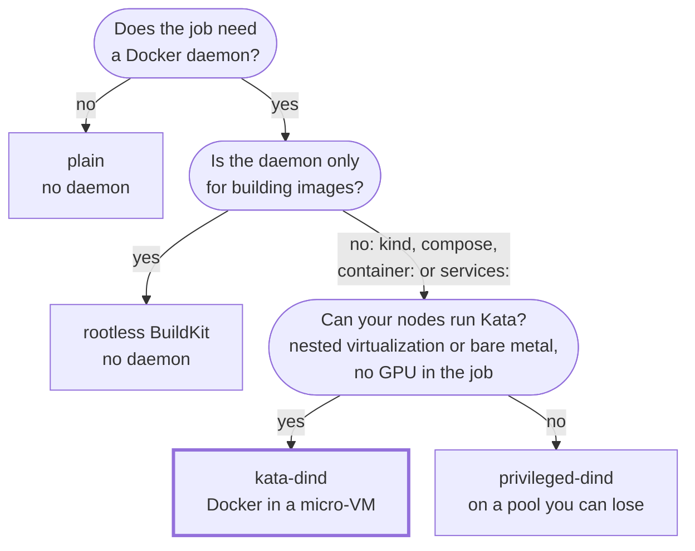

---
hide:
  - navigation
---

# Choosing worker isolation: Kata, Docker-in-Docker, or neither

Every CI job runs code nobody on your team reviewed line by line: dependencies, third-party actions, and on a public repository, a stranger's pull request.
Assume some job will escape its container eventually, and ask what the escape reaches and what it costs to make that smaller.
GitHub Actions Gateway (GAG) ships one worker shape for each answer, as entries in its [runner template library](operations/runner-template-library.md), and this page sets out what each one buys, what it costs, and what it cannot run.

## Which shape fits

Start from what the jobs do, then from what the nodes can do.

| Shape | An escape reaches | What it costs you | What it cannot run |
|---|---|---|---|
| `plain` | the node's kernel, through a container with no added capabilities and the security defaults of GAG's per-tenant controller stamped on | nothing beyond a normal pod | anything that needs a Docker daemon: `kind`, `docker compose`, and a job's `container:` or `services:` |
| `kata-dind` | a throwaway guest kernel inside a KVM micro-VM, not the node | nested-virtualization nodes, a Kata install, a block volume per worker, and a larger pod ([below](#what-kata-costs)) | GKE Autopilot, most AMD and Arm machine families, most of EC2, GPU jobs ([below](#where-kata-cannot-run)) |
| `privileged-dind` | the node, as root: every pod on it, the kubelet's credential, and the node's cloud identity | a node pool sized and locked down on the assumption it will be lost ([below](#what-privileged-dind-costs)) | nothing, which is the reason it exists |

The highlighted path is the one GAG's own end-to-end CI takes: it builds a `kind` cluster inside a `kata-dind` worker on every release candidate, with no `privileged: true` container anywhere in the pod.

## What Kata costs

Kata Containers runs each worker pod in its own lightweight virtual machine, so the job gets a kernel of its own.
The boot is the small part of the cost.
On GAG's dogfood nodes (GKE `c2-standard-4` with nested virtualization, Kata 3.32.0 on QEMU), a Kata pod reached `Ready` in about 3 seconds against about 1 for the default runtime, and `kind create cluster` took 58 seconds from a cold image cache and 43 warm ([measured setup](operations/kata-dind-workloads.md#caveats-and-limitations)).

The larger costs are in capacity and setup:

- **Every pod reserves 250m CPU and 160Mi of memory** for the VM itself, on top of what its containers ask for.
  The scheduler and the namespace `ResourceQuota` both charge it, and so does GAG's own quota gate.
- **The guest gets only what its limits allow.** A VM cannot burst into the node's spare capacity the way a container can, so the shipped `kata-dind` sizes the guest at 8 vCPU and 12Gi across the runner and the daemon, which fits one worker on an 8-vCPU node.
  Those numbers come from GAG's own end-to-end suite, so [re-measure them for yours](operations/worker-rightsizing.md).
- **Every worker gets a 100Gi block volume** for Docker's storage, created and deleted with the pod.
  Docker cannot use its normal storage driver on the filesystem Kata hands a guest, so the volume is not optional, and your default StorageClass has to support `volumeMode: Block`.
- **Nested virtualization costs CPU.** Google [documents](https://docs.cloud.google.com/compute/docs/instances/nested-virtualization/overview) a penalty of 10% or more for CPU-bound work, and potentially more for I/O-bound work.
  GAG has not measured what the micro-VM adds to a full job on its own suite against the same job under `privileged-dind`, so treat the 10% as the vendor's figure, not ours.
- **The namespace still needs the `privileged` Pod Security level.** The daemon needs capabilities that only act on the guest kernel, but Pod Security Admission cannot see the VM, so it rejects the pod at `baseline`.
  What keeps the pod unprivileged is that only the platform team can author the template, not the admission level.

## Where Kata cannot run

Kata needs the `/dev/kvm` device, which on a cloud means nested virtualization or bare metal.
That rules out more clusters than it sounds like:

- **GKE Autopilot** does not allow nested virtualization at all.
- **On GKE Standard, E2, C2D and N2D are out.** The API took the flag on A2, A3, C2, C3, C4, C4D, C4N, G2, H3, H4D, N1, N2, N4, N4D, Z3 and M4 when GAG checked on 2026-08-02.
  Google's written rules disagree with the API at the margins, so check the family you plan to use with the API before you buy capacity for it.
- **On EC2 it is Intel only.** AWS listed sixteen families on 2026-08-12, every one of them an Intel family from the 7th and 8th instance generations, with no AMD, Graviton, P or G family among them.
  Anything else means a `.metal` instance.
- **GPU jobs are effectively bare-metal only.** NVIDIA's Kata path needs IOMMU support exposed to the guest, no NVIDIA driver bound on the host, and a whole GPU per VM, which a cloud GPU instance does not give you ([detail](plan/gpu-and-accelerated-ci.md#the-collision-with-the-security-goal)).
- **Jobs that load host kernel modules or need specific host devices** need extra Kata configuration, if they work at all.

If any of these describes your cluster, the honest choice is between `privileged-dind` and dropping the daemon, not between `privileged-dind` and Kata.

## What privileged DinD costs

`privileged-dind` runs the same Docker daemon with full access to the node's kernel, so plan for a job escaping to the node, whoever wrote the workflow.
A trusted repository still pulls third-party actions and dependencies, and a workflow pushed with a stolen token runs as its author.

An escape reaches every pod on the node and the Secrets mounted into them, the kubelet's credential, the container runtime, and the node's cloud identity, which the pod network's metadata block does not cover once the process is on the host.
So the cost is a node pool built to hold as little as possible: a minimal node service account, Workload Identity, a taint and a node selector that keep the controllers off it, and one pool per tenant.
[Running `privileged-dind`](operations/runner-template-library.md#running-privileged-dind-assume-the-node-is-lost) walks each step.

Keep fork pull requests off it.
A `pull_request` run uses the fork's copy of the workflow file, so a fork can name any runner label it likes, and GitHub has no setting that refuses a job because it came from a fork.
GAG refuses fork jobs on every runner set by default, and that default should never be relaxed on a privileged set ([why](operations/security-operations.md#fork-pull-requests-choose-their-own-runner-label)).

## What running without a daemon costs

`plain` is the only shape that keeps the security defaults the Actions Gateway Controller (AGC) stamps on every worker: non-root, a numeric user, the default seccomp profile, and under the `restricted` profile no privilege escalation and no capabilities at all.
It costs nothing to run.

The cost is in what the jobs give up.
Nothing under `plain` can start a container.
That excludes `kind`, `docker compose`, and every job that uses `container:` or `services:`, because GAG runs one pod per job and those steps need a daemon inside it.
Rootless BuildKit can still build images without a daemon, though it is not a library entry yet and on many kernels it needs a looser seccomp profile than `plain` allows ([in-runner image builds](operations/in-runner-image-builds.md)).
If most of your jobs are tests, lint and deploys, that trade is free, and the daemon shapes only need to exist for the jobs that build or test containers.

## What none of them cover

A sandbox bounds the kernel, not the network.
Measured on GKE, the cloud metadata server answered from inside a Kata guest, so Workload Identity or an equivalent metadata block is a prerequisite for every shape, Kata included ([the rationale](operations/kata-dind-workloads.md#the-security-rationale)).
Running an external contributor's pull request also wants egress narrowed to GitHub, DNS and an in-cluster registry mirror, which GAG ships as [the tight-egress posture](operations/kata-dind-workloads.md#untrusted-pull-requests--the-tight-egress-posture) and measures on every run of its Kata lane.

GAG does not install Kata, register `RuntimeClass` objects, or mark any template as the cluster default.
Those are cluster decisions, and making one the default is a single annotation on the template once your nodes can run it.
It also never falls back from one shape to another on its own: a Kata worker that cannot schedule stays pending rather than quietly becoming a privileged one.

gVisor and Sysbox are the other sandboxes people ask about.
Neither has run a job on a GAG cluster, so neither ships as a template ([worker isolation design](design/appendix-b-worker-isolation.md)).
